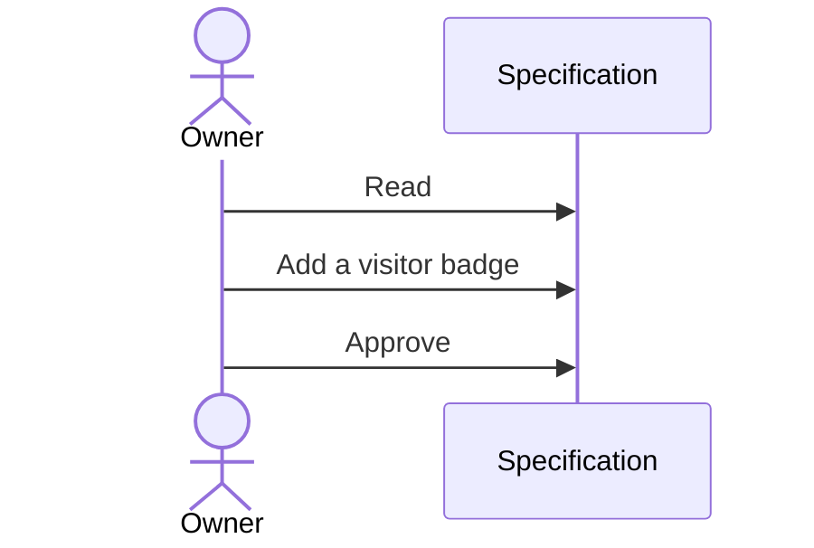

🏠 [Specs](../../../../README.md) › 🧩 [Functional capabilities](../../../README.md) ›
🏭 [F19 Feature factory (hosted edition)](../../README.md) › 📝 [Use cases](../README.md) ›
📝 [Use cases: FL-F19-01 Describe and order](README.md) › 📝 UC-F19-02 Refine the feature with the chatbot

# 📝 UC-F19-02 Refine the feature with the chatbot

**Status:** ✅ specified

## Summary

The owner refines the feature with the chatbot into a specification (use cases, screens, data, examples) and approves it
before anything is built.

## Personas

- [U13 Owner](../../../../01-users/personas/u13-owner.md)

## Goal

An agreed specification.

## Trigger

An outline.

## Frequency

Each request.

## Preconditions

- An outline.

## Postconditions

- Success: specification approved.
- Failure: draft kept.

## Main flow

1. The owner reads the Specification (S-F19-02).
2. They ask for changes; the chatbot updates it.
3. They read the examples.
4. They approve (BR-F19-03).

## Alternative flows

- 2a. Several rounds.

## Error flows

- 4e. Not approved: nothing built.
- Any step: a service does not answer; the call is retried first (BR-F3-32), then the message follows the error pattern
  (D122) and what was typed stays on the screen.

## Business rules

- [BR-F19-03 The specification is agreed before the build](../../business-rules/br-f19-03-spec-agreed-before-build.md)
- [BR-F19-02 A feature is a plugin, never a core change](../../business-rules/br-f19-02-feature-is-a-plugin.md)

## Entities

- [E-F19-01 Feature request](../../data/e-f19-01-feature-request.md)
- [E-F19-02 Feature specification](../../data/e-f19-02-feature-specification.md)

## Permissions

Owner and administrator.

## Notifications

- The owner when the draft is ready.

## Audit events

Versions and approval.

## AI involvement

The chatbot writes it.

## API, MCP and A2A exposure

Through T5 and T6 with the caller's rights (BR-F3-34).

## Screens

- [S-F19-02 Specification](../../screens/01-describe-and-order/s-f19-02-specification.md)

## Flowchart

See [FL-F19-01 Describe and order](../../flows/fl-f19-01-describe-and-order.md#flowchart).

## Sequence diagram

## Acceptance criteria

1. **Given** 4 use cases and 3 screens **when** approved **then** the quote follows.
2. **Given** not approved **when** left **then** nothing is built.
3. **Given** a change **when** asked **then** a new version shows.

## Non-functional notes

D408's targets ([Performance](../../../../05-non-functional/performance.md)): 95 % of screens within 1 second; lists
paged on the server, the first page within 1 second; reports within 5 seconds or in the background.

## Regulatory references

Billing and rights rules of the France country pack:
[CR-FR-205 VAT on the promotion credit](../../../../10-country-packs/france/tax-and-vat/cr-fr-205-promotion-credit-vat-treatment.md),
[CR-FR-200 Credit notes and corrective invoices](../../../../10-country-packs/france/invoicing/cr-fr-200-credit-notes.md),
[CR-FR-202 Price reductions on invoices](../../../../10-country-packs/france/invoicing/cr-fr-202-price-reductions-on-invoices.md),
[CR-FR-201 Self-billing](../../../../10-country-packs/france/invoicing/cr-fr-201-self-billing.md),
[CR-FR-015 Mandatory invoice mentions](../../../../10-country-packs/france/invoicing/cr-fr-015-invoice-mandatory-mentions.md),
[CR-FR-100 VAT on services to clients abroad](../../../../10-country-packs/france/tax-and-vat/cr-fr-100-vat-on-services-abroad.md),
[CR-FR-203 Who owns software, and assigning it](../../../../10-country-packs/france/digital/cr-fr-203-software-copyright-assignment.md),
[CR-FR-204 Works generated by an AI](../../../../10-country-packs/france/digital/cr-fr-204-ai-generated-works.md),
[CR-FR-016 Electronic invoicing](../../../../10-country-packs/france/invoicing/cr-fr-016-electronic-invoicing.md),
[CR-FR-056 People know they deal with an AI](../../../../10-country-packs/france/ai-and-recording/cr-fr-056-people-know-they-deal-with-an-ai.md).

## Related use cases

- [UC-F19-03 Accept the quote](uc-f19-03-accept-the-quote.md)

## Open questions

None.

---

⬅️ [UC-F19-01 Describe a feature in plain words](uc-f19-01-describe-a-feature-in-plain-words.md) · ⬆️ [Up](README.md) ·
➡️ [UC-F19-03 Accept the quote](uc-f19-03-accept-the-quote.md)
