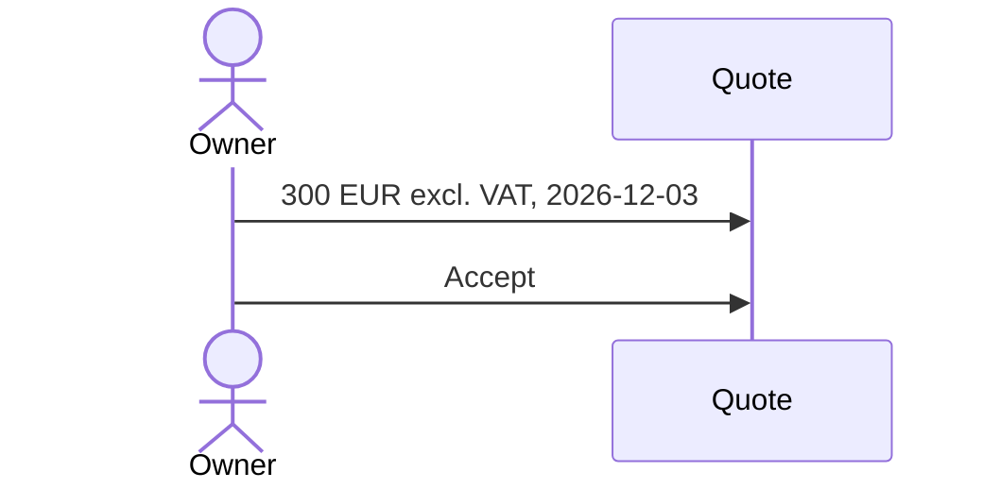

🏠 [Specs](../../../../README.md) › 🧩 [Functional capabilities](../../../README.md) ›
🏭 [F19 Feature factory (hosted edition)](../../README.md) › 📝 [Use cases](../README.md) ›
📝 [Use cases: FL-F19-01 Describe and order](README.md) › 📝 UC-F19-03 Accept the quote

# 📝 UC-F19-03 Accept the quote

**Status:** ✅ specified

## Summary

The owner accepts the quote of 300 EUR a month excluding VAT within the spending limit, with the committed delivery
date.

## Personas

- [U13 Owner](../../../../01-users/personas/u13-owner.md)

## Goal

The feature ordered.

## Trigger

Specification approved.

## Frequency

Each request.

## Preconditions

- Approved specification.

## Postconditions

- Success: ordered, date committed.
- Failure: refused above the limit.

## Main flow

1. The owner opens the Quote (S-F19-03).
2. They read price, VAT and the delivery date (BR-F19-15).
3. simple-ERP checks the spending limit (BR-F19-08).
4. They accept; the delivery date is committed (UC-F19-21).

## Alternative flows

- 3a. An administrator above the limit: goes to the owner.

## Error flows

- 3e. Above the limit: refused.
- Any step: a service does not answer; the call is retried first (BR-F3-32), then the message follows the error pattern
  (D122) and what was typed stays on the screen.

## Business rules

- [BR-F19-08 Ordered by the owner or an administrator](../../business-rules/br-f19-08-ordered-by-owner-or-admin.md)
- [BR-F19-09 300 EUR a month excluding VAT](../../business-rules/br-f19-09-price-excludes-vat.md)
- [BR-F19-15 A delivery date is committed and kept](../../business-rules/br-f19-15-a-delivery-date-is-committed-and-kept.md)

## Entities

- [E-F19-03 Feature subscription](../../data/e-f19-03-feature-subscription.md)
- [E-F19-11 Delivery commitment](../../data/e-f19-11-delivery-commitment.md)

## Permissions

Owner; administrator within the limit.

## Notifications

- The owner when an administrator's acceptance needs them.

## Audit events

Acceptance.

## AI involvement

None.

## API, MCP and A2A exposure

Through T5 and T6 with the caller's rights (BR-F3-34).

## Screens

- [S-F19-03 Quote](../../screens/01-describe-and-order/s-f19-03-quote.md)

## Flowchart

See [FL-F19-01 Describe and order](../../flows/fl-f19-01-describe-and-order.md#flowchart).

## Sequence diagram

## Acceptance criteria

1. **Given** 300.00 EUR excluding VAT **when** accepted **then** the date is committed.
2. **Given** an administrator above the limit **when** accepting **then** it goes to the owner.
3. **Given** VAT 20 % **when** shown **then** 360.00 EUR including VAT.

## Non-functional notes

D408's targets ([Performance](../../../../05-non-functional/performance.md)): 95 % of screens within 1 second; lists
paged on the server, the first page within 1 second; reports within 5 seconds or in the background.

## Regulatory references

Billing and rights rules of the France country pack:
[CR-FR-205 VAT on the promotion credit](../../../../10-country-packs/france/tax-and-vat/cr-fr-205-promotion-credit-vat-treatment.md),
[CR-FR-200 Credit notes and corrective invoices](../../../../10-country-packs/france/invoicing/cr-fr-200-credit-notes.md),
[CR-FR-202 Price reductions on invoices](../../../../10-country-packs/france/invoicing/cr-fr-202-price-reductions-on-invoices.md),
[CR-FR-201 Self-billing](../../../../10-country-packs/france/invoicing/cr-fr-201-self-billing.md),
[CR-FR-015 Mandatory invoice mentions](../../../../10-country-packs/france/invoicing/cr-fr-015-invoice-mandatory-mentions.md),
[CR-FR-100 VAT on services to clients abroad](../../../../10-country-packs/france/tax-and-vat/cr-fr-100-vat-on-services-abroad.md),
[CR-FR-203 Who owns software, and assigning it](../../../../10-country-packs/france/digital/cr-fr-203-software-copyright-assignment.md),
[CR-FR-204 Works generated by an AI](../../../../10-country-packs/france/digital/cr-fr-204-ai-generated-works.md),
[CR-FR-016 Electronic invoicing](../../../../10-country-packs/france/invoicing/cr-fr-016-electronic-invoicing.md),
[CR-FR-056 People know they deal with an AI](../../../../10-country-packs/france/ai-and-recording/cr-fr-056-people-know-they-deal-with-an-ai.md).

## Related use cases

- [UC-F19-21 Commit to a delivery date and handle delays](uc-f19-21-commit-to-a-delivery-date-and-handle-delays.md)

## Open questions

None.

---

⬅️ [UC-F19-02 Refine the feature with the chatbot](uc-f19-02-refine-the-feature-with-the-chatbot.md) ·
⬆️ [Up](README.md) · ➡️ [UC-F19-04](../02-build-and-check/uc-f19-04-generate-the-plugin-in-the-sandbox.md)
