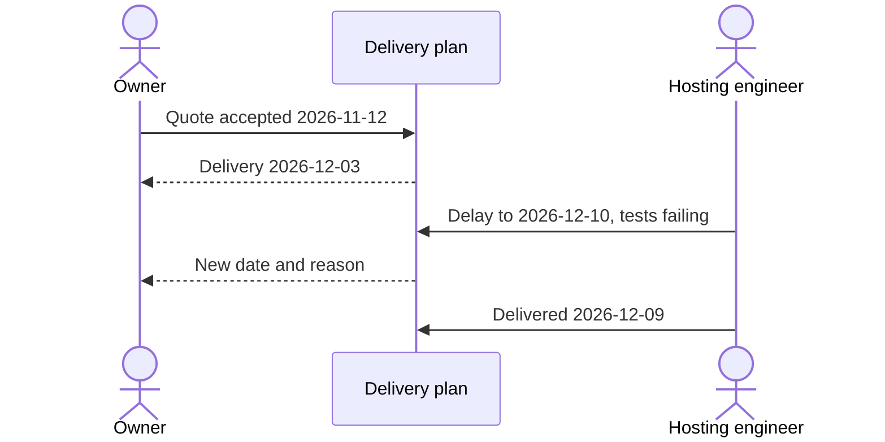

🏠 [Specs](../../../../README.md) › 🧩 [Functional capabilities](../../../README.md) ›
🏭 [F19 Feature factory (hosted edition)](../../README.md) › 📝 [Use cases](../README.md) ›
📝 [Use cases: FL-F19-01 Describe and order](README.md) › 📝 UC-F19-21 Commit to a delivery date and handle delays

# 📝 UC-F19-21 Commit to a delivery date and handle delays

**Status:** ✅ specified

## Summary

When the quote is accepted, the factory commits to a delivery date for the first try-out; the hosting engineer announces
any delay before the date with its reason and new date, and the owner may cancel an order too late.

## Personas

- [U13 Owner](../../../../01-users/personas/u13-owner.md)
- [U48 Hosting engineer](../../../../01-users/personas/u48-hosting-engineer.md), who builds and announces delays

## Goal

The customer knows when the feature arrives and is never surprised by a delay.

## Trigger

The quote accepted (UC-F19-03).

## Frequency

Each order.

## Preconditions

- The specification is approved and the quote accepted.

## Postconditions

- Success: the feature delivered for try-out by the committed or announced date.
- Failure: the order cancelled without charge when too late.

## Main flow

1. The quote is accepted; SimpleERP commits the delivery date and shows it on the Delivery plan (S-F19-21) (BR-F19-15).
2. The hosting engineer follows the generation and checks against the date.
3. A risk of delay: the engineer announces it before the date with the new date and the reason.
4. The owner is told and sees the new date.
5. The feature is delivered for try-out (UC-F19-07); the board records on time or late.

## Alternative flows

- 3a. The delay comes from the customer (questions unanswered): the date moves by the same time, said.
- 4a. The order is more than the limit late: the owner cancels without charge.

## Error flows

- 3e. A delay announced after the date: counted as missed on the board.
- Any step: a service does not answer; the call is retried first (BR-F3-32), then the message follows the error pattern
  (D122) and what was typed stays on the screen.

## Business rules

- [BR-F19-15 A delivery date is committed and kept](../../business-rules/br-f19-15-a-delivery-date-is-committed-and-kept.md)

## Entities

- [E-F19-11 Delivery commitment](../../data/e-f19-11-delivery-commitment.md)

## Permissions

Owner and administrator read and cancel; the hosting engineer announces delays.

## Notifications

- The owner at commitment, at each delay and at delivery.

## Audit events

Commitment, delays with reasons, delivery, cancellation.

## AI involvement

The factory estimates the date from the specification's size; a person announces delays.

## API, MCP and A2A exposure

Through the API (T5) and as AI assistant tools (T6), with the caller's rights (BR-F3-34).

## Screens

- [S-F19-21 Delivery plan](../../screens/01-describe-and-order/s-f19-21-delivery-plan.md)

## Flowchart

See [FL-F19-06 Delivery and refunds](../../flows/fl-f19-06-delivery-and-refunds.md#flowchart).

## Sequence diagram

## Acceptance criteria

1. **Given** a specification approved and a quote accepted on 2026-11-12 **when** committed **then** the delivery date
   2026-12-03 shows to the owner.
2. **Given** a delay announced on 2026-12-01 to 2026-12-10 **when** announced **then** the owner is told with the
   reason.
3. **Given** a delivery 25 business days late **when** the owner cancels **then** nothing is charged.
4. **Given** the customer answered questions 3 days late **when** the date is computed **then** it moves by 3 days.

## Non-functional notes

D408's targets ([Performance](../../../../05-non-functional/performance.md)): 95 % of screens within 1 second; lists
paged on the server, the first page within 1 second; reports within 5 seconds or in the background.

## Regulatory references

None.

## Related use cases

- [UC-F19-03 Accept the quote](uc-f19-03-accept-the-quote.md)
- [UC-F19-07 Try the feature on a copy of the data](../03-try-install-and-maintain/uc-f19-07-try-the-feature-on-a-copy-of-the-data.md)
- [UC-F19-22 Refund when acceptance fails](../06-delivery-and-refunds/uc-f19-22-refund-when-acceptance-fails.md)

## Open questions

None.

---

⬅️ [UC-F19-20](../04-promote/uc-f19-20-accept-the-licence-terms-of-a-promotion.md) · ⬆️ [Up](README.md) ·
➡️ [UC-F19-22 Refund when acceptance fails](../06-delivery-and-refunds/uc-f19-22-refund-when-acceptance-fails.md)
