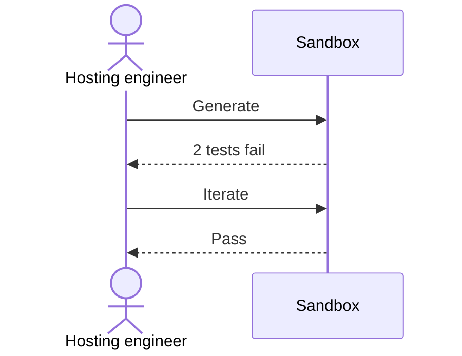

🏠 [Specs](../../../../README.md) › 🧩 [Functional capabilities](../../../README.md) ›
🏭 [F19 Feature factory (hosted edition)](../../README.md) › 📝 [Use cases](../README.md) ›
📝 [Use cases: FL-F19-02 Build and check](README.md) › 📝 UC-F19-04 Generate the plugin in the sandbox

# 📝 UC-F19-04 Generate the plugin in the sandbox

**Status:** ✅ specified

## Summary

The hosting engineer has the plugin generated in the sandbox with test data only, runs its tests and iterates.

## Personas

- [U48 Hosting engineer](../../../../01-users/personas/u48-hosting-engineer.md)

## Goal

Working generated code.

## Trigger

Quote accepted.

## Frequency

Each order.

## Preconditions

- Approved specification.

## Postconditions

- Success: tests pass.
- Failure: iterations or a delay.

## Main flow

1. The engineer starts Generation (S-F19-04).
2. Code and tests are generated in the sandbox (BR-F19-04).
3. Tests run.
4. The engineer iterates until they pass.
5. A risk to the date is announced (UC-F19-21).

## Alternative flows

- 4a. API missing: added to the product (BR-F19-02).

## Error flows

- 3e. Tests fail repeatedly: delay announced.
- Any step: a service does not answer; the call is retried first (BR-F3-32), then the message follows the error pattern
  (D122) and what was typed stays on the screen.

## Business rules

- [BR-F19-02 A feature is a plugin, never a core change](../../business-rules/br-f19-02-feature-is-a-plugin.md)
- [BR-F19-04 Generated code runs in the sandbox](../../business-rules/br-f19-04-generated-code-runs-sandboxed.md)
- [BR-F19-15 A delivery date is committed and kept](../../business-rules/br-f19-15-a-delivery-date-is-committed-and-kept.md)

## Entities

- [E-F19-04 Generated plugin version](../../data/e-f19-04-generated-plugin-version.md)

## Permissions

Hosting engineer.

## Notifications

- None.

## Audit events

Generations.

## AI involvement

The factory generates; people review.

## API, MCP and A2A exposure

Through T5 and T6 with the caller's rights (BR-F3-34).

## Screens

- [S-F19-04 Generation](../../screens/02-build-and-check/s-f19-04-generation.md)

## Flowchart

See [FL-F19-02 Build and check](../../flows/fl-f19-02-build-and-check.md#flowchart).

## Sequence diagram

## Acceptance criteria

1. **Given** generation **when** run **then** only test data is used.
2. **Given** failing tests **when** iterated **then** they pass.
3. **Given** a delay **when** likely **then** announced.

## Non-functional notes

D408's targets ([Performance](../../../../05-non-functional/performance.md)): 95 % of screens within 1 second; lists
paged on the server, the first page within 1 second; reports within 5 seconds or in the background.

## Regulatory references

Billing and rights rules of the France country pack:
[CR-FR-205 VAT on the promotion credit](../../../../10-country-packs/france/tax-and-vat/cr-fr-205-promotion-credit-vat-treatment.md),
[CR-FR-200 Credit notes and corrective invoices](../../../../10-country-packs/france/invoicing/cr-fr-200-credit-notes.md),
[CR-FR-202 Price reductions on invoices](../../../../10-country-packs/france/invoicing/cr-fr-202-price-reductions-on-invoices.md),
[CR-FR-201 Self-billing](../../../../10-country-packs/france/invoicing/cr-fr-201-self-billing.md),
[CR-FR-015 Mandatory invoice mentions](../../../../10-country-packs/france/invoicing/cr-fr-015-invoice-mandatory-mentions.md),
[CR-FR-100 VAT on services to clients abroad](../../../../10-country-packs/france/tax-and-vat/cr-fr-100-vat-on-services-abroad.md),
[CR-FR-203 Who owns software, and assigning it](../../../../10-country-packs/france/digital/cr-fr-203-software-copyright-assignment.md),
[CR-FR-204 Works generated by an AI](../../../../10-country-packs/france/digital/cr-fr-204-ai-generated-works.md),
[CR-FR-016 Electronic invoicing](../../../../10-country-packs/france/invoicing/cr-fr-016-electronic-invoicing.md),
[CR-FR-056 People know they deal with an AI](../../../../10-country-packs/france/ai-and-recording/cr-fr-056-people-know-they-deal-with-an-ai.md).

## Related use cases

- [UC-F19-05 Run the automatic checks](uc-f19-05-run-the-automatic-checks.md)

## Open questions

None.

---

⬅️ [UC-F19-03 Accept the quote](../01-describe-and-order/uc-f19-03-accept-the-quote.md) · ⬆️ [Up](README.md) ·
➡️ [UC-F19-05 Run the automatic checks](uc-f19-05-run-the-automatic-checks.md)
