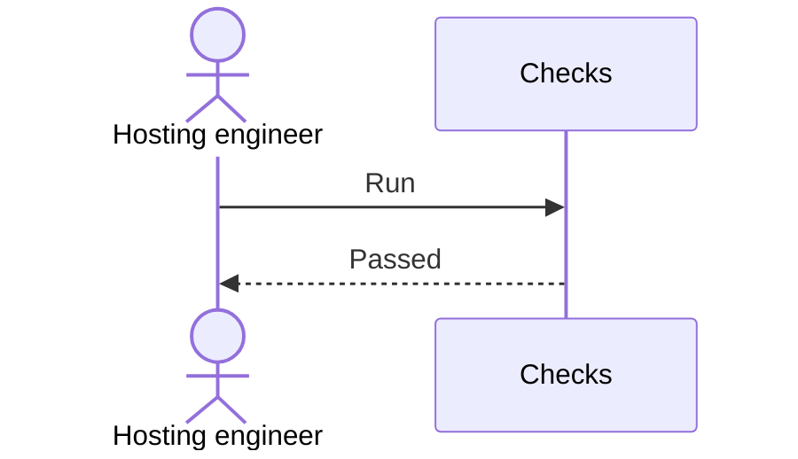

🏠 [Specs](../../../../README.md) › 🧩 [Functional capabilities](../../../README.md) ›
🏭 [F19 Feature factory (hosted edition)](../../README.md) › 📝 [Use cases](../README.md) ›
📝 [Use cases: FL-F19-02 Build and check](README.md) › 📝 UC-F19-05 Run the automatic checks

# 📝 UC-F19-05 Run the automatic checks

**Status:** ✅ specified

## Summary

The hosting engineer runs the automatic checks: tests, conventions, licences, vulnerabilities and the boundary check.

## Personas

- [U48 Hosting engineer](../../../../01-users/personas/u48-hosting-engineer.md)

## Goal

Clean code.

## Trigger

Generation done.

## Frequency

Each version.

## Preconditions

- Tests pass.

## Postconditions

- Success: passed.
- Failure: fixed.

## Main flow

1. The engineer runs Checks (S-F19-05).
2. Reports show.
3. They fix failures.
4. Passing versions go to the security and privacy review (UC-F19-24).

## Alternative flows

- 2a. Warnings.

## Error flows

- 2e. Closed code detected: rejected.
- Any step: a service does not answer; the call is retried first (BR-F3-32), then the message follows the error pattern
  (D122) and what was typed stays on the screen.

## Business rules

- [BR-F19-05 Checks, review and signing before install](../../business-rules/br-f19-05-checks-review-and-signing.md)

## Entities

- [E-F19-05 Feature check report](../../data/e-f19-05-feature-check-report.md)

## Permissions

Hosting engineer.

## Notifications

- None.

## Audit events

Runs.

## AI involvement

None.

## API, MCP and A2A exposure

Through T5 and T6 with the caller's rights (BR-F3-34).

## Screens

- [S-F19-05 Checks](../../screens/02-build-and-check/s-f19-05-checks.md)

## Flowchart

See [FL-F19-02 Build and check](../../flows/fl-f19-02-build-and-check.md#flowchart).

## Sequence diagram

## Acceptance criteria

1. **Given** clean code **when** checked **then** passed.
2. **Given** a vulnerable dependency **when** checked **then** failed.
3. **Given** passed **when** done **then** the review starts.

## Non-functional notes

D408's targets ([Performance](../../../../05-non-functional/performance.md)): 95 % of screens within 1 second; lists
paged on the server, the first page within 1 second; reports within 5 seconds or in the background.

## Regulatory references

Billing and rights rules of the France country pack:
[CR-FR-205 VAT on the promotion credit](../../../../10-country-packs/france/tax-and-vat/cr-fr-205-promotion-credit-vat-treatment.md),
[CR-FR-200 Credit notes and corrective invoices](../../../../10-country-packs/france/invoicing/cr-fr-200-credit-notes.md),
[CR-FR-202 Price reductions on invoices](../../../../10-country-packs/france/invoicing/cr-fr-202-price-reductions-on-invoices.md),
[CR-FR-201 Self-billing](../../../../10-country-packs/france/invoicing/cr-fr-201-self-billing.md),
[CR-FR-015 Mandatory invoice mentions](../../../../10-country-packs/france/invoicing/cr-fr-015-invoice-mandatory-mentions.md),
[CR-FR-100 VAT on services to clients abroad](../../../../10-country-packs/france/tax-and-vat/cr-fr-100-vat-on-services-abroad.md),
[CR-FR-203 Who owns software, and assigning it](../../../../10-country-packs/france/digital/cr-fr-203-software-copyright-assignment.md),
[CR-FR-204 Works generated by an AI](../../../../10-country-packs/france/digital/cr-fr-204-ai-generated-works.md),
[CR-FR-016 Electronic invoicing](../../../../10-country-packs/france/invoicing/cr-fr-016-electronic-invoicing.md),
[CR-FR-056 People know they deal with an AI](../../../../10-country-packs/france/ai-and-recording/cr-fr-056-people-know-they-deal-with-an-ai.md).

## Related use cases

- [UC-F19-24 Review a feature's security and privacy](uc-f19-24-review-a-features-security-and-privacy.md)

## Open questions

None.

---

⬅️ [UC-F19-04 Generate the plugin in the sandbox](uc-f19-04-generate-the-plugin-in-the-sandbox.md) ·
⬆️ [Up](README.md) · ➡️ [UC-F19-06 Review and sign the feature](uc-f19-06-review-and-sign-the-feature.md)
