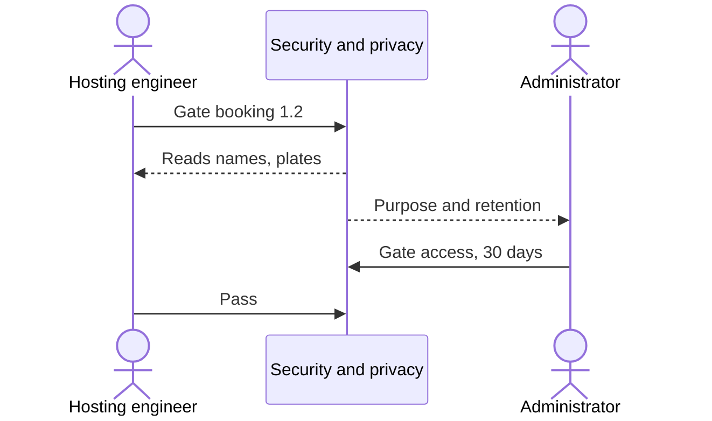

🏠 [Specs](../../../../README.md) › 🧩 [Functional capabilities](../../../README.md) ›
🏭 [F19 Feature factory (hosted edition)](../../README.md) › 📝 [Use cases](../README.md) ›
📝 [Use cases: FL-F19-02 Build and check](README.md) › 📝 UC-F19-24 Review a feature's security and privacy

# 📝 UC-F19-24 Review a feature's security and privacy

**Status:** 🔄 waiting for the owner

## Summary

Before signing, the hosting engineer reviews a generated feature's permissions, outside calls and secrets, and the
personal data it handles with purpose and retention; a feature that needs an impact assessment waits for the customer's.

## Personas

- [U48 Hosting engineer](../../../../01-users/personas/u48-hosting-engineer.md)
- [U07 Administrator](../../../../01-users/personas/u07-administrator.md), who answers the privacy questions for the
  company

## Goal

No generated feature ships unsafe or careless with personal data.

## Trigger

A version passed the automated checks (UC-F19-05).

## Frequency

Each version.

## Preconditions

- Checks passed.

## Postconditions

- Success: review passed; the version can be signed.
- Failure: changes asked or rejected.

## Main flow

1. The engineer opens Security and privacy (S-F19-24) for the version.
2. They check the permissions, outside calls and secrets handling.
3. simple-ERP lists the personal data the feature reads and writes.
4. The administrator answers purpose and retention; the engineer records them (BR-F19-18).
5. The engineer passes the review; signing follows (UC-F19-06).

## Alternative flows

- 4a. High risk (employees scored): the customer's impact assessment is required (UC-F15-11).

## Error flows

- 2e. An undeclared outside call: rejected.
- 4e. No retention given: the review waits.
- Any step: a service does not answer; the call is retried first (BR-F3-32), then the message follows the error pattern
  (D122) and what was typed stays on the screen.

## Business rules

- [BR-F19-18 Security and privacy review before signing](../../business-rules/br-f19-18-security-and-privacy-review-before-signing.md)
- [BR-F19-05 Checks, review and signing before install](../../business-rules/br-f19-05-checks-review-and-signing.md)

## Entities

- [E-F19-14 Security and privacy review](../../data/e-f19-14-security-and-privacy-review.md)

## Permissions

Hosting engineer reviews; administrator answers.

## Notifications

- The administrator when answers are needed; the owner when an assessment is required.

## Audit events

Review steps and decision.

## AI involvement

The factory lists data from the code; people decide.

## API, MCP and A2A exposure

Through the API (T5) and as AI assistant tools (T6), with the caller's rights (BR-F3-34).

## Screens

- [S-F19-24 Security and privacy](../../screens/02-build-and-check/s-f19-24-security-and-privacy.md)

## Flowchart

See [FL-F19-02 Build and check](../../flows/fl-f19-02-build-and-check.md#flowchart).

## Sequence diagram

## Acceptance criteria

1. **Given** gate booking reading names and plates **when** reviewed **then** purpose and a 30-day retention are
   recorded before signing.
2. **Given** an undeclared outside call **when** found **then** the version is rejected.
3. **Given** a feature scoring employees **when** reviewed **then** signing waits for the approved assessment.

## Non-functional notes

D408's targets ([Performance](../../../../05-non-functional/performance.md)): 95 % of screens within 1 second; lists
paged on the server, the first page within 1 second; reports within 5 seconds or in the background.

## Regulatory references

[CR-FR-050](../../../../10-country-packs/france/data-protection/cr-fr-050-privacy-by-design.md),
[CR-FR-058](../../../../10-country-packs/france/ai-and-recording/cr-fr-058-high-risk-ai-in-employment.md); impact
assessment: (Proposed) to read.

## Related use cases

- [UC-F19-05 Run the automatic checks](uc-f19-05-run-the-automatic-checks.md)
- [UC-F19-06 Review and sign the feature](uc-f19-06-review-and-sign-the-feature.md)

## Open questions

None.

---

⬅️ [UC-F19-23 Get the source of a feature](../03-try-install-and-maintain/uc-f19-23-get-the-source-of-a-feature.md) ·
⬆️ [Up](README.md) ·
➡️ [UC-F19-25](../05-bill-and-credit/uc-f19-25-post-feature-invoices-credits-and-refunds-to-accounting.md)
