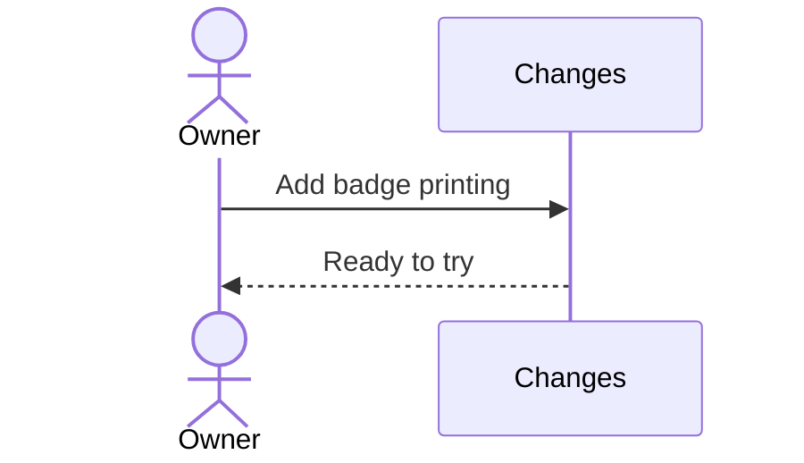

🏠 [Specs](../../../../README.md) › 🧩 [Functional capabilities](../../../README.md) ›
🏭 [F19 Feature factory (hosted edition)](../../README.md) › 📝 [Use cases](../README.md) ›
📝 [Use cases: FL-F19-03 Try, install and maintain](README.md) › 📝 UC-F19-09 Ask for changes

# 📝 UC-F19-09 Ask for changes

**Status:** ✅ specified

## Summary

The owner asks for changes to a feature; it is regenerated, checked and tried again.

## Personas

- [U13 Owner](../../../../01-users/personas/u13-owner.md)

## Goal

Feature fits.

## Trigger

Change wanted.

## Frequency

Occasional.

## Preconditions

- Feature exists.

## Postconditions

- Success: new version.
- Failure: none.

## Main flow

1. The owner opens Changes (S-F19-09).
2. They describe.
3. The feature is regenerated and checked.
4. They try again.

## Alternative flows

- 2a. Specification updated.

## Error flows

- 3e. Checks fail: fixed.
- Any step: a service does not answer; the call is retried first (BR-F3-32), then the message follows the error pattern
  (D122) and what was typed stays on the screen.

## Business rules

- [BR-F19-03 The specification is agreed before the build](../../business-rules/br-f19-03-spec-agreed-before-build.md)
- [BR-F19-05 Checks, review and signing before install](../../business-rules/br-f19-05-checks-review-and-signing.md)

## Entities

- [E-F19-01 Feature request](../../data/e-f19-01-feature-request.md)
- [E-F19-04 Generated plugin version](../../data/e-f19-04-generated-plugin-version.md)

## Permissions

Owner.

## Notifications

- When ready.

## Audit events

Changes.

## AI involvement

Chatbot.

## API, MCP and A2A exposure

Through T5 and T6 with the caller's rights (BR-F3-34).

## Screens

- [S-F19-09 Changes](../../screens/03-try-install-and-maintain/s-f19-09-changes.md)

## Flowchart

See [FL-F19-03 Try, install and maintain](../../flows/fl-f19-03-try-install-and-maintain.md#flowchart).

## Sequence diagram

## Acceptance criteria

1. **Given** a change **when** asked **then** a new version is tried.
2. **Given** checks fail **when** run **then** fixed.
3. **Given** accepted **when** done **then** installed.

## Non-functional notes

D408's targets ([Performance](../../../../05-non-functional/performance.md)): 95 % of screens within 1 second; lists
paged on the server, the first page within 1 second; reports within 5 seconds or in the background.

## Regulatory references

Billing and rights rules of the France country pack:
[CR-FR-205 VAT on the promotion credit](../../../../10-country-packs/france/tax-and-vat/cr-fr-205-promotion-credit-vat-treatment.md),
[CR-FR-200 Credit notes and corrective invoices](../../../../10-country-packs/france/invoicing/cr-fr-200-credit-notes.md),
[CR-FR-202 Price reductions on invoices](../../../../10-country-packs/france/invoicing/cr-fr-202-price-reductions-on-invoices.md),
[CR-FR-201 Self-billing](../../../../10-country-packs/france/invoicing/cr-fr-201-self-billing.md),
[CR-FR-015 Mandatory invoice mentions](../../../../10-country-packs/france/invoicing/cr-fr-015-invoice-mandatory-mentions.md),
[CR-FR-100 VAT on services to clients abroad](../../../../10-country-packs/france/tax-and-vat/cr-fr-100-vat-on-services-abroad.md),
[CR-FR-203 Who owns software, and assigning it](../../../../10-country-packs/france/digital/cr-fr-203-software-copyright-assignment.md),
[CR-FR-204 Works generated by an AI](../../../../10-country-packs/france/digital/cr-fr-204-ai-generated-works.md),
[CR-FR-016 Electronic invoicing](../../../../10-country-packs/france/invoicing/cr-fr-016-electronic-invoicing.md),
[CR-FR-056 People know they deal with an AI](../../../../10-country-packs/france/ai-and-recording/cr-fr-056-people-know-they-deal-with-an-ai.md).

## Related use cases

- [UC-F19-07 Try the feature on a copy of the data](uc-f19-07-try-the-feature-on-a-copy-of-the-data.md)

## Open questions

None.

---

⬅️ [UC-F19-08 Accept and install the feature](uc-f19-08-accept-and-install-the-feature.md) · ⬆️ [Up](README.md) ·
➡️ [UC-F19-10 Report a defect](uc-f19-10-report-a-defect.md)
