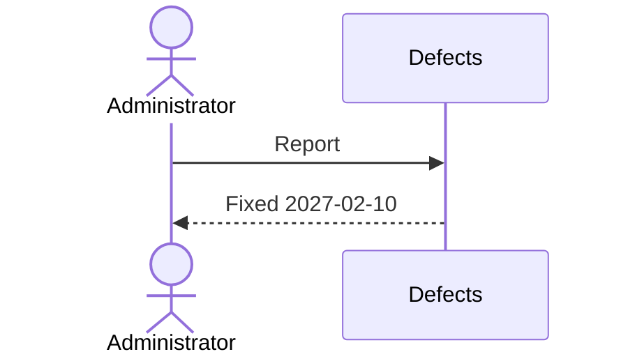

🏠 [Specs](../../../../README.md) › 🧩 [Functional capabilities](../../../README.md) ›
🏭 [F19 Feature factory (hosted edition)](../../README.md) › 📝 [Use cases](../README.md) ›
📝 [Use cases: FL-F19-03 Try, install and maintain](README.md) › 📝 UC-F19-10 Report a defect

# 📝 UC-F19-10 Report a defect

**Status:** ✅ specified

## Summary

The administrator reports a defect; a fix is generated, checked and released; a defect unfixed past the limit is
credited.

## Personas

- [U07 Administrator](../../../../01-users/personas/u07-administrator.md)

## Goal

Defects fixed quickly.

## Trigger

A bug.

## Frequency

Occasional.

## Preconditions

- Feature installed.

## Postconditions

- Success: fixed.
- Failure: credited.

## Main flow

1. The administrator opens Defects (S-F19-10) and reports.
2. A fix is generated.
3. Checks and review run.
4. The fix is released.

## Alternative flows

- 4a. Unfixed past the limit: credit (UC-F19-22).

## Error flows

- 1e. Not reproducible: more details asked.
- Any step: a service does not answer; the call is retried first (BR-F3-32), then the message follows the error pattern
  (D122) and what was typed stays on the screen.

## Business rules

- [BR-F19-05 Checks, review and signing before install](../../business-rules/br-f19-05-checks-review-and-signing.md)
- [BR-F19-07 Kept working across upgrades](../../business-rules/br-f19-07-kept-working-across-upgrades.md)
- [BR-F19-16 Nothing charged without an accepted feature](../../business-rules/br-f19-16-nothing-charged-without-an-accepted-feature.md)

## Entities

- [E-F19-04 Generated plugin version](../../data/e-f19-04-generated-plugin-version.md)
- [E-F19-12 Feature refund](../../data/e-f19-12-feature-refund.md)
- [E-F19-16 Feature defect](../../data/e-f19-16-feature-defect.md)

## Permissions

Administrator.

## Notifications

- When fixed.

## Audit events

Defects.

## AI involvement

Fix generation.

## API, MCP and A2A exposure

Through T5 and T6 with the caller's rights (BR-F3-34).

## Screens

- [S-F19-10 Defects](../../screens/03-try-install-and-maintain/s-f19-10-defects.md)

## Flowchart

See [FL-F19-03 Try, install and maintain](../../flows/fl-f19-03-try-install-and-maintain.md#flowchart).

## Sequence diagram

## Acceptance criteria

1. **Given** reported on 2027-02-03 **when** fixed on 2027-02-10 **then** no credit.
2. **Given** unfixed by 2027-02-17 **when** passed **then** credit proposed.
3. **Given** not reproducible **when** checked **then** details asked.

## Non-functional notes

D408's targets ([Performance](../../../../05-non-functional/performance.md)): 95 % of screens within 1 second; lists
paged on the server, the first page within 1 second; reports within 5 seconds or in the background.

## Regulatory references

Billing and rights rules of the France country pack:
[CR-FR-205 VAT on the promotion credit](../../../../10-country-packs/france/tax-and-vat/cr-fr-205-promotion-credit-vat-treatment.md),
[CR-FR-200 Credit notes and corrective invoices](../../../../10-country-packs/france/invoicing/cr-fr-200-credit-notes.md),
[CR-FR-202 Price reductions on invoices](../../../../10-country-packs/france/invoicing/cr-fr-202-price-reductions-on-invoices.md),
[CR-FR-201 Self-billing](../../../../10-country-packs/france/invoicing/cr-fr-201-self-billing.md),
[CR-FR-015 Mandatory invoice mentions](../../../../10-country-packs/france/invoicing/cr-fr-015-invoice-mandatory-mentions.md),
[CR-FR-100 VAT on services to clients abroad](../../../../10-country-packs/france/tax-and-vat/cr-fr-100-vat-on-services-abroad.md),
[CR-FR-203 Who owns software, and assigning it](../../../../10-country-packs/france/digital/cr-fr-203-software-copyright-assignment.md),
[CR-FR-204 Works generated by an AI](../../../../10-country-packs/france/digital/cr-fr-204-ai-generated-works.md),
[CR-FR-016 Electronic invoicing](../../../../10-country-packs/france/invoicing/cr-fr-016-electronic-invoicing.md),
[CR-FR-056 People know they deal with an AI](../../../../10-country-packs/france/ai-and-recording/cr-fr-056-people-know-they-deal-with-an-ai.md).

## Related use cases

- [UC-F19-22 Refund when acceptance fails](../06-delivery-and-refunds/uc-f19-22-refund-when-acceptance-fails.md)

## Open questions

None.

---

⬅️ [UC-F19-09 Ask for changes](uc-f19-09-ask-for-changes.md) · ⬆️ [Up](README.md) ·
➡️ [UC-F19-11 Cancel a feature and export its data](uc-f19-11-cancel-a-feature-and-export-its-data.md)
