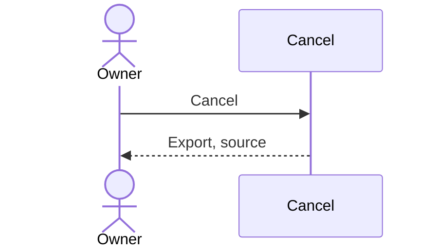

🏠 [Specs](../../../../README.md) › 🧩 [Functional capabilities](../../../README.md) ›
🏭 [F19 Feature factory (hosted edition)](../../README.md) › 📝 [Use cases](../README.md) ›
📝 [Use cases: FL-F19-03 Try, install and maintain](README.md) › 📝 UC-F19-11 Cancel a feature and export its data

# 📝 UC-F19-11 Cancel a feature and export its data

**Status:** ✅ specified

## Summary

The owner cancels a feature at the end of a month and exports its data; the source is handed over.

## Personas

- [U13 Owner](../../../../01-users/personas/u13-owner.md)

## Goal

Leave cleanly.

## Trigger

Not needed.

## Frequency

Rare.

## Preconditions

- Feature active.

## Postconditions

- Success: uninstalled at month end, data exported.
- Failure: none.

## Main flow

1. The owner opens Cancel (S-F19-11).
2. They cancel.
3. Data is exported; the source is handed over (UC-F19-23).
4. Uninstalled at month end.

## Alternative flows

- 2a. Promoted feature: promotion ends too.

## Error flows

- 3e. Export fails: retried.
- Any step: a service does not answer; the call is retried first (BR-F3-32), then the message follows the error pattern
  (D122) and what was typed stays on the screen.

## Business rules

- [BR-F19-09 300 EUR a month excluding VAT](../../business-rules/br-f19-09-price-excludes-vat.md)
- [BR-F19-17 Generated code is AGPL and stays usable](../../business-rules/br-f19-17-generated-code-is-agpl-and-stays-usable.md)

## Entities

- [E-F19-03 Feature subscription](../../data/e-f19-03-feature-subscription.md)
- [E-F19-06 Try-out copy](../../data/e-f19-06-try-out-copy.md)
- [E-F19-13 Code handover](../../data/e-f19-13-code-handover.md)

## Permissions

Owner.

## Notifications

- The owner at month end.

## Audit events

Cancellations.

## AI involvement

None.

## API, MCP and A2A exposure

Through T5 and T6 with the caller's rights (BR-F3-34).

## Screens

- [S-F19-11 Cancel](../../screens/03-try-install-and-maintain/s-f19-11-cancel.md)

## Flowchart

See [FL-F19-03 Try, install and maintain](../../flows/fl-f19-03-try-install-and-maintain.md#flowchart).

## Sequence diagram

## Acceptance criteria

1. **Given** cancelled on 2027-03-10 **when** month ends **then** uninstalled 2027-03-31.
2. **Given** cancelled **when** exported **then** data and source available.
3. **Given** promoted **when** cancelled **then** promotion ends.

## Non-functional notes

D408's targets ([Performance](../../../../05-non-functional/performance.md)): 95 % of screens within 1 second; lists
paged on the server, the first page within 1 second; reports within 5 seconds or in the background.

## Regulatory references

Billing and rights rules of the France country pack:
[CR-FR-205 VAT on the promotion credit](../../../../10-country-packs/france/tax-and-vat/cr-fr-205-promotion-credit-vat-treatment.md),
[CR-FR-200 Credit notes and corrective invoices](../../../../10-country-packs/france/invoicing/cr-fr-200-credit-notes.md),
[CR-FR-202 Price reductions on invoices](../../../../10-country-packs/france/invoicing/cr-fr-202-price-reductions-on-invoices.md),
[CR-FR-201 Self-billing](../../../../10-country-packs/france/invoicing/cr-fr-201-self-billing.md),
[CR-FR-015 Mandatory invoice mentions](../../../../10-country-packs/france/invoicing/cr-fr-015-invoice-mandatory-mentions.md),
[CR-FR-100 VAT on services to clients abroad](../../../../10-country-packs/france/tax-and-vat/cr-fr-100-vat-on-services-abroad.md),
[CR-FR-203 Who owns software, and assigning it](../../../../10-country-packs/france/digital/cr-fr-203-software-copyright-assignment.md),
[CR-FR-204 Works generated by an AI](../../../../10-country-packs/france/digital/cr-fr-204-ai-generated-works.md),
[CR-FR-016 Electronic invoicing](../../../../10-country-packs/france/invoicing/cr-fr-016-electronic-invoicing.md),
[CR-FR-056 People know they deal with an AI](../../../../10-country-packs/france/ai-and-recording/cr-fr-056-people-know-they-deal-with-an-ai.md).

## Related use cases

- [UC-F19-23 Get the source of a feature](uc-f19-23-get-the-source-of-a-feature.md)

## Open questions

None.

---

⬅️ [UC-F19-10 Report a defect](uc-f19-10-report-a-defect.md) · ⬆️ [Up](README.md) ·
➡️ [UC-F19-12](../04-promote/uc-f19-12-promote-the-feature-to-every-hosted-customer.md)
