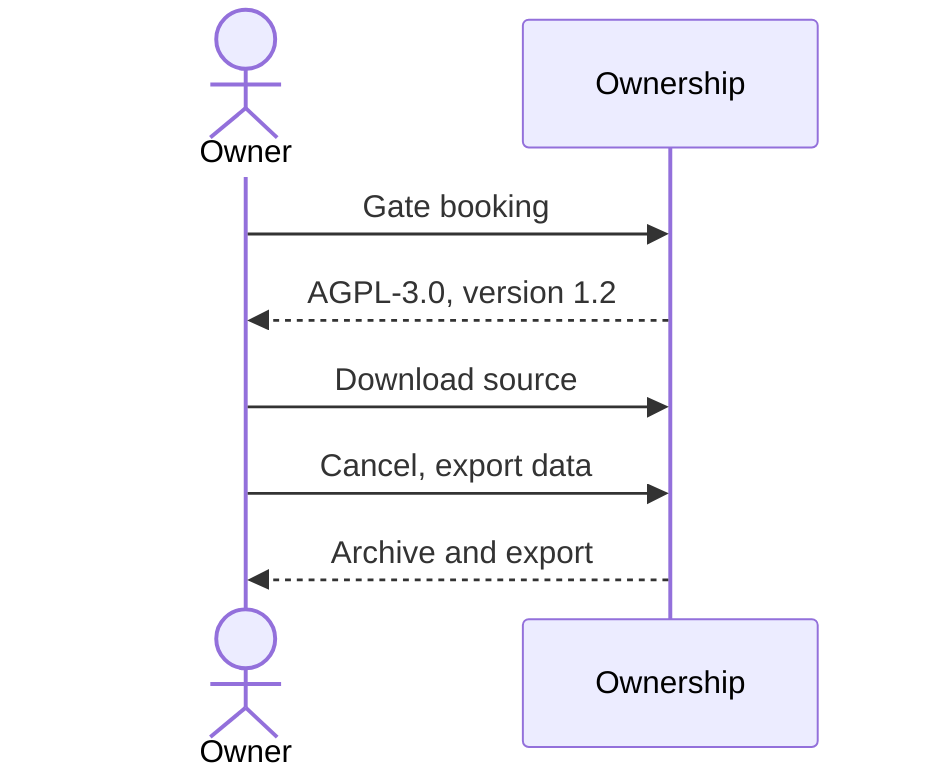

🏠 [Specs](../../../../README.md) › 🧩 [Functional capabilities](../../../README.md) ›
🏭 [F19 Feature factory (hosted edition)](../../README.md) › 📝 [Use cases](../README.md) ›
📝 [Use cases: FL-F19-03 Try, install and maintain](README.md) › 📝 UC-F19-23 Get the source of a feature

# 📝 UC-F19-23 Get the source of a feature

**Status:** ✅ specified, ⚖️ lawyer review before launch (D574)

## Summary

The owner downloads the AGPL source of a generated feature at any time; at cancellation the source and the data export
are handed over so the company can keep running it elsewhere.

## Personas

- [U13 Owner](../../../../01-users/personas/u13-owner.md)

## Goal

The company is never locked in by a generated feature.

## Trigger

The owner's request; a cancellation (UC-F19-11).

## Frequency

Rare.

## Preconditions

- The feature is signed.

## Postconditions

- Success: source archive and data export available.
- Failure: none: the source is always available.

## Main flow

1. The owner opens Ownership (S-F19-23) on a feature.
2. SimpleERP shows the licence (AGPL-3.0, D377) and the versions.
3. The owner downloads the source archive of the signed version.
4. At cancellation, the data export is added (UC-F19-11).
5. The handover stays available for the retention period.

## Alternative flows

- 3a. A promoted feature: the licence granted to the publisher is shown too (BR-F19-10).

## Error flows

- 1e. An exclusive licence asked: refused (BR-F19-17).
- Any step: a service does not answer; the call is retried first (BR-F3-32), then the message follows the error pattern
  (D122) and what was typed stays on the screen.

## Business rules

- [BR-F19-17 Generated code is AGPL and stays usable](../../business-rules/br-f19-17-generated-code-is-agpl-and-stays-usable.md)

## Entities

- [E-F19-13 Code handover](../../data/e-f19-13-code-handover.md)

## Permissions

Owner; administrators read.

## Notifications

- The owner when the handover is ready.

## Audit events

Downloads.

## AI involvement

None.

## API, MCP and A2A exposure

Through the API (T5) and as AI assistant tools (T6), with the caller's rights (BR-F3-34).

## Screens

- [S-F19-23 Ownership](../../screens/03-try-install-and-maintain/s-f19-23-ownership.md)

## Flowchart

See [FL-F19-03 Try, install and maintain](../../flows/fl-f19-03-try-install-and-maintain.md#flowchart).

## Sequence diagram

## Acceptance criteria

1. **Given** gate booking 1.2 signed **when** the owner downloads **then** the AGPL source archive is given.
2. **Given** a cancellation **when** done **then** the source and the data export are available.
3. **Given** an exclusive licence asked **when** asked **then** it is refused.

## Non-functional notes

D408's targets ([Performance](../../../../05-non-functional/performance.md)): 95 % of screens within 1 second; lists
paged on the server, the first page within 1 second; reports within 5 seconds or in the background.

## Regulatory references

[CR-FR-203](../../../../10-country-packs/france/digital/cr-fr-203-software-copyright-assignment.md),
[CR-FR-204](../../../../10-country-packs/france/digital/cr-fr-204-ai-generated-works.md); ownership of AI-generated
code: (⚖️ lawyer review before launch, D574) to read: Code de la propriété intellectuelle L111-1 and L113-1 on who is an author.

## Related use cases

- [UC-F19-11 Cancel a feature and export its data](uc-f19-11-cancel-a-feature-and-export-its-data.md)
- [UC-F19-12 Promote the feature to every hosted customer](../04-promote/uc-f19-12-promote-the-feature-to-every-hosted-customer.md)

## Open questions

None.

---

⬅️ [UC-F19-22 Refund when acceptance fails](../06-delivery-and-refunds/uc-f19-22-refund-when-acceptance-fails.md) ·
⬆️ [Up](README.md) · ➡️ [UC-F19-24](../02-build-and-check/uc-f19-24-review-a-features-security-and-privacy.md)
