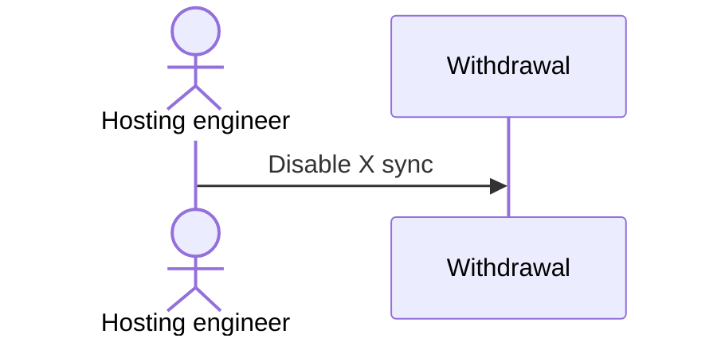

🏠 [Specs](../../../../README.md) › 🧩 [Functional capabilities](../../../README.md) ›
🏭 [F19 Feature factory (hosted edition)](../../README.md) › 📝 [Use cases](../README.md) ›
📝 [Use cases: FL-F19-04 Promote](README.md) › 📝 UC-F19-18 Withdraw a harmful feature

# 📝 UC-F19-18 Withdraw a harmful feature

**Status:** ✅ specified

## Summary

The hosting engineer withdraws a harmful feature, disables it everywhere and tells the companies with an export.

## Personas

- [U48 Hosting engineer](../../../../01-users/personas/u48-hosting-engineer.md)

## Goal

Harm stopped.

## Trigger

Harm found.

## Frequency

Rare.

## Preconditions

- Evidence.

## Postconditions

- Success: disabled.
- Failure: escalated.

## Main flow

1. The engineer opens Withdrawal (S-F19-18).
2. They decide.
3. The feature is disabled (BR-F19-13).
4. Companies are told with an export.

## Alternative flows

- 3a. Patch instead.

## Error flows

- 3e. Disable fails: escalated.
- Any step: a service does not answer; the call is retried first (BR-F3-32), then the message follows the error pattern
  (D122) and what was typed stays on the screen.

## Business rules

- [BR-F19-13 A harmful feature is withdrawn](../../business-rules/br-f19-13-harmful-feature-withdrawn.md)

## Entities

- [E-F19-10 Feature withdrawal](../../data/e-f19-10-feature-withdrawal.md)

## Permissions

Hosting engineer.

## Notifications

- Companies.

## Audit events

Withdrawals.

## AI involvement

None.

## API, MCP and A2A exposure

Through T5 and T6 with the caller's rights (BR-F3-34).

## Screens

- [S-F19-18 Withdrawal](../../screens/04-promote/s-f19-18-withdrawal.md)

## Flowchart

See [FL-F19-04 Promote](../../flows/fl-f19-04-promote.md#flowchart).

## Sequence diagram

## Acceptance criteria

1. **Given** a leak **when** withdrawn **then** disabled everywhere.
2. **Given** companies **when** told **then** exports given.
3. **Given** a patch **when** pushed **then** no disable.

## Non-functional notes

D408's targets ([Performance](../../../../05-non-functional/performance.md)): 95 % of screens within 1 second; lists
paged on the server, the first page within 1 second; reports within 5 seconds or in the background.

## Regulatory references

Billing and rights rules of the France country pack:
[CR-FR-205 VAT on the promotion credit](../../../../10-country-packs/france/tax-and-vat/cr-fr-205-promotion-credit-vat-treatment.md),
[CR-FR-200 Credit notes and corrective invoices](../../../../10-country-packs/france/invoicing/cr-fr-200-credit-notes.md),
[CR-FR-202 Price reductions on invoices](../../../../10-country-packs/france/invoicing/cr-fr-202-price-reductions-on-invoices.md),
[CR-FR-201 Self-billing](../../../../10-country-packs/france/invoicing/cr-fr-201-self-billing.md),
[CR-FR-015 Mandatory invoice mentions](../../../../10-country-packs/france/invoicing/cr-fr-015-invoice-mandatory-mentions.md),
[CR-FR-100 VAT on services to clients abroad](../../../../10-country-packs/france/tax-and-vat/cr-fr-100-vat-on-services-abroad.md),
[CR-FR-203 Who owns software, and assigning it](../../../../10-country-packs/france/digital/cr-fr-203-software-copyright-assignment.md),
[CR-FR-204 Works generated by an AI](../../../../10-country-packs/france/digital/cr-fr-204-ai-generated-works.md),
[CR-FR-016 Electronic invoicing](../../../../10-country-packs/france/invoicing/cr-fr-016-electronic-invoicing.md),
[CR-FR-056 People know they deal with an AI](../../../../10-country-packs/france/ai-and-recording/cr-fr-056-people-know-they-deal-with-an-ai.md).

## Related use cases

- [UC-F19-14 Publish it in the hosted store](uc-f19-14-publish-it-in-the-hosted-store.md)

## Open questions

None.

---

⬅️ [UC-F19-17](../02-build-and-check/uc-f19-17-keep-features-working-across-upgrades.md) · ⬆️ [Up](README.md) ·
➡️ [UC-F19-19](../05-bill-and-credit/uc-f19-19-follow-features-costs-and-credits.md)
