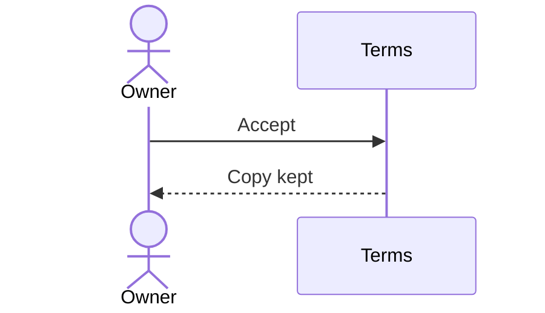

🏠 [Specs](../../../../README.md) › 🧩 [Functional capabilities](../../../README.md) ›
🏭 [F19 Feature factory (hosted edition)](../../README.md) › 📝 [Use cases](../README.md) ›
📝 [Use cases: FL-F19-04 Promote](README.md) › 📝 UC-F19-20 Accept the licence terms of a promotion

# 📝 UC-F19-20 Accept the licence terms of a promotion

**Status:** ✅ specified

## Summary

The owner reads and accepts the licence terms of a promotion and keeps a copy.

## Personas

- [U13 Owner](../../../../01-users/personas/u13-owner.md)

## Goal

Informed consent.

## Trigger

Promotion.

## Frequency

Rare.

## Preconditions

- Promotion started.

## Postconditions

- Success: accepted.
- Failure: none.

## Main flow

1. The owner opens Promotion terms (S-F19-20).
2. They read.
3. They accept.
4. A copy is kept.

## Alternative flows

- 2a. Download.

## Error flows

- 3e. Not owner: refused.
- Any step: a service does not answer; the call is retried first (BR-F3-32), then the message follows the error pattern
  (D122) and what was typed stays on the screen.

## Business rules

- [BR-F19-10 Promotion needs the customer's terms](../../business-rules/br-f19-10-promotion-needs-terms.md)
- [BR-F19-17 Generated code is AGPL and stays usable](../../business-rules/br-f19-17-generated-code-is-agpl-and-stays-usable.md)

## Entities

- [E-F19-07 Feature promotion](../../data/e-f19-07-feature-promotion.md)

## Permissions

Owner.

## Notifications

- None.

## Audit events

Acceptance.

## AI involvement

None.

## API, MCP and A2A exposure

Through T5 and T6 with the caller's rights (BR-F3-34).

## Screens

- [S-F19-20 Promotion terms](../../screens/04-promote/s-f19-20-promotion-terms.md)

## Flowchart

See [FL-F19-04 Promote](../../flows/fl-f19-04-promote.md#flowchart).

## Sequence diagram

## Acceptance criteria

1. **Given** terms **when** accepted **then** copy kept.
2. **Given** administrator **when** accepting **then** refused.
3. **Given** accepted **when** downloaded **then** PDF.

## Non-functional notes

D408's targets ([Performance](../../../../05-non-functional/performance.md)): 95 % of screens within 1 second; lists
paged on the server, the first page within 1 second; reports within 5 seconds or in the background.

## Regulatory references

Billing and rights rules of the France country pack:
[CR-FR-205 VAT on the promotion credit](../../../../10-country-packs/france/tax-and-vat/cr-fr-205-promotion-credit-vat-treatment.md),
[CR-FR-200 Credit notes and corrective invoices](../../../../10-country-packs/france/invoicing/cr-fr-200-credit-notes.md),
[CR-FR-202 Price reductions on invoices](../../../../10-country-packs/france/invoicing/cr-fr-202-price-reductions-on-invoices.md),
[CR-FR-201 Self-billing](../../../../10-country-packs/france/invoicing/cr-fr-201-self-billing.md),
[CR-FR-015 Mandatory invoice mentions](../../../../10-country-packs/france/invoicing/cr-fr-015-invoice-mandatory-mentions.md),
[CR-FR-100 VAT on services to clients abroad](../../../../10-country-packs/france/tax-and-vat/cr-fr-100-vat-on-services-abroad.md),
[CR-FR-203 Who owns software, and assigning it](../../../../10-country-packs/france/digital/cr-fr-203-software-copyright-assignment.md),
[CR-FR-204 Works generated by an AI](../../../../10-country-packs/france/digital/cr-fr-204-ai-generated-works.md),
[CR-FR-016 Electronic invoicing](../../../../10-country-packs/france/invoicing/cr-fr-016-electronic-invoicing.md),
[CR-FR-056 People know they deal with an AI](../../../../10-country-packs/france/ai-and-recording/cr-fr-056-people-know-they-deal-with-an-ai.md).

## Related use cases

- [UC-F19-12 Promote the feature to every hosted customer](uc-f19-12-promote-the-feature-to-every-hosted-customer.md)

## Open questions

None.

---

⬅️ [UC-F19-19](../05-bill-and-credit/uc-f19-19-follow-features-costs-and-credits.md) · ⬆️ [Up](README.md) ·
➡️ [UC-F19-21](../01-describe-and-order/uc-f19-21-commit-to-a-delivery-date-and-handle-delays.md)
