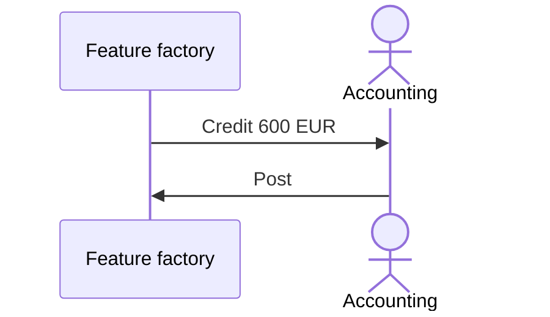

🏠 [Specs](../../../../README.md) › 🧩 [Functional capabilities](../../../README.md) ›
🏭 [F19 Feature factory (hosted edition)](../../README.md) › 📝 [Use cases](../README.md) ›
📝 [Use cases: FL-F19-05 Bill and credit](README.md) › 📝 UC-F19-15 Receive the promotion credit

# 📝 UC-F19-15 Receive the promotion credit

**Status:** ✅ specified

## Summary

Accounting and the owner receive the promotion credit, 50 % of others' payments, as a credit note.

## Personas

- [U05 Accounting](../../../../01-users/personas/u05-accounting.md)
- [U13 Owner](../../../../01-users/personas/u13-owner.md)

## Goal

Credits applied.

## Trigger

Month closed.

## Frequency

Monthly.

## Preconditions

- Promoted feature with buyers.

## Postconditions

- Success: credit note.
- Failure: carried.

## Main flow

1. The month closes.
2. Credits are computed (BR-F19-11).
3. A credit note is issued (BR-F19-12).
4. Accounting posts it (UC-F19-25).

## Alternative flows

- 3a. Above the invoice: carried.

## Error flows

- 2e. No buyer: none.
- Any step: a service does not answer; the call is retried first (BR-F3-32), then the message follows the error pattern
  (D122) and what was typed stays on the screen.

## Business rules

- [BR-F19-11 Half of the revenue credited](../../business-rules/br-f19-11-promotion-credit-half-of-revenue.md)
- [BR-F19-12 The credit is a credit note](../../business-rules/br-f19-12-credit-is-a-credit-note.md)
- [BR-F19-19 Factory billing posted to accounting](../../business-rules/br-f19-19-factory-billing-posted-to-accounting.md)

## Entities

- [E-F19-08 Promotion credit](../../data/e-f19-08-promotion-credit.md)
- [E-F19-09 Hosted invoice](../../data/e-f19-09-hosted-invoice.md)
- [E-F19-15 Factory posting](../../data/e-f19-15-factory-posting.md)

## Permissions

Accounting; owner reads.

## Notifications

- Owner.

## Audit events

Credits.

## AI involvement

None.

## API, MCP and A2A exposure

Through T5 and T6 with the caller's rights (BR-F3-34).

## Screens

- [S-F19-15 Credits](../../screens/05-bill-and-credit/s-f19-15-credits.md)

## Flowchart

See [FL-F19-05 Bill and credit](../../flows/fl-f19-05-bill-and-credit.md#flowchart).

## Sequence diagram

## Acceptance criteria

1. **Given** 1 200.00 EUR paid by others **when** computed **then** 600.00 EUR credit.
2. **Given** an invoice of 360.00 EUR **when** credited **then** the rest is carried.
3. **Given** no buyer **when** computed **then** none.

## Non-functional notes

D408's targets ([Performance](../../../../05-non-functional/performance.md)): 95 % of screens within 1 second; lists
paged on the server, the first page within 1 second; reports within 5 seconds or in the background.

## Regulatory references

Billing and rights rules of the France country pack:
[CR-FR-205 VAT on the promotion credit](../../../../10-country-packs/france/tax-and-vat/cr-fr-205-promotion-credit-vat-treatment.md),
[CR-FR-200 Credit notes and corrective invoices](../../../../10-country-packs/france/invoicing/cr-fr-200-credit-notes.md),
[CR-FR-202 Price reductions on invoices](../../../../10-country-packs/france/invoicing/cr-fr-202-price-reductions-on-invoices.md),
[CR-FR-201 Self-billing](../../../../10-country-packs/france/invoicing/cr-fr-201-self-billing.md),
[CR-FR-015 Mandatory invoice mentions](../../../../10-country-packs/france/invoicing/cr-fr-015-invoice-mandatory-mentions.md),
[CR-FR-100 VAT on services to clients abroad](../../../../10-country-packs/france/tax-and-vat/cr-fr-100-vat-on-services-abroad.md),
[CR-FR-203 Who owns software, and assigning it](../../../../10-country-packs/france/digital/cr-fr-203-software-copyright-assignment.md),
[CR-FR-204 Works generated by an AI](../../../../10-country-packs/france/digital/cr-fr-204-ai-generated-works.md),
[CR-FR-016 Electronic invoicing](../../../../10-country-packs/france/invoicing/cr-fr-016-electronic-invoicing.md),
[CR-FR-056 People know they deal with an AI](../../../../10-country-packs/france/ai-and-recording/cr-fr-056-people-know-they-deal-with-an-ai.md).

## Related use cases

- [UC-F19-25 Post feature invoices, credits and refunds to accounting](uc-f19-25-post-feature-invoices-credits-and-refunds-to-accounting.md)

## Open questions

None.

---

⬅️ [UC-F19-14 Publish it in the hosted store](../04-promote/uc-f19-14-publish-it-in-the-hosted-store.md) ·
⬆️ [Up](README.md) ·
➡️ [UC-F19-16 Invoice features with the right VAT](uc-f19-16-invoice-features-with-the-right-vat.md)
