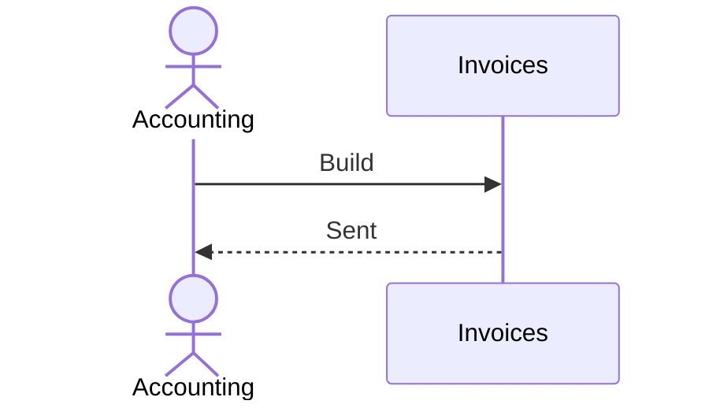

🏠 [Specs](../../../../README.md) › 🧩 [Functional capabilities](../../../README.md) ›
🏭 [F19 Feature factory (hosted edition)](../../README.md) › 📝 [Use cases](../README.md) ›
📝 [Use cases: FL-F19-05 Bill and credit](README.md) › 📝 UC-F19-16 Invoice features with the right VAT

# 📝 UC-F19-16 Invoice features with the right VAT

**Status:** ✅ specified

## Summary

Accounting invoices features monthly with the right VAT and sends them electronically.

## Personas

- [U05 Accounting](../../../../01-users/personas/u05-accounting.md)

## Goal

Correct invoices.

## Trigger

Month closed.

## Frequency

Monthly.

## Preconditions

- Active features.

## Postconditions

- Success: sent.
- Failure: corrected.

## Main flow

1. Accounting opens Invoices (S-F19-16).
2. Invoices are built.
3. VAT is applied (BR-F19-01).
4. They are sent electronically.

## Alternative flows

- 3a. Reverse charge.

## Error flows

- 4e. Validation fails: corrected.
- Any step: a service does not answer; the call is retried first (BR-F3-32), then the message follows the error pattern
  (D122) and what was typed stays on the screen.

## Business rules

- [BR-F19-01 Prices and credits follow the country pack](../../business-rules/br-f19-01-factory-follows-the-country-pack.md)
- [BR-F19-09 300 EUR a month excluding VAT](../../business-rules/br-f19-09-price-excludes-vat.md)
- [BR-F19-19 Factory billing posted to accounting](../../business-rules/br-f19-19-factory-billing-posted-to-accounting.md)

## Entities

- [E-F19-09 Hosted invoice](../../data/e-f19-09-hosted-invoice.md)
- [E-F19-15 Factory posting](../../data/e-f19-15-factory-posting.md)

## Permissions

Accounting.

## Notifications

- Customers.

## Audit events

Invoices.

## AI involvement

None.

## API, MCP and A2A exposure

Through T5 and T6 with the caller's rights (BR-F3-34).

## Screens

- [S-F19-16 Invoices](../../screens/05-bill-and-credit/s-f19-16-invoices.md)

## Flowchart

See [FL-F19-05 Bill and credit](../../flows/fl-f19-05-bill-and-credit.md#flowchart).

## Sequence diagram

## Acceptance criteria

1. **Given** 300.00 EUR **when** invoiced **then** 60.00 EUR VAT.
2. **Given** EU business **when** invoiced **then** reverse charge.
3. **Given** validation fails **when** sent **then** corrected.

## Non-functional notes

D408's targets ([Performance](../../../../05-non-functional/performance.md)): 95 % of screens within 1 second; lists
paged on the server, the first page within 1 second; reports within 5 seconds or in the background.

## Regulatory references

Billing and rights rules of the France country pack:
[CR-FR-205 VAT on the promotion credit](../../../../10-country-packs/france/tax-and-vat/cr-fr-205-promotion-credit-vat-treatment.md),
[CR-FR-200 Credit notes and corrective invoices](../../../../10-country-packs/france/invoicing/cr-fr-200-credit-notes.md),
[CR-FR-202 Price reductions on invoices](../../../../10-country-packs/france/invoicing/cr-fr-202-price-reductions-on-invoices.md),
[CR-FR-201 Self-billing](../../../../10-country-packs/france/invoicing/cr-fr-201-self-billing.md),
[CR-FR-015 Mandatory invoice mentions](../../../../10-country-packs/france/invoicing/cr-fr-015-invoice-mandatory-mentions.md),
[CR-FR-100 VAT on services to clients abroad](../../../../10-country-packs/france/tax-and-vat/cr-fr-100-vat-on-services-abroad.md),
[CR-FR-203 Who owns software, and assigning it](../../../../10-country-packs/france/digital/cr-fr-203-software-copyright-assignment.md),
[CR-FR-204 Works generated by an AI](../../../../10-country-packs/france/digital/cr-fr-204-ai-generated-works.md),
[CR-FR-016 Electronic invoicing](../../../../10-country-packs/france/invoicing/cr-fr-016-electronic-invoicing.md),
[CR-FR-056 People know they deal with an AI](../../../../10-country-packs/france/ai-and-recording/cr-fr-056-people-know-they-deal-with-an-ai.md).

## Related use cases

- [UC-F19-25 Post feature invoices, credits and refunds to accounting](uc-f19-25-post-feature-invoices-credits-and-refunds-to-accounting.md)

## Open questions

None.

---

⬅️ [UC-F19-15 Receive the promotion credit](uc-f19-15-receive-the-promotion-credit.md) · ⬆️ [Up](README.md) ·
➡️ [UC-F19-17](../02-build-and-check/uc-f19-17-keep-features-working-across-upgrades.md)
