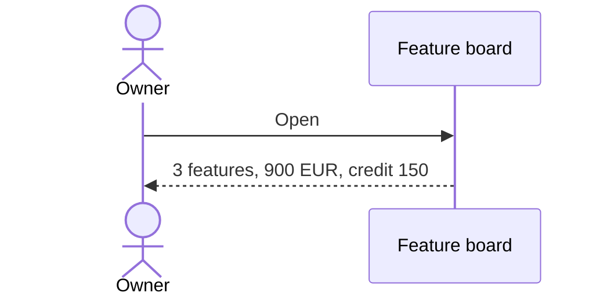

🏠 [Specs](../../../../README.md) › 🧩 [Functional capabilities](../../../README.md) ›
🏭 [F19 Feature factory (hosted edition)](../../README.md) › 📝 [Use cases](../README.md) ›
📝 [Use cases: FL-F19-05 Bill and credit](README.md) › 📝 UC-F19-19 Follow features, costs and credits

# 📝 UC-F19-19 Follow features, costs and credits

**Status:** ✅ specified

## Summary

The owner and accounting follow features, costs, credits, refunds and delivery record on a board.

## Personas

- [U13 Owner](../../../../01-users/personas/u13-owner.md)
- [U05 Accounting](../../../../01-users/personas/u05-accounting.md)

## Goal

Overview.

## Trigger

Any time.

## Frequency

Monthly.

## Preconditions

- Features exist.

## Postconditions

- Success: read.
- Failure: none.

## Main flow

1. They open the Feature board (S-F19-19).
2. They read subscriptions and costs.
3. They read credits and refunds.
4. They export.

## Alternative flows

- 3a. Delivery record on time or late.

## Error flows

- 1e. No feature: said.
- Any step: a service does not answer; the call is retried first (BR-F3-32), then the message follows the error pattern
  (D122) and what was typed stays on the screen.

## Business rules

- [BR-F19-09 300 EUR a month excluding VAT](../../business-rules/br-f19-09-price-excludes-vat.md)
- [BR-F19-11 Half of the revenue credited](../../business-rules/br-f19-11-promotion-credit-half-of-revenue.md)
- [BR-F19-15 A delivery date is committed and kept](../../business-rules/br-f19-15-a-delivery-date-is-committed-and-kept.md)
- [BR-F19-16 Nothing charged without an accepted feature](../../business-rules/br-f19-16-nothing-charged-without-an-accepted-feature.md)

## Entities

- [E-F19-03 Feature subscription](../../data/e-f19-03-feature-subscription.md)
- [E-F19-08 Promotion credit](../../data/e-f19-08-promotion-credit.md)
- [E-F19-11 Delivery commitment](../../data/e-f19-11-delivery-commitment.md)
- [E-F19-12 Feature refund](../../data/e-f19-12-feature-refund.md)

## Permissions

Owner and accounting.

## Notifications

- None.

## Audit events

Exports.

## AI involvement

None.

## API, MCP and A2A exposure

Through T5 and T6 with the caller's rights (BR-F3-34).

## Screens

- [S-F19-19 Feature board](../../screens/05-bill-and-credit/s-f19-19-feature-board.md)

## Flowchart

See [FL-F19-05 Bill and credit](../../flows/fl-f19-05-bill-and-credit.md#flowchart).

## Sequence diagram

## Acceptance criteria

1. **Given** 3 features **when** opened **then** 900.00 EUR shows.
2. **Given** a credit **when** opened **then** shown.
3. **Given** a late delivery **when** opened **then** counted.

## Non-functional notes

D408's targets ([Performance](../../../../05-non-functional/performance.md)): 95 % of screens within 1 second; lists
paged on the server, the first page within 1 second; reports within 5 seconds or in the background.

## Regulatory references

Billing and rights rules of the France country pack:
[CR-FR-205 VAT on the promotion credit](../../../../10-country-packs/france/tax-and-vat/cr-fr-205-promotion-credit-vat-treatment.md),
[CR-FR-200 Credit notes and corrective invoices](../../../../10-country-packs/france/invoicing/cr-fr-200-credit-notes.md),
[CR-FR-202 Price reductions on invoices](../../../../10-country-packs/france/invoicing/cr-fr-202-price-reductions-on-invoices.md),
[CR-FR-201 Self-billing](../../../../10-country-packs/france/invoicing/cr-fr-201-self-billing.md),
[CR-FR-015 Mandatory invoice mentions](../../../../10-country-packs/france/invoicing/cr-fr-015-invoice-mandatory-mentions.md),
[CR-FR-100 VAT on services to clients abroad](../../../../10-country-packs/france/tax-and-vat/cr-fr-100-vat-on-services-abroad.md),
[CR-FR-203 Who owns software, and assigning it](../../../../10-country-packs/france/digital/cr-fr-203-software-copyright-assignment.md),
[CR-FR-204 Works generated by an AI](../../../../10-country-packs/france/digital/cr-fr-204-ai-generated-works.md),
[CR-FR-016 Electronic invoicing](../../../../10-country-packs/france/invoicing/cr-fr-016-electronic-invoicing.md),
[CR-FR-056 People know they deal with an AI](../../../../10-country-packs/france/ai-and-recording/cr-fr-056-people-know-they-deal-with-an-ai.md).

## Related use cases

- [UC-F19-26 Reconcile feature payments and follow up unpaid invoices](uc-f19-26-reconcile-feature-payments-and-follow-up-unpaid-invoices.md)

## Open questions

None.

---

⬅️ [UC-F19-18 Withdraw a harmful feature](../04-promote/uc-f19-18-withdraw-a-harmful-feature.md) · ⬆️ [Up](README.md) ·
➡️ [UC-F19-20](../04-promote/uc-f19-20-accept-the-licence-terms-of-a-promotion.md)
