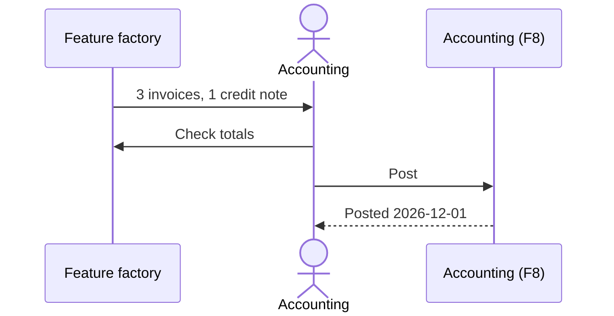

🏠 [Specs](../../../../README.md) › 🧩 [Functional capabilities](../../../README.md) ›
🏭 [F19 Feature factory (hosted edition)](../../README.md) › 📝 [Use cases](../README.md) ›
📝 [Use cases: FL-F19-05 Bill and credit](README.md) ›
📝 UC-F19-25 Post feature invoices, credits and refunds to accounting

# 📝 UC-F19-25 Post feature invoices, credits and refunds to accounting

**Status:** ✅ specified

## Summary

Accounting posts the factory's monthly invoices, promotion credit notes and refunds to F8 with revenue, VAT and
receivable accounts, from the factory's own postings.

## Personas

- [U05 Accounting](../../../../01-users/personas/u05-accounting.md)

## Goal

The factory's money in the books each month.

## Trigger

The month's invoices and credits issued.

## Frequency

Monthly.

## Preconditions

- The account mapping is set in F8.

## Postconditions

- Success: postings in F8, balanced.
- Failure: postings held with the reason.

## Main flow

1. The month closes; SimpleERP prepares the postings (S-F19-25) (BR-F19-19).
2. Accounting checks totals against the invoices and credit notes.
3. They post to F8.
4. F8 records them in the open period.

## Alternative flows

- 1a. A reverse-charge invoice for an EU business: no VAT line, the mention set.

## Error flows

- 3e. The period is closed in F8: posted in the next open one with a note.
- 1e. An account is missing: held.
- Any step: a service does not answer; the call is retried first (BR-F3-32), then the message follows the error pattern
  (D122) and what was typed stays on the screen.

## Business rules

- [BR-F19-19 Factory billing posted to accounting](../../business-rules/br-f19-19-factory-billing-posted-to-accounting.md)
- [BR-F19-01 Prices and credits follow the country pack](../../business-rules/br-f19-01-factory-follows-the-country-pack.md)

## Entities

- [E-F19-15 Factory posting](../../data/e-f19-15-factory-posting.md)
- [E-F19-09 Hosted invoice](../../data/e-f19-09-hosted-invoice.md)

## Permissions

Accounting.

## Notifications

- Accounting when postings are ready.

## Audit events

Postings.

## AI involvement

None.

## API, MCP and A2A exposure

Through the API (T5) and as AI assistant tools (T6), with the caller's rights (BR-F3-34).

## Screens

- [S-F19-25 Factory accounting](../../screens/05-bill-and-credit/s-f19-25-factory-accounting.md)

## Flowchart

See [FL-F19-05 Bill and credit](../../flows/fl-f19-05-bill-and-credit.md#flowchart).

## Sequence diagram

## Acceptance criteria

1. **Given** an invoice of 300.00 EUR plus 60.00 EUR VAT **when** posted **then** 706 300.00, 44571 60.00 and 411
   360.00.
2. **Given** a credit note of 150.00 EUR **when** posted **then** revenue and VAT are reduced.
3. **Given** November closed in F8 **when** posted **then** it goes to December with a note.

## Non-functional notes

D408's targets ([Performance](../../../../05-non-functional/performance.md)): 95 % of screens within 1 second; lists
paged on the server, the first page within 1 second; reports within 5 seconds or in the background.

## Regulatory references

[CR-FR-004](../../../../10-country-packs/france/accounting/cr-fr-004-balanced-entries-continuous-numbers.md),
[CR-FR-200 Credit notes](../../../../10-country-packs/france/invoicing/cr-fr-200-credit-notes.md).

## Related use cases

- [UC-F19-16 Invoice features with the right VAT](uc-f19-16-invoice-features-with-the-right-vat.md)
- [UC-F19-26 Reconcile feature payments and follow up unpaid invoices](uc-f19-26-reconcile-feature-payments-and-follow-up-unpaid-invoices.md)

## Open questions

None.

---

⬅️ [UC-F19-24](../02-build-and-check/uc-f19-24-review-a-features-security-and-privacy.md) · ⬆️ [Up](README.md) ·
➡️ [UC-F19-26](uc-f19-26-reconcile-feature-payments-and-follow-up-unpaid-invoices.md)
