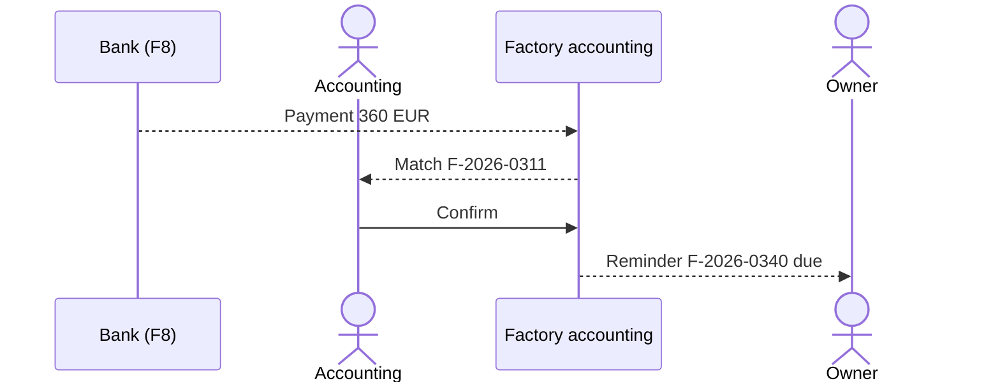

🏠 [Specs](../../../../README.md) › 🧩 [Functional capabilities](../../../README.md) ›
🏭 [F19 Feature factory (hosted edition)](../../README.md) › 📝 [Use cases](../README.md) ›
📝 [Use cases: FL-F19-05 Bill and credit](README.md) ›
📝 UC-F19-26 Reconcile feature payments and follow up unpaid invoices

# 📝 UC-F19-26 Reconcile feature payments and follow up unpaid invoices

**Status:** ✅ specified

## Summary

Accounting matches each payment of a feature invoice with its bank line, and follows unpaid invoices with reminders
while the feature keeps running.

## Personas

- [U05 Accounting](../../../../01-users/personas/u05-accounting.md)
- [U13 Owner](../../../../01-users/personas/u13-owner.md), who receives reminders

## Goal

Every feature invoice paid and matched.

## Trigger

Bank lines imported; a due date passed.

## Frequency

Weekly.

## Preconditions

- Invoices posted (UC-F19-25).

## Postconditions

- Success: invoices matched.
- Failure: unpaid invoices in follow-up.

## Main flow

1. Bank lines arrive in F8; SimpleERP proposes matches (S-F19-25).
2. Accounting confirms each match.
3. An invoice unpaid at its due date gets a reminder to the owner.
4. Paid later, it is matched and the follow-up closes.

## Alternative flows

- 1a. One payment for several invoices: split.

## Error flows

- 3e. Still unpaid after reminders: accounting decides with the hosting provider's collection policy; a business
  customer owes the late-payment penalties and the 40 EUR indemnity of
  [CR-FR-019](../../../../10-country-packs/france/invoicing/cr-fr-019-late-payment-penalties.md).
- Any step: a service does not answer; the call is retried first (BR-F3-32), then the message follows the error pattern
  (D122) and what was typed stays on the screen.

## Business rules

- [BR-F19-19 Factory billing posted to accounting](../../business-rules/br-f19-19-factory-billing-posted-to-accounting.md)

## Entities

- [E-F19-15 Factory posting](../../data/e-f19-15-factory-posting.md)

## Permissions

Accounting; the owner reads.

## Notifications

- The owner on reminders.

## Audit events

Matches and reminders.

## AI involvement

Match proposals.

## API, MCP and A2A exposure

Through the API (T5) and as AI assistant tools (T6), with the caller's rights (BR-F3-34).

## Screens

- [S-F19-25 Factory accounting](../../screens/05-bill-and-credit/s-f19-25-factory-accounting.md)

## Flowchart

See [FL-F19-05 Bill and credit](../../flows/fl-f19-05-bill-and-credit.md#flowchart).

## Sequence diagram

## Acceptance criteria

1. **Given** a payment of 360.00 EUR **when** matched **then** F-2026-0311 is paid.
2. **Given** F-2026-0340 unpaid at its due date **when** the day passes **then** the owner gets a reminder.
3. **Given** one payment of 720.00 EUR for two invoices **when** matched **then** both are paid.

## Non-functional notes

D408's targets ([Performance](../../../../05-non-functional/performance.md)): 95 % of screens within 1 second; lists
paged on the server, the first page within 1 second; reports within 5 seconds or in the background.

## Regulatory references

None.

## Related use cases

- [UC-F19-25 Post feature invoices, credits and refunds to accounting](uc-f19-25-post-feature-invoices-credits-and-refunds-to-accounting.md)
- [UC-F19-19 Follow features, costs and credits](uc-f19-19-follow-features-costs-and-credits.md)

## Open questions

None.

---

⬅️ [UC-F19-25](uc-f19-25-post-feature-invoices-credits-and-refunds-to-accounting.md) · ⬆️ [Up](README.md) ·
➡️ [UC-F19-27](../07-catalogue-and-co-funding/uc-f19-27-see-similar-features-before-ordering.md)
