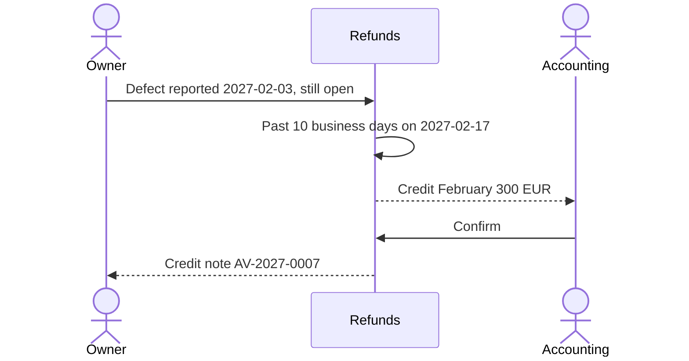

🏠 [Specs](../../../../README.md) › 🧩 [Functional capabilities](../../../README.md) ›
🏭 [F19 Feature factory (hosted edition)](../../README.md) › 📝 [Use cases](../README.md) ›
📝 [Use cases: FL-F19-06 Delivery and refunds](README.md) › 📝 UC-F19-22 Refund when acceptance fails

# 📝 UC-F19-22 Refund when acceptance fails

**Status:** ✅ specified

## Summary

A feature refused after its change rounds closes the order without charge; an accepted feature made unusable by a defect
not fixed in time is credited for that month by a credit note.

## Personas

- [U13 Owner](../../../../01-users/personas/u13-owner.md)
- [U05 Accounting](../../../../01-users/personas/u05-accounting.md), who issues the credit note

## Goal

The customer pays only for a feature that works.

## Trigger

A refusal after the change rounds; a defect not fixed within the limit.

## Frequency

Rare.

## Preconditions

- A try-out refused (UC-F19-07) or a defect reported (UC-F19-10).

## Postconditions

- Success: order closed without charge, or a credit note issued.
- Failure: the refund refused with the rule not met.

## Main flow

1. The owner refuses the feature after the change rounds, or a defect stays unfixed past the limit.
2. SimpleERP proposes a refund on Refunds (S-F19-22): closing without charge or the month's credit (BR-F19-16).
3. Accounting checks the dates and confirms.
4. A credit note is issued against the month's invoice (BR-F19-12 rules apply to its VAT).
5. The owner is told; the board shows the refund.

## Alternative flows

- 1a. Refusal before any invoice: the order is simply closed, no document issued.

## Error flows

- 3e. The defect came from the customer's own changes: refused with the reason.
- Any step: a service does not answer; the call is retried first (BR-F3-32), then the message follows the error pattern
  (D122) and what was typed stays on the screen.

## Business rules

- [BR-F19-16 Nothing charged without an accepted feature](../../business-rules/br-f19-16-nothing-charged-without-an-accepted-feature.md)
- [BR-F19-12 The credit is a credit note](../../business-rules/br-f19-12-credit-is-a-credit-note.md)

## Entities

- [E-F19-12 Feature refund](../../data/e-f19-12-feature-refund.md)
- [E-F19-09 Hosted invoice](../../data/e-f19-09-hosted-invoice.md)
- [E-F19-16 Feature defect](../../data/e-f19-16-feature-defect.md)

## Permissions

Accounting confirms; the owner reads.

## Notifications

- The owner when the refund is issued or refused.

## Audit events

Refund proposed, confirmed or refused, credit note.

## AI involvement

None.

## API, MCP and A2A exposure

Through the API (T5) and as AI assistant tools (T6), with the caller's rights (BR-F3-34).

## Screens

- [S-F19-22 Refunds](../../screens/06-delivery-and-refunds/s-f19-22-refunds.md)

## Flowchart

See [FL-F19-06 Delivery and refunds](../../flows/fl-f19-06-delivery-and-refunds.md#flowchart).

## Sequence diagram

## Acceptance criteria

1. **Given** gate booking refused after 3 change rounds **when** closed **then** no invoice is issued.
2. **Given** a defect reported on 2027-02-03 and not fixed by 2027-02-17 **when** the limit passes **then** a credit of
   300.00 EUR excluding VAT is proposed for February.
3. **Given** accounting confirms **when** issued **then** a numbered credit note refers to February's invoice.
4. **Given** a defect caused by the customer's own changes **when** checked **then** the refund is refused.

## Non-functional notes

D408's targets ([Performance](../../../../05-non-functional/performance.md)): 95 % of screens within 1 second; lists
paged on the server, the first page within 1 second; reports within 5 seconds or in the background.

## Regulatory references

[CR-FR-200 Credit notes](../../../../10-country-packs/france/invoicing/cr-fr-200-credit-notes.md).

## Related use cases

- [UC-F19-10 Report a defect](../03-try-install-and-maintain/uc-f19-10-report-a-defect.md)
- [UC-F19-21 Commit to a delivery date and handle delays](../01-describe-and-order/uc-f19-21-commit-to-a-delivery-date-and-handle-delays.md)
- [UC-F19-25 Post feature invoices, credits and refunds to accounting](../05-bill-and-credit/uc-f19-25-post-feature-invoices-credits-and-refunds-to-accounting.md)

## Open questions

None.

---

⬅️ [UC-F19-21](../01-describe-and-order/uc-f19-21-commit-to-a-delivery-date-and-handle-delays.md) · ⬆️ [Up](README.md) ·
➡️ [UC-F19-23 Get the source of a feature](../03-try-install-and-maintain/uc-f19-23-get-the-source-of-a-feature.md)
