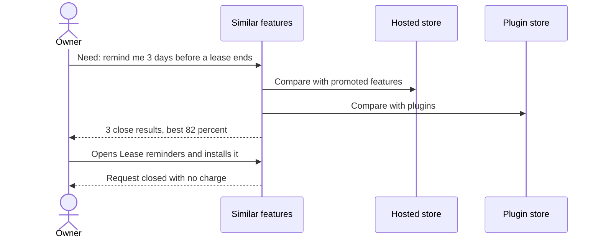

🏠 [Specs](../../../../README.md) › 🧩 [Functional capabilities](../../../README.md) ›
🏭 [F19 Feature factory (hosted edition)](../../README.md) › 📝 [Use cases](../README.md) ›
📝 [Use cases: FL-F19-07 Similar features, catalogue, co-funding and maintenance](README.md) ›
📝 UC-F19-27 See similar features before ordering

# 📝 UC-F19-27 See similar features before ordering

**Status:** ✅ specified

## Summary

Before the factory quotes a new feature, the owner sees the features that already do something close: features other
customers promoted to the hosted store and plugins of the plugin store, each with what it does, its price, how many
companies use it and how close it is to the need. The owner installs one, or says that none fits and goes on to the
quote.

## Personas

- [U13 Owner](../../../../01-users/personas/u13-owner.md)

## Goal

The owner never pays for a feature that already exists, and the factory builds only what is missing.

## Trigger

The owner has described a need to the chatbot
([UC-F19-01](../01-describe-and-order/uc-f19-01-describe-a-feature-in-plain-words.md)) and the specification is about to
be agreed.

## Frequency

Once per feature request.

## Preconditions

- A feature request holds the owner's description ([E-F19-01 Feature request](../../data/e-f19-01-feature-request.md)).
- The hosted store holds promoted features and the plugin store holds plugins
  ([E-F19-07 Feature promotion](../../data/e-f19-07-feature-promotion.md),
  [E-F14-01 Store listing](../../../f14-plugin-store/data/e-f14-01-store-listing.md)).

## Postconditions

- **Succeeded:** the owner has seen the similar features and chosen one to install or to continue; the choice is in the
  request's audit trail and the quote can be prepared.
- **Failed:** nothing is chosen; the quote is not prepared and the request waits.

## Main flow

1. The chatbot summarises the need; simple-ERP opens the similar features screen
   ([S-F19-26](../../screens/07-catalogue-and-co-funding/s-f19-26-similar-features.md)) for the owner.
2. simple-ERP compares the description with the promoted features of the hosted store and the plugins of the plugin
   store, using only their public descriptions, and lists the closest ones with a closeness mark.
3. The owner opens a result to read what it does, its price, its installs and its last update, and what part of the need
   it covers.
4. The owner installs a result that fits, through the usual installation
   ([UC-F19-08](../03-try-install-and-maintain/uc-f19-08-accept-and-install-the-feature.md),
   [UC-F14-02](../../../f14-plugin-store/use-cases/01-find-and-install/uc-f14-02-install-a-plugin-or-sector-pack.md)),
   or marks that none fits and says why in a few words.
5. simple-ERP records the choice and moves the request to the specification and the quote
   ([UC-F19-03](../01-describe-and-order/uc-f19-03-accept-the-quote.md)), keeping what a similar feature already covers
   as the part not to build.
6. If the owner installs one, the request is closed with no charge.

## Alternative flows

- 2a. Nothing close exists: the screen says so and the request goes on at once.
- 4a. A result covers half of the need: the owner installs it and the request is reduced to the missing part.
- 4b. The owner wants the result with a change: the change is ordered as a catalogue change or a feature
  ([UC-F19-28](uc-f19-28-order-a-fixed-price-change.md)).

## Error flows

- 2e. The store cannot be read: the list is retried, then the owner may continue without it, with the reason recorded.
- 3e. A result was withdrawn since the list was made
  ([UC-F19-18](../04-promote/uc-f19-18-withdraw-a-harmful-feature.md)): it is removed from the list and not offered.
- 4e. The owner continues without choosing: the quote cannot be prepared until a choice is recorded.
- Any step: a service does not answer; the call is retried first
  ([BR-F3-32](../../../f03-assistant/business-rules/br-f03-32-retry-before-an-error.md)), then the message follows the
  error pattern ([D122](../../../../06-decisions/ux/d122-error-message-standard.md)) and what the user typed stays on
  the screen.

## Business rules

- [BR-F19-20](../../business-rules/br-f19-20-similar-features-are-shown-before-any-quote.md)
- [BR-F19-10](../../business-rules/br-f19-10-promotion-needs-terms.md)
- [BR-F19-14](../../business-rules/br-f19-14-ai-disclosed-and-overseen.md)

## Entities

- [E-F19-01 Feature request](../../data/e-f19-01-feature-request.md): read, the need as described
- [E-F19-07 Feature promotion](../../data/e-f19-07-feature-promotion.md): read, the promoted features
- [E-F14-01 Store listing](../../../f14-plugin-store/data/e-f14-01-store-listing.md): read, the plugin store listings

## Permissions

The owner and the administrators of the company see and choose. The hosting engineer reads the choices for
support.

## Notifications

None: the owner is looking at the screen; the request's page shows the choice afterwards.

## Audit events

Each list shown (which results, which closeness), each result opened, the choice (installed or none fits) and its
reason, with who and when.

## AI involvement

The AI compares the description with the public descriptions of features and says it does so
([BR-F19-14](../../business-rules/br-f19-14-ai-disclosed-and-overseen.md)); it never reads another customer's feature
code or data, and it never decides: the owner chooses.

## API, MCP and A2A exposure

T5 operations of the capability for the personas above: create, read, update and list. The MCP tool of the
capability may read and propose, never confirm alone. No A2A skill.

## Screens

- [S-F19-26](../../screens/07-catalogue-and-co-funding/s-f19-26-similar-features.md)

## Flowchart

See
[FL-F19-07 Similar features, catalogue, co-funding and maintenance](../../flows/fl-f19-07-catalogue-and-co-funding.md#flowchart).

## Sequence diagram

## Acceptance criteria

1. **Given** a request that matches a promoted feature at 80 percent **when** the specification is about to be agreed
   **then** the similar features screen lists it before any quote.
2. **Given** an owner who says none fits **when** they continue **then** the choice and the reason are recorded and the
   quote is prepared.
3. **Given** a similar feature the owner installs **when** the installation ends **then** the request is closed with no
   charge.
4. **Given** a request whose similar features were not shown **when** someone asks for the quote **then** the quote is
   refused until the list has been shown.

## Non-functional notes

The screen answers within 2 seconds for 10,000 records; every change is audited.

## Regulatory references

The comparison reads only what the store publishes about a feature, never another customer's content
([CR-FR-192 Trade secrets](../../../../10-country-packs/france/trade/cr-fr-192-trade-secrets.md)). Generated code is
shared only under the open licence the promotion accepted
([CR-FR-203](../../../../10-country-packs/france/digital/cr-fr-203-software-copyright-assignment.md)).

## Related use cases

- [UC-F19-28 Order a fixed-price change](uc-f19-28-order-a-fixed-price-change.md)
- [UC-F19-01](../01-describe-and-order/uc-f19-01-describe-a-feature-in-plain-words.md)
- [UC-F19-02](../01-describe-and-order/uc-f19-02-refine-the-feature-with-the-chatbot.md)
- [UC-F19-03 Accept the quote](../01-describe-and-order/uc-f19-03-accept-the-quote.md)
- [UC-F19-14](../04-promote/uc-f19-14-publish-it-in-the-hosted-store.md)
- [UC-F14-01](../../../f14-plugin-store/use-cases/01-find-and-install/uc-f14-01-browse-and-search-the-store.md)
- [UC-F14-20](../../../f14-plugin-store/use-cases/01-find-and-install/uc-f14-20-ask-the-assistant-to-find-or-set-up-a-plugin.md)

## Open questions

None.

---

⬅️ [UC-F19-26](../05-bill-and-credit/uc-f19-26-reconcile-feature-payments-and-follow-up-unpaid-invoices.md) ·
⬆️ [Up](README.md) · ➡️ [UC-F19-28 Order a fixed-price change](uc-f19-28-order-a-fixed-price-change.md)
