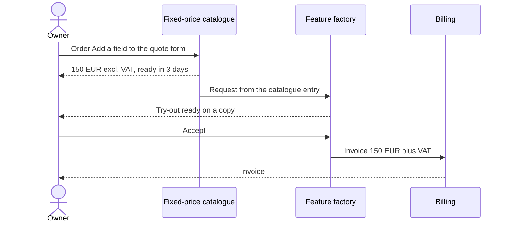

🏠 [Specs](../../../../README.md) › 🧩 [Functional capabilities](../../../README.md) ›
🏭 [F19 Feature factory (hosted edition)](../../README.md) › 📝 [Use cases](../README.md) ›
📝 [Use cases: FL-F19-07 Similar features, catalogue, co-funding and maintenance](README.md) ›
📝 UC-F19-28 Order a fixed-price change

# 📝 UC-F19-28 Order a fixed-price change

**Status:** ✅ specified

## Summary

The owner or an administrator orders a small, ready-made change from a catalogue of changes with a fixed price and a
delivery delay (a new field on a form, a column on a report, a tweak of a document template, a simple rule). The price
shown is the price charged, whatever the work turns out to be, and the change goes through the same build, checks,
try-out and acceptance as any feature.

## Personas

- [U13 Owner](../../../../01-users/personas/u13-owner.md)
- [U07 Administrator](../../../../01-users/personas/u07-administrator.md)

## Goal

A small change is ordered in a minute at a known price and date, with no specification to write and no quote to
negotiate.

## Trigger

The owner or an administrator sees a catalogue change that fits, or the chatbot proposes one.

## Frequency

A few a year per company.

## Preconditions

- The company's hosted subscription is active and the person may order features
  ([BR-F19-08](../../business-rules/br-f19-08-ordered-by-owner-or-admin.md)).
- The catalogue holds the change with its price and delay, kept by the simple-ERP team in a catalogue file.

## Postconditions

- **Succeeded:** the order is saved ([E-F19-17 Catalogue change](../../data/e-f19-17-catalogue-change.md)) with the
  price and delay shown, and a feature request is opened that skips the quote
  ([E-F19-01 Feature request](../../data/e-f19-01-feature-request.md)); billing starts only at acceptance
  ([BR-F19-16](../../business-rules/br-f19-16-nothing-charged-without-an-accepted-feature.md)).
- **Failed:** nothing is ordered and nothing is charged; the screen says why (spending limit, no right to order).

## Main flow

1. The owner opens the fixed-price catalogue
   ([S-F19-27](../../screens/07-catalogue-and-co-funding/s-f19-27-fixed-price-catalogue.md)) and filters the changes by
   area (forms, reports, documents, rules).
2. The owner opens a change to read what it does, an example of before and after, its fixed price and its delivery
   delay.
3. The owner or an administrator chooses where it applies (which form, which report) and orders it, within the company's
   spending limit ([UC-F19-03](../01-describe-and-order/uc-f19-03-accept-the-quote.md)).
4. simple-ERP freezes the price and the committed date in the order
   ([BR-F19-21](../../business-rules/br-f19-21-fixed-price-changes-keep-their-price.md)) and opens a feature request
   that goes straight to generation
   ([UC-F19-04](../02-build-and-check/uc-f19-04-generate-the-plugin-in-the-sandbox.md)).
5. The factory builds, checks and signs the change as a plugin
   ([UC-F19-05](../02-build-and-check/uc-f19-05-run-the-automatic-checks.md),
   [UC-F19-06](../02-build-and-check/uc-f19-06-review-and-sign-the-feature.md)); the owner tries it on a copy
   ([UC-F19-07](../03-try-install-and-maintain/uc-f19-07-try-the-feature-on-a-copy-of-the-data.md)).
6. The owner accepts it; the fixed price is invoiced with the right VAT
   ([UC-F19-16](../05-bill-and-credit/uc-f19-16-invoice-features-with-the-right-vat.md)); a refusal closes the order
   with no charge.

## Alternative flows

- 3a. The change needs more than the catalogue offers (another place, another rule): the chatbot turns it into a normal
  feature request with a quote ([UC-F19-02](../01-describe-and-order/uc-f19-02-refine-the-feature-with-the-chatbot.md)).
- 5a. The delay is missed: the delay rules of
  [UC-F19-21](../01-describe-and-order/uc-f19-21-commit-to-a-delivery-date-and-handle-delays.md) apply and the price
  stays.
- 6a. The owner asks for a small correction after the try-out: it is part of the order, not a new price.

## Error flows

- 3e. The price is over the company's spending limit: the order waits for the owner's approval.
- 4e. The catalogue price changed while the order was open: the order keeps the price it was made at.
- 5e. The generated change fails its checks twice: the factory team looks at it and the owner is told the new date; the
  price does not move.
- Any step: a service does not answer; the call is retried first
  ([BR-F3-32](../../../f03-assistant/business-rules/br-f03-32-retry-before-an-error.md)), then the message follows the
  error pattern ([D122](../../../../06-decisions/ux/d122-error-message-standard.md)) and what the user typed stays on
  the screen.

## Business rules

- [BR-F19-21](../../business-rules/br-f19-21-fixed-price-changes-keep-their-price.md)
- [BR-F19-08](../../business-rules/br-f19-08-ordered-by-owner-or-admin.md)
- [BR-F19-16](../../business-rules/br-f19-16-nothing-charged-without-an-accepted-feature.md)
- [BR-F19-02](../../business-rules/br-f19-02-feature-is-a-plugin.md)

## Entities

- [E-F19-17 Catalogue change](../../data/e-f19-17-catalogue-change.md): created, changed
- [E-F19-01 Feature request](../../data/e-f19-01-feature-request.md): created, the request without a quote
- [E-F19-02 Feature specification](../../data/e-f19-02-feature-specification.md): created, the specification from the
  catalogue entry
- [E-F19-09 Hosted invoice](../../data/e-f19-09-hosted-invoice.md): created, the invoice at acceptance
- [E-F19-11 Delivery commitment](../../data/e-f19-11-delivery-commitment.md): created, the delivery commitment

## Permissions

The owner and the administrators order. Accounting reads the orders and their invoices; the hosting engineer
reads the delivery dates.

## Notifications

The owner, by email and in the app: the order's committed date, the try-out ready, a delay.

## Audit events

Each order with its frozen price and date, each change of its state, each acceptance or refusal, with who and when.

## AI involvement

No AI step of its own. The AI assistant may open the screen and prefill it from the user's words; the user checks and
confirms ([BR-F3-07](../../../f03-assistant/business-rules/br-f03-07-no-deletes-no-irreversible-acts.md)).

## API, MCP and A2A exposure

T5 operations of the capability for the personas above: create, read, update and list. The MCP tool of the
capability may read and propose, never confirm alone. No A2A skill.

## Screens

- [S-F19-27](../../screens/07-catalogue-and-co-funding/s-f19-27-fixed-price-catalogue.md)

## Flowchart

See
[FL-F19-07 Similar features, catalogue, co-funding and maintenance](../../flows/fl-f19-07-catalogue-and-co-funding.md#flowchart).

## Sequence diagram

## Acceptance criteria

1. **Given** a catalogue change at 150 EUR and 3 days **when** the owner orders it **then** the order freezes 150 EUR
   and the committed date.
2. **Given** a change that takes longer than planned **when** the work ends **then** the customer is charged 150 EUR and
   no more.
3. **Given** a price raised in the catalogue after an order **when** the order is invoiced **then** the older price is
   charged.
4. **Given** a change refused at the try-out **when** the owner refuses it **then** the order closes with no charge.

## Non-functional notes

The screen answers within 2 seconds for 10,000 records; every change is audited.

## Regulatory references

The price is shown excluding VAT with the VAT of the customer's country added on the invoice
([CR-FR-015](../../../../10-country-packs/france/invoicing/cr-fr-015-invoice-mandatory-mentions.md),
[CR-FR-100](../../../../10-country-packs/france/tax-and-vat/cr-fr-100-vat-on-services-abroad.md)); a business customer's
price shown before ordering is the price charged. The AGPL source of the change is available as for any feature
([BR-F19-17](../../business-rules/br-f19-17-generated-code-is-agpl-and-stays-usable.md)).

Prices come from the hosted edition's price catalogue, a data file kept by the simple-ERP team, never from the
specification
([D566](../../../../06-decisions/foundations/d566-answers-of-2026-11-15-after-the-benchmark-gap-round.md)); the amounts
on this page are examples.

## Related use cases

- [UC-F19-27](uc-f19-27-see-similar-features-before-ordering.md)
- [UC-F19-29 Co-fund a feature](uc-f19-29-co-fund-a-feature.md)
- [UC-F19-27](uc-f19-27-see-similar-features-before-ordering.md)
- [UC-F19-02](../01-describe-and-order/uc-f19-02-refine-the-feature-with-the-chatbot.md)
- [UC-F19-03 Accept the quote](../01-describe-and-order/uc-f19-03-accept-the-quote.md)
- [UC-F19-16](../05-bill-and-credit/uc-f19-16-invoice-features-with-the-right-vat.md)
- [UC-F19-22](../06-delivery-and-refunds/uc-f19-22-refund-when-acceptance-fails.md)
- [UC-F19-30](uc-f19-30-subscribe-to-a-feature-maintenance-plan.md)

## Open questions

None.

---

⬅️ [UC-F19-27 See similar features before ordering](uc-f19-27-see-similar-features-before-ordering.md) ·
⬆️ [Up](README.md) · ➡️ [UC-F19-29 Co-fund a feature](uc-f19-29-co-fund-a-feature.md)
