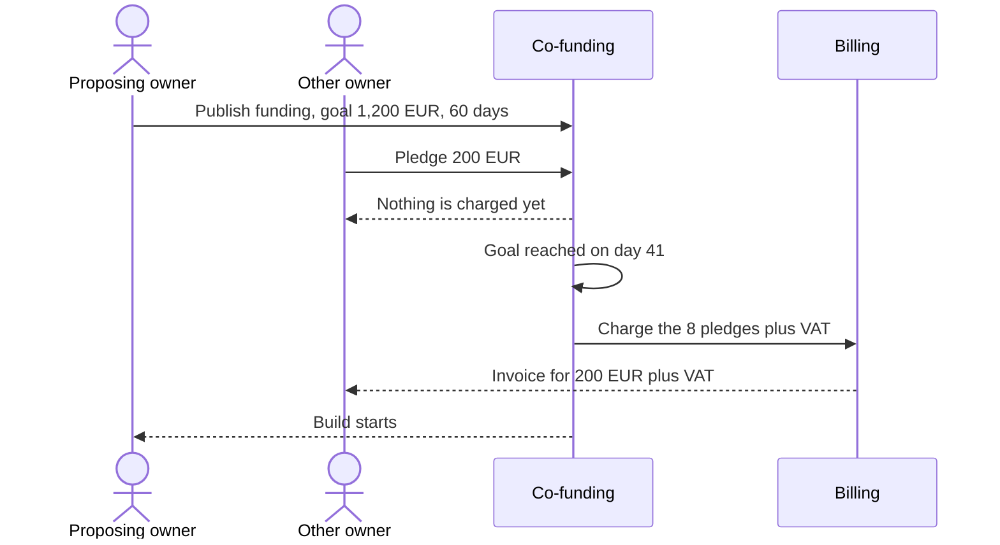

🏠 [Specs](../../../../README.md) › 🧩 [Functional capabilities](../../../README.md) ›
🏭 [F19 Feature factory (hosted edition)](../../README.md) › 📝 [Use cases](../README.md) ›
📝 [Use cases: FL-F19-07 Similar features, catalogue, co-funding and maintenance](README.md) ›
📝 UC-F19-29 Co-fund a feature

# 📝 UC-F19-29 Co-fund a feature

**Status:** ✅ specified

## Summary

Several hosted customers who want the same feature share its cost. One owner proposes a feature that may be shared, the
feature is shown to other customers with its goal and its deadline, and each pledges an amount. The pledges are charged
only if the goal is met by the deadline; then the factory builds the feature and every pledger gets it.

## Personas

- [U13 Owner](../../../../01-users/personas/u13-owner.md)

## Goal

A feature too expensive for one company is built because enough companies want it, and nobody pays for a feature that is
not built.

## Trigger

An owner agrees that a requested feature may be shared and opens a funding, or another owner opens a funding page to
pledge.

## Frequency

A few funding goals a year; a pledge takes a minute.

## Preconditions

- The feature request has an agreed specification and a quote that is the funding goal
  ([E-F19-02 Feature specification](../../data/e-f19-02-feature-specification.md),
  [UC-F19-03](../01-describe-and-order/uc-f19-03-accept-the-quote.md)).
- The proposing owner accepted the promotion terms
  ([BR-F19-10](../../business-rules/br-f19-10-promotion-needs-terms.md)) and the specification passed the genericity and
  privacy review ([UC-F19-13](../04-promote/uc-f19-13-review-a-promotion-for-genericity-and-privacy.md)).

## Postconditions

- **Succeeded:** each pledge is saved ([E-F19-18 Funding pledge](../../data/e-f19-18-funding-pledge.md)); when the goal
  is met the pledges are charged and the feature is built and promoted to the pledgers; when the deadline passes without
  the goal every pledge lapses.
- **Failed:** the pledge is not saved; nothing is authorised and nothing is charged.

## Main flow

1. The proposing owner opens the co-funding screen
   ([S-F19-28 Co-funding](../../screens/07-catalogue-and-co-funding/s-f19-28-co-funding.md)) and publishes the feature's
   funding: the specification in plain words, the goal, the deadline (60 days by default) and what each pledger gets.
2. Another owner reads the page, picks an amount (a minimum is set) and pledges; nothing is charged.
3. simple-ERP shows the amount raised, the number of pledgers and the days left, without naming the pledgers to each
   other.
4. When the pledges reach the goal, simple-ERP charges every pledge at once, with the right VAT
   ([BR-F19-22](../../business-rules/br-f19-22-pledges-are-charged-only-when-the-goal-is-met.md),
   [UC-F19-16](../05-bill-and-credit/uc-f19-16-invoice-features-with-the-right-vat.md)).
5. The factory builds, checks and signs the feature as any other
   ([UC-F19-04](../02-build-and-check/uc-f19-04-generate-the-plugin-in-the-sandbox.md),
   [UC-F19-06](../02-build-and-check/uc-f19-06-review-and-sign-the-feature.md)); each pledger tries it and accepts it on
   their own copy.
6. The promoted feature is published to the hosted store
   ([UC-F19-14](../04-promote/uc-f19-14-publish-it-in-the-hosted-store.md)); pledgers have it as pledged, other
   customers by the store's terms.

## Alternative flows

- 2a. A pledger withdraws before the goal is met: the pledge is cancelled and the amount raised drops.
- 4a. The pledges exceed the goal: the extra is shared back as a lower charge to every pledger, in proportion to their
  pledge.
- 5a. A pledger refuses the feature at the try-out: their charge is refunded as for any feature
  ([UC-F19-22](../06-delivery-and-refunds/uc-f19-22-refund-when-acceptance-fails.md)).

## Error flows

- 4e. The deadline passes with the goal not reached: every pledge lapses, nothing is charged, and pledgers and the
  proposer are told.
- 4e. A pledger's payment fails after the goal is met: the pledge is retried once, then lapses and the goal is
  re-checked; if it is no longer met the others are refunded.
- 5e. The generated feature fails its checks beyond the committed date: the delay rules apply to every pledger
  ([UC-F19-21](../01-describe-and-order/uc-f19-21-commit-to-a-delivery-date-and-handle-delays.md)).
- Any step: a service does not answer; the call is retried first
  ([BR-F3-32](../../../f03-assistant/business-rules/br-f03-32-retry-before-an-error.md)), then the message follows the
  error pattern ([D122](../../../../06-decisions/ux/d122-error-message-standard.md)) and what the user typed stays on
  the screen.

## Business rules

- [BR-F19-22](../../business-rules/br-f19-22-pledges-are-charged-only-when-the-goal-is-met.md)
- [BR-F19-10](../../business-rules/br-f19-10-promotion-needs-terms.md)
- [BR-F19-16](../../business-rules/br-f19-16-nothing-charged-without-an-accepted-feature.md)
- [BR-F19-01](../../business-rules/br-f19-01-factory-follows-the-country-pack.md)

## Entities

- [E-F19-18 Funding pledge](../../data/e-f19-18-funding-pledge.md): created, changed, charged
- [E-F19-02 Feature specification](../../data/e-f19-02-feature-specification.md): read, the specification and the goal
- [E-F19-07 Feature promotion](../../data/e-f19-07-feature-promotion.md): created, the promotion of the feature
- [E-F19-09 Hosted invoice](../../data/e-f19-09-hosted-invoice.md): created, one invoice per charged pledge
- [E-F19-12 Feature refund](../../data/e-f19-12-feature-refund.md): created, a refund when acceptance fails

## Permissions

The owner of a company pledges or withdraws. The proposing owner publishes the funding. Accounting reads the
pledges and their invoices.

## Notifications

Pledgers, by email: the goal was met, the goal was not met, the feature is ready to try. The proposer: the amount raised
each week.

## Audit events

Each funding published, pledge made, withdrawn, charged, lapsed or refunded, the goal's check and the date, with who.

## AI involvement

No AI step of its own. The AI assistant may open the screen and prefill it from the user's words; the user checks and
confirms ([BR-F3-07](../../../f03-assistant/business-rules/br-f03-07-no-deletes-no-irreversible-acts.md)).

## API, MCP and A2A exposure

T5 operations of the capability for the personas above: create, read, update and list. The MCP tool of the
capability may read and propose, never confirm alone. No A2A skill.

## Screens

- [S-F19-28 Co-funding](../../screens/07-catalogue-and-co-funding/s-f19-28-co-funding.md)

## Flowchart

See
[FL-F19-07 Similar features, catalogue, co-funding and maintenance](../../flows/fl-f19-07-catalogue-and-co-funding.md#flowchart).

## Sequence diagram

## Acceptance criteria

1. **Given** a funding with a goal of 1,200 EUR **when** pledges total 900 EUR on the deadline **then** every pledge
   lapses and nothing is charged.
2. **Given** a pledge made before the goal is met **when** the pledger looks at their account **then** nothing has been
   charged.
3. **Given** pledges that reach the goal on day 41 **when** the goal is met **then** every pledge is charged with the
   VAT of the pledger's country.
4. **Given** a pledger who withdraws on day 20 **when** they confirm **then** the pledge is cancelled and the amount
   raised drops.

## Non-functional notes

The screen answers within 2 seconds for 10,000 records; every change is audited.

## Regulatory references

A pledge towards a feature is a payment for a service: the VAT of each pledge follows the pledger's country
and status as for any service sold to a business
([CR-FR-100](../../../../10-country-packs/france/tax-and-vat/cr-fr-100-vat-on-services-abroad.md),
[CR-FR-015](../../../../10-country-packs/france/invoicing/cr-fr-015-invoice-mandatory-mentions.md)), and a refund is a
credit note ([CR-FR-200](../../../../10-country-packs/france/invoicing/cr-fr-200-credit-notes.md)). Charging only when
the goal is met is a condition of the offer, stated before the pledge. The wording for consumers, if ever offered, is
not covered. The France-pack rule on VAT on co-funded features is written later.

## Related use cases

- [UC-F19-28 Order a fixed-price change](uc-f19-28-order-a-fixed-price-change.md)
- [UC-F19-30](uc-f19-30-subscribe-to-a-feature-maintenance-plan.md)
- [UC-F19-27](uc-f19-27-see-similar-features-before-ordering.md)
- [UC-F19-12](../04-promote/uc-f19-12-promote-the-feature-to-every-hosted-customer.md)
- [UC-F19-13](../04-promote/uc-f19-13-review-a-promotion-for-genericity-and-privacy.md)
- [UC-F19-14](../04-promote/uc-f19-14-publish-it-in-the-hosted-store.md)
- [UC-F19-22](../06-delivery-and-refunds/uc-f19-22-refund-when-acceptance-fails.md)
- [UC-F19-16](../05-bill-and-credit/uc-f19-16-invoice-features-with-the-right-vat.md)
- [UC-F19-15](../05-bill-and-credit/uc-f19-15-receive-the-promotion-credit.md)

## Open questions

None.

---

⬅️ [UC-F19-28 Order a fixed-price change](uc-f19-28-order-a-fixed-price-change.md) · ⬆️ [Up](README.md) ·
➡️ [UC-F19-30 Subscribe to a feature maintenance plan](uc-f19-30-subscribe-to-a-feature-maintenance-plan.md)
