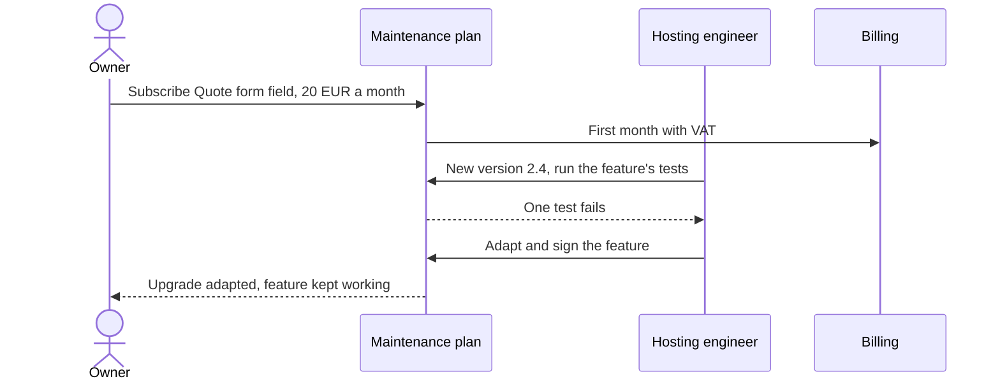

🏠 [Specs](../../../../README.md) › 🧩 [Functional capabilities](../../../README.md) ›
🏭 [F19 Feature factory (hosted edition)](../../README.md) › 📝 [Use cases](../README.md) ›
📝 [Use cases: FL-F19-07 Similar features, catalogue, co-funding and maintenance](README.md) ›
📝 UC-F19-30 Subscribe to a feature maintenance plan

# 📝 UC-F19-30 Subscribe to a feature maintenance plan

**Status:** ✅ specified

## Summary

The owner subscribes a feature to a maintenance plan. A feature bought at a fixed price, co-funded or taken as source is
not on the monthly price that keeps a feature working across upgrades, so the plan pays for that care: adapting the
feature to each SimpleERP upgrade and applying security fixes, for a monthly price shown before subscribing.

## Personas

- [U13 Owner](../../../../01-users/personas/u13-owner.md)

## Goal

A feature that was paid once keeps working after every upgrade, at a price the owner knows and can stop at the end of
any month.

## Trigger

A fixed-price change or a co-funded feature is accepted, a feature's source is handed over
([UC-F19-23](../03-try-install-and-maintain/uc-f19-23-get-the-source-of-a-feature.md)), or the owner asks for a plan.

## Frequency

Once per feature; a monthly renewal.

## Preconditions

- The feature is installed and belongs to the company
  ([E-F19-04 Generated plugin version](../../data/e-f19-04-generated-plugin-version.md)).
- The feature is not on the monthly feature price, which already includes the upkeep
  ([BR-F19-07](../../business-rules/br-f19-07-kept-working-across-upgrades.md)).

## Postconditions

- **Succeeded:** the plan is saved
  ([E-F19-19 Feature maintenance plan](../../data/e-f19-19-feature-maintenance-plan.md)); each upgrade is tested against
  the feature and the feature is adapted before the customer's upgrade; the plan renews monthly and ends at the end of
  the month on cancellation.
- **Failed:** no plan is created and nothing is billed; the feature keeps working until the next upgrade breaks it, and
  the owner is told so.

## Main flow

1. The owner opens the maintenance plan screen
   ([S-F19-29](../../screens/07-catalogue-and-co-funding/s-f19-29-maintenance-plan.md)) and sees the features with and
   without a plan.
2. The owner opens a feature without a plan: the screen shows what the plan covers (adaptation to upgrades, security
   fixes), what it does not (new functions) and the monthly price.
3. The owner subscribes; the plan starts the next day and its first month is billed with the right VAT
   ([UC-F19-16](../05-bill-and-credit/uc-f19-16-invoice-features-with-the-right-vat.md)).
4. For each new SimpleERP version, the hosting engineer's tests run on the feature
   ([UC-F19-17](../02-build-and-check/uc-f19-17-keep-features-working-across-upgrades.md)); a failure is fixed within
   the plan and the owner is told.
5. A security fix of the feature is applied and signed without a new order
   ([UC-F19-06](../02-build-and-check/uc-f19-06-review-and-sign-the-feature.md)).
6. The owner cancels at any time; the plan ends at the end of the month and the feature is no longer adapted.

## Alternative flows

- 3a. The owner wants a new function: it is a change, ordered from the catalogue or by a quote
  ([UC-F19-28](uc-f19-28-order-a-fixed-price-change.md),
  [UC-F19-09](../03-try-install-and-maintain/uc-f19-09-ask-for-changes.md)), not part of the plan.
- 6a. The owner takes the source ([UC-F19-23](../03-try-install-and-maintain/uc-f19-23-get-the-source-of-a-feature.md))
  and keeps the plan: the factory keeps adapting the hosted copy only.
- 6b. The owner cancels and subscribes again later: the plan restarts at the price then in force.

## Error flows

- 4e. An upgrade cannot be adapted in time: the upgrade for this company is held back with the reason, and the owner
  decides between waiting and switching the feature off.
- 3e. The monthly payment fails: the plan is suspended after the usual reminders
  ([UC-F19-26](../05-bill-and-credit/uc-f19-26-reconcile-feature-payments-and-follow-up-unpaid-invoices.md)) and the
  feature is no longer adapted.
- 6e. The feature is withdrawn as harmful ([UC-F19-18](../04-promote/uc-f19-18-withdraw-a-harmful-feature.md)): the plan
  ends and the unused days are credited.
- Any step: a service does not answer; the call is retried first
  ([BR-F3-32](../../../f03-assistant/business-rules/br-f03-32-retry-before-an-error.md)), then the message follows the
  error pattern ([D122](../../../../06-decisions/ux/d122-error-message-standard.md)) and what the user typed stays on
  the screen.

## Business rules

- [BR-F19-23](../../business-rules/br-f19-23-maintenance-covers-upgrades-within-the-plan.md)
- [BR-F19-07](../../business-rules/br-f19-07-kept-working-across-upgrades.md)
- [BR-F19-09 300 EUR a month excluding VAT](../../business-rules/br-f19-09-price-excludes-vat.md)
- [BR-F19-16](../../business-rules/br-f19-16-nothing-charged-without-an-accepted-feature.md)

## Entities

- [E-F19-19 Feature maintenance plan](../../data/e-f19-19-feature-maintenance-plan.md): created, changed, ended
- [E-F19-04 Generated plugin version](../../data/e-f19-04-generated-plugin-version.md): read, the version kept working
- [E-F19-03 Feature subscription](../../data/e-f19-03-feature-subscription.md): read, the features on the monthly price
- [E-F19-09 Hosted invoice](../../data/e-f19-09-hosted-invoice.md): created, the monthly invoice
- [E-F19-13 Code handover](../../data/e-f19-13-code-handover.md): read, a source handed over

## Permissions

The owner subscribes and cancels. Administrators read the plans; accounting reads their invoices; the hosting
engineer reads the features covered.

## Notifications

The owner, by email and in the app: an upgrade was adapted, an upgrade is held back, the plan ends at the end of the
month.

## Audit events

Each plan subscribed, renewed and cancelled, each upgrade tested and its result, each fix applied, each invoice, with
who and when.

## AI involvement

No AI step of its own. The AI assistant may open the screen and prefill it from the user's words; the user checks and
confirms ([BR-F3-07](../../../f03-assistant/business-rules/br-f03-07-no-deletes-no-irreversible-acts.md)).

## API, MCP and A2A exposure

T5 operations of the capability for the personas above: create, read, update and list. The MCP tool of the
capability may read and propose, never confirm alone. No A2A skill.

## Screens

- [S-F19-29](../../screens/07-catalogue-and-co-funding/s-f19-29-maintenance-plan.md)

## Flowchart

See
[FL-F19-07 Similar features, catalogue, co-funding and maintenance](../../flows/fl-f19-07-catalogue-and-co-funding.md#flowchart).

## Sequence diagram

## Acceptance criteria

1. **Given** a feature bought at a fixed price with no plan **when** a new version comes **then** the owner is warned
   that it is not tested.
2. **Given** a feature on a plan **when** a new version comes **then** the feature is tested and adapted before the
   customer's upgrade.
3. **Given** an owner who cancels on the 10th **when** the month ends **then** the plan ends at the end of the month,
   not before.
4. **Given** a request for a new function **when** the owner asks within the plan **then** it is offered as a change,
   not covered by the plan.

## Non-functional notes

The screen answers within 2 seconds for 10,000 records; every change is audited.

## Regulatory references

A monthly plan is a service contract billed with the VAT of the customer's country and cancellable at the end
of any month as for features
([BR-F19-09 300 EUR a month excluding VAT](../../business-rules/br-f19-09-price-excludes-vat.md),
[CR-FR-015](../../../../10-country-packs/france/invoicing/cr-fr-015-invoice-mandatory-mentions.md)). Generated code
stays open under its licence
([CR-FR-203](../../../../10-country-packs/france/digital/cr-fr-203-software-copyright-assignment.md)).

Prices come from the hosted edition's price catalogue, a data file kept by the SimpleERP team, never from the
specification
([D566](../../../../06-decisions/foundations/d566-answers-of-2026-11-15-after-the-benchmark-gap-round.md)); the amounts
on this page are examples.

## Related use cases

- [UC-F19-29 Co-fund a feature](uc-f19-29-co-fund-a-feature.md)
- [UC-F19-17](../02-build-and-check/uc-f19-17-keep-features-working-across-upgrades.md)
- [UC-F19-23](../03-try-install-and-maintain/uc-f19-23-get-the-source-of-a-feature.md)
- [UC-F19-28 Order a fixed-price change](uc-f19-28-order-a-fixed-price-change.md)
- [UC-F19-29 Co-fund a feature](uc-f19-29-co-fund-a-feature.md)
- [UC-F19-16](../05-bill-and-credit/uc-f19-16-invoice-features-with-the-right-vat.md)
- [UC-F19-11](../03-try-install-and-maintain/uc-f19-11-cancel-a-feature-and-export-its-data.md)

## Open questions

None.

---

⬅️ [UC-F19-29 Co-fund a feature](uc-f19-29-co-fund-a-feature.md) · ⬆️ [Up](README.md)
