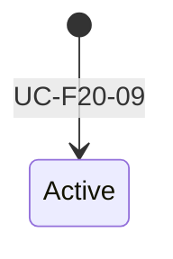

🏠 [Specs](../../../README.md) › 🧩 [Functional capabilities](../../README.md) ›
🛟 [F20 Hosted support assistant (hosted edition)](../README.md) › 🗃️ [Data](README.md) › 🗃️ E-F20-01 Support request

# 🗃️ E-F20-01 Support request

**Status:** ✅ specified

## Purpose

A customer's problem.

## Fields

| Name | Type | Required | Validation | Default | Example | Personal data | Custom fields |
|---|---|---|---|---|---|---|---|
| company, author, title, status, plan | records | yes | BR-F20-02 | open | Acme, admin, invoices fail, waiting for you | yes | no |

## Relations

As its use cases.

## Lifecycle

## Indexes and search

By number, date, partner.

## Retention

2 years after closing, then erased:
[CR-FR-052 Personal data kept no longer than needed](../../../10-country-packs/france/data-protection/cr-fr-052-storage-limitation.md).

## Audit

Every change.

## Import and export

CSV, FEC where relevant.

## Used by

- [UC-F20-01](../use-cases/01-talk-it-through/uc-f20-01-report-a-problem-in-plain-words.md)
- [UC-F20-02](../use-cases/01-talk-it-through/uc-f20-02-answer-clarifying-questions.md)
- [UC-F20-08](../use-cases/03-incidents/uc-f20-08-escalate-to-an-engineer.md)
- [UC-F20-09](../use-cases/01-talk-it-through/uc-f20-09-follow-the-request.md)
- [UC-F20-20](../use-cases/04-govern-the-assistant/uc-f20-20-export-a-support-conversation.md)
- [UC-F20-28 Report something broken from the screen](../use-cases/07-employees-help/uc-f20-28-report-something-broken-from-the-screen.md)

## Open questions

None.

---

⬆️ [Up](README.md) · ➡️ [E-F20-02 Message](e-f20-02-message.md)
