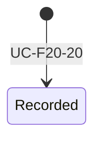

🏠 [Specs](../../../README.md) › 🧩 [Functional capabilities](../../README.md) ›
🛟 [F20 Hosted support assistant (hosted edition)](../README.md) › 🗃️ [Data](README.md) › 🗃️ E-F20-02 Message

# 🗃️ E-F20-02 Message

**Status:** ✅ specified

## Purpose

A message of the conversation.

## Fields

| Name | Type | Required | Validation | Default | Example | Personal data | Custom fields |
|---|---|---|---|---|---|---|---|
| request, author, text, sent | records | yes | BR-F20-07 | - | R-41, assistant, 'We are on it.', 10:02 | yes | no |

## Relations

As its use cases.

## Lifecycle

## Indexes and search

By number, date, partner.

## Retention

2 years after closing, then erased:
[CR-FR-052 Personal data kept no longer than needed](../../../10-country-packs/france/data-protection/cr-fr-052-storage-limitation.md).

## Audit

Every change.

## Import and export

CSV, FEC where relevant.

## Used by

- [UC-F20-02](../use-cases/01-talk-it-through/uc-f20-02-answer-clarifying-questions.md)
- [UC-F20-05](../use-cases/02-diagnose-and-fix/uc-f20-05-explain-the-cause-simply.md)
- [UC-F20-09](../use-cases/01-talk-it-through/uc-f20-09-follow-the-request.md)
- [UC-F20-12](../use-cases/01-talk-it-through/uc-f20-12-answer-how-to-questions-from-the-documentation.md)
- [UC-F20-20](../use-cases/04-govern-the-assistant/uc-f20-20-export-a-support-conversation.md)
- [UC-F20-25 Get support in French or English](../use-cases/07-employees-help/uc-f20-25-get-support-in-french-or-english.md)
- [UC-F20-27 Get help on a task from the phone](../use-cases/07-employees-help/uc-f20-27-get-help-on-a-task-from-the-phone.md)

## Open questions

None.

---

⬅️ [E-F20-01 Support request](e-f20-01-support-request.md) · ⬆️ [Up](README.md) ·
➡️ [E-F20-03 Screenshot](e-f20-03-screenshot.md)
