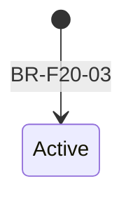

🏠 [Specs](../../../README.md) › 🧩 [Functional capabilities](../../README.md) ›
🛟 [F20 Hosted support assistant (hosted edition)](../README.md) › 🗃️ [Data](README.md) › 🗃️ E-F20-04 Diagnosis

# 🗃️ E-F20-04 Diagnosis

**Status:** ✅ specified

## Purpose

What the AI assistant read and concluded.

## Fields

| Name | Type | Required | Validation | Default | Example | Personal data | Custom fields |
|---|---|---|---|---|---|---|---|
| request, resources read, cause, confidence | records | yes | BR-F20-03 | - | R-41, invoices pod, out of memory, high | no | no |

## Relations

As its use cases.

## Lifecycle

## Indexes and search

By number, date, partner.

## Retention

Kept for the period of its kind of record in the country pack (D293), or else its kind's default in the
[retention schedule](../../../05-non-functional/data-retention.md).

## Audit

Every change.

## Import and export

CSV, FEC where relevant.

## Used by

- [UC-F20-04](../use-cases/02-diagnose-and-fix/uc-f20-04-diagnose-on-the-cluster.md)
- [UC-F20-05](../use-cases/02-diagnose-and-fix/uc-f20-05-explain-the-cause-simply.md)
- [UC-F20-07](../use-cases/02-diagnose-and-fix/uc-f20-07-apply-and-verify-the-fix.md)
- [UC-F20-14](../use-cases/02-diagnose-and-fix/uc-f20-14-investigate-slowness.md)

## Open questions

None.

---

⬅️ [E-F20-03 Screenshot](e-f20-03-screenshot.md) · ⬆️ [Up](README.md) ·
➡️ [E-F20-05 Cluster reading](e-f20-05-cluster-reading.md)
