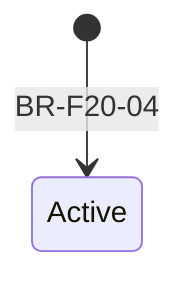

🏠 [Specs](../../../README.md) › 🧩 [Functional capabilities](../../README.md) ›
🛟 [F20 Hosted support assistant (hosted edition)](../README.md) › 🗃️ [Data](README.md) › 🗃️ E-F20-06 Fix proposal

# 🗃️ E-F20-06 Fix proposal

**Status:** ✅ specified

## Purpose

A proposed fix and its approval.

## Fields

| Name | Type | Required | Validation | Default | Example | Personal data | Custom fields |
|---|---|---|---|---|---|---|---|
| request, action, risk, rollback, approved by | records | yes | BR-F20-04, BR-F20-05 | - | R-41, raise memory, low, revert, maintainer M | no | no |

## Relations

As its use cases.

## Lifecycle

## Indexes and search

By number, date, partner.

## Retention

Kept for the period of its kind of record in the country pack (D293), or else its kind's default in the
[retention schedule](../../../05-non-functional/data-retention.md).

## Audit

Every change.

## Import and export

CSV, FEC where relevant.

## Used by

- [UC-F20-06](../use-cases/02-diagnose-and-fix/uc-f20-06-propose-a-fix-for-a-maintainer-s-yes.md)
- [UC-F20-07](../use-cases/02-diagnose-and-fix/uc-f20-07-apply-and-verify-the-fix.md)
- [UC-F20-11](../use-cases/03-incidents/uc-f20-11-warn-before-customers-notice.md)
- [UC-F20-13](../use-cases/02-diagnose-and-fix/uc-f20-13-restore-data-from-a-backup.md)

## Open questions

None.

---

⬅️ [E-F20-05 Cluster reading](e-f20-05-cluster-reading.md) · ⬆️ [Up](README.md) ·
➡️ [E-F20-07 Service incident](e-f20-07-service-incident.md)
