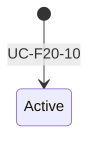

🏠 [Specs](../../../README.md) › 🧩 [Functional capabilities](../../README.md) ›
🛟 [F20 Hosted support assistant (hosted edition)](../README.md) › 🗃️ [Data](README.md) › 🗃️ E-F20-07 Service incident

# 🗃️ E-F20-07 Service incident

**Status:** ✅ specified

## Purpose

An incident affecting one or more customers.

## Fields

| Name | Type | Required | Validation | Default | Example | Personal data | Custom fields |
|---|---|---|---|---|---|---|---|
| title, customers, started, ended, status | records | yes | BR-F20-08 | - | DB slowness, 40, 09:00, 09:40 | no | no |

## Relations

As its use cases.

## Lifecycle

## Indexes and search

By number, date, partner.

## Retention

Kept for the period of its kind of record in the country pack (D293), or else its kind's default in the
[retention schedule](../../../05-non-functional/data-retention.md).

## Audit

Every change.

## Import and export

CSV, FEC where relevant.

## Used by

- [UC-F20-08](../use-cases/03-incidents/uc-f20-08-escalate-to-an-engineer.md)
- [UC-F20-10](../use-cases/03-incidents/uc-f20-10-handle-a-wide-incident-with-a-status-page.md)
- [UC-F20-11](../use-cases/03-incidents/uc-f20-11-warn-before-customers-notice.md)
- [UC-F20-15](../use-cases/03-incidents/uc-f20-15-handle-a-security-incident-or-breach.md)
- [UC-F20-23 Send the written incident report](../use-cases/06-after-an-incident/uc-f20-23-send-the-written-incident-report.md)

## Open questions

None.

---

⬅️ [E-F20-06 Fix proposal](e-f20-06-fix-proposal.md) · ⬆️ [Up](README.md) · ➡️ [E-F20-08 Restore](e-f20-08-restore.md)
