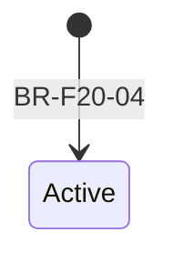

🏠 [Specs](../../../README.md) › 🧩 [Functional capabilities](../../README.md) ›
🛟 [F20 Hosted support assistant (hosted edition)](../README.md) › 🗃️ [Data](README.md) › 🗃️ E-F20-08 Restore

# 🗃️ E-F20-08 Restore

**Status:** ✅ specified

## Purpose

A data restore.

## Fields

| Name | Type | Required | Validation | Default | Example | Personal data | Custom fields |
|---|---|---|---|---|---|---|---|
| company, backup, target, approved by | records | yes | BR-F20-04 | - | Acme, 02:00 backup, copy, maintainer M | no | no |

## Relations

As its use cases.

## Lifecycle

## Indexes and search

By number, date, partner.

## Retention

Kept for the period of its kind of record in the country pack (D293), or else its kind's default in the
[retention schedule](../../../05-non-functional/data-retention.md).

## Audit

Every change.

## Import and export

CSV, FEC where relevant.

## Used by

- [UC-F20-13](../use-cases/02-diagnose-and-fix/uc-f20-13-restore-data-from-a-backup.md)

## Open questions

None.

---

⬅️ [E-F20-07 Service incident](e-f20-07-service-incident.md) · ⬆️ [Up](README.md) ·
➡️ [E-F20-09 Breach record](e-f20-09-breach-record.md)
