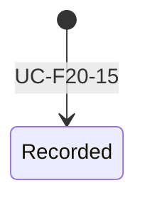

🏠 [Specs](../../../README.md) › 🧩 [Functional capabilities](../../README.md) ›
🛟 [F20 Hosted support assistant (hosted edition)](../README.md) › 🗃️ [Data](README.md) › 🗃️ E-F20-09 Breach record

# 🗃️ E-F20-09 Breach record

**Status:** ✅ specified

## Purpose

The documentation of a breach.

## Fields

| Name | Type | Required | Validation | Default | Example | Personal data | Custom fields |
|---|---|---|---|---|---|---|---|
| incident, nature, people, records, measures, notified | records | yes | BR-F20-10 | - | INC-7, exposure, 120, 340, closed, CNIL | yes | no |

## Relations

As its use cases.

## Lifecycle

## Indexes and search

By number, date, partner.

## Retention

Kept for the period of its kind of record in the country pack (D293), or else its kind's default in the
[retention schedule](../../../05-non-functional/data-retention.md).

## Audit

Every change.

## Import and export

CSV, FEC where relevant.

## Used by

- [UC-F20-15](../use-cases/03-incidents/uc-f20-15-handle-a-security-incident-or-breach.md)

## Open questions

None.

---

⬅️ [E-F20-08 Restore](e-f20-08-restore.md) · ⬆️ [Up](README.md) · ➡️ [E-F20-10 Rating](e-f20-10-rating.md)
