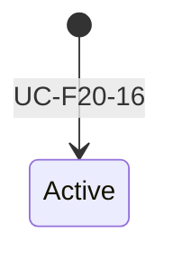

🏠 [Specs](../../../README.md) › 🧩 [Functional capabilities](../../README.md) ›
🛟 [F20 Hosted support assistant (hosted edition)](../README.md) › 🗃️ [Data](README.md) › 🗃️ E-F20-10 Rating

# 🗃️ E-F20-10 Rating

**Status:** ✅ specified

## Purpose

A rating of a request.

## Fields

| Name | Type | Required | Validation | Default | Example | Personal data | Custom fields |
|---|---|---|---|---|---|---|---|
| request, score, comment | records | yes | - | - | R-41, 5, quick | no | no |

## Relations

As its use cases.

## Lifecycle

## Indexes and search

By number, date, partner.

## Retention

Kept for the period of its kind of record in the country pack (D293), or else its kind's default in the
[retention schedule](../../../05-non-functional/data-retention.md).

## Audit

Every change.

## Import and export

CSV, FEC where relevant.

## Used by

- [UC-F20-16](../use-cases/04-govern-the-assistant/uc-f20-16-rate-the-help-and-review-quality.md)

## Open questions

None.

---

⬅️ [E-F20-09 Breach record](e-f20-09-breach-record.md) · ⬆️ [Up](README.md) ·
➡️ [E-F20-11 Assistant policy](e-f20-11-assistant-policy.md)
