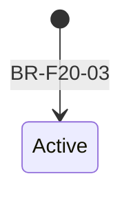

🏠 [Specs](../../../README.md) › 🧩 [Functional capabilities](../../README.md) ›
🛟 [F20 Hosted support assistant (hosted edition)](../README.md) › 🗃️ [Data](README.md) › 🗃️ E-F20-11 Assistant policy

# 🗃️ E-F20-11 Assistant policy

**Status:** ✅ specified

## Purpose

Rights and masking rules.

## Fields

| Name | Type | Required | Validation | Default | Example | Personal data | Custom fields |
|---|---|---|---|---|---|---|---|
| reads, fix kinds, masking rules | records | yes | BR-F20-03, BR-F20-07 | - | logs+events, restart+rollback, emails+keys | no | no |

## Relations

As its use cases.

## Lifecycle

## Indexes and search

By number, date, partner.

## Retention

Kept for the period of its kind of record in the country pack (D293), or else its kind's default in the
[retention schedule](../../../05-non-functional/data-retention.md).

## Audit

Every change.

## Import and export

CSV, FEC where relevant.

## Used by

- [UC-F20-17](../use-cases/04-govern-the-assistant/uc-f20-17-control-and-audit-the-assistant-s-rights.md)
- [UC-F20-18](../use-cases/04-govern-the-assistant/uc-f20-18-mask-personal-data-and-secrets.md)

## Open questions

None.

---

⬅️ [E-F20-10 Rating](e-f20-10-rating.md) · ⬆️ [Up](README.md) · ➡️ [E-F20-12 Support plan](e-f20-12-support-plan.md)
