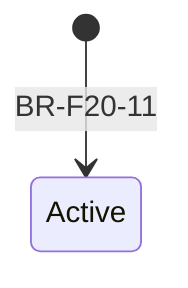

🏠 [Specs](../../../README.md) › 🧩 [Functional capabilities](../../README.md) ›
🛟 [F20 Hosted support assistant (hosted edition)](../README.md) › 🗃️ [Data](README.md) › 🗃️ E-F20-12 Support plan

# 🗃️ E-F20-12 Support plan

**Status:** ✅ specified

## Purpose

Targets per plan.

## Fields

| Name | Type | Required | Validation | Default | Example | Personal data | Custom fields |
|---|---|---|---|---|---|---|---|
| plan, first answer, resolution | records | yes | BR-F20-11 | - | business, 1 hour, 1 day | no | no |

## Relations

As its use cases.

## Lifecycle

## Indexes and search

By number, date, partner.

## Retention

Kept for the period of its kind of record in the country pack (D293), or else its kind's default in the
[retention schedule](../../../05-non-functional/data-retention.md).

## Audit

Every change.

## Import and export

CSV, FEC where relevant.

## Used by

- [UC-F20-19](../use-cases/04-govern-the-assistant/uc-f20-19-choose-a-support-plan-and-see-its-times.md)
- [UC-F20-24 Credit missed service-level targets](../use-cases/06-after-an-incident/uc-f20-24-credit-missed-service-level-targets.md)

## Open questions

None.

---

⬅️ [E-F20-11 Assistant policy](e-f20-11-assistant-policy.md) · ⬆️ [Up](README.md) ·
➡️ [E-F20-13 Maintenance notice](e-f20-13-maintenance-notice.md)
