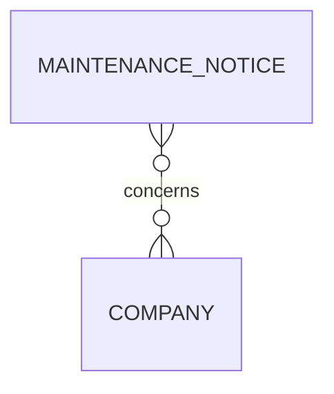
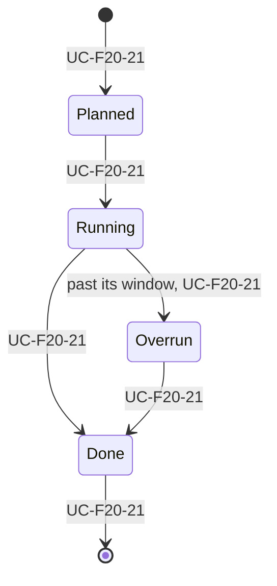

🏠 [Specs](../../../README.md) › 🧩 [Functional capabilities](../../README.md) ›
🛟 [F20 Hosted support assistant (hosted edition)](../README.md) › 🗃️ [Data](README.md) ›
🗃️ E-F20-13 Maintenance notice

# 🗃️ E-F20-13 Maintenance notice

**Status:** 🔄 waiting for the owner

## Purpose

An announcement of planned maintenance with its window and effect.

## Fields

| Name | Type | Required | Validation | Default | Example | Personal data | Custom fields |
|---|---|---|---|---|---|---|---|
| title | text | yes | - | - | Database upgrade | no | no |
| window | date and times | yes | at least the notice delay ahead | - | 2026-11-22 22:00 to 23:00 | no | no |
| effect | text | yes | - | - | service unavailable up to 10 minutes | no | no |
| customers | list | yes | - | all | 340 | no | no |
| status | choice | yes | planned, running, done, overrun | planned | done | no | no |

## Relations

## Lifecycle

## Indexes and search

By date and status.

## Retention

(Proposed) 2 years.

## Audit

Every creation and change, with who, when, the old and the new value.

## Import and export

CSV and JSON export through the API (T5); no bulk import.

## Used by

- [UC-F20-21 Announce planned maintenance](../use-cases/05-maintenance-and-releases/uc-f20-21-announce-planned-maintenance.md)

## Open questions

None.

---

⬅️ [E-F20-12 Support plan](e-f20-12-support-plan.md) · ⬆️ [Up](README.md) ·
➡️ [E-F20-14 Upgrade release note](e-f20-14-upgrade-release-note.md)
