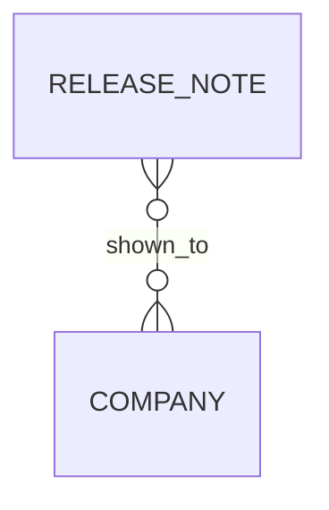
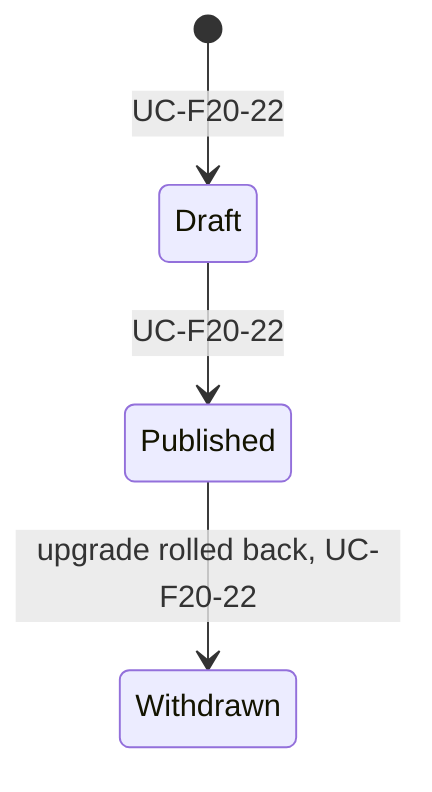

🏠 [Specs](../../../README.md) › 🧩 [Functional capabilities](../../README.md) ›
🛟 [F20 Hosted support assistant (hosted edition)](../README.md) › 🗃️ [Data](README.md) ›
🗃️ E-F20-14 Upgrade release note

# 🗃️ E-F20-14 Upgrade release note

**Status:** ✅ specified

## Purpose

The plain-words notes of an upgrade, by capability and role.

## Fields

| Name | Type | Required | Validation | Default | Example | Personal data | Custom fields |
|---|---|---|---|---|---|---|---|
| version | text | yes | - | - | 1.4 | no | no |
| date | date | yes | before the rollout | - | 2026-11-30 | no | no |
| items | list | yes | capability, role, text | - | F8, accounting, faster bank matching | no | no |
| languages | list | yes | French and English | both | both | no | no |

## Relations

## Lifecycle

## Indexes and search

By version and capability.

## Retention

Kept for the life of the service.

## Audit

Every creation and change, with who, when, the old and the new value.

## Import and export

CSV and JSON export through the API (T5); no bulk import.

## Used by

- [UC-F20-22 Read the release notes of an upgrade](../use-cases/05-maintenance-and-releases/uc-f20-22-read-the-release-notes-of-an-upgrade.md)

## Open questions

None.

---

⬅️ [E-F20-13 Maintenance notice](e-f20-13-maintenance-notice.md) · ⬆️ [Up](README.md) ·
➡️ [E-F20-15 Incident report](e-f20-15-incident-report.md)
