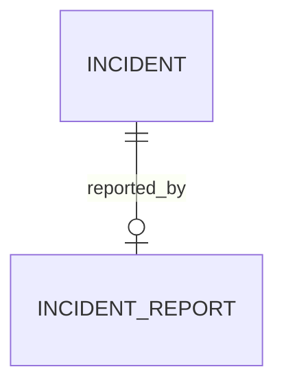
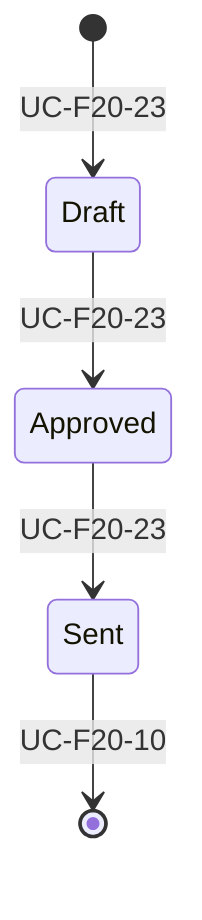

🏠 [Specs](../../../README.md) › 🧩 [Functional capabilities](../../README.md) ›
🛟 [F20 Hosted support assistant (hosted edition)](../README.md) › 🗃️ [Data](README.md) › 🗃️ E-F20-15 Incident report

# 🗃️ E-F20-15 Incident report

**Status:** ✅ specified

## Purpose

The written report sent to customers after an incident.

## Fields

| Name | Type | Required | Validation | Default | Example | Personal data | Custom fields |
|---|---|---|---|---|---|---|---|
| incident | link | yes | an incident | - | INC-12 | no | no |
| timeline | text | yes | - | - | 09:00 slow, 09:40 fixed | no | no |
| cause, measures | text | yes | - | - | disk full on a database node | no | no |
| customers | list | yes | affected | - | 40 | no | no |
| approved, sent | dates | yes | within the delay | - | 2026-11-25 | no | no |

## Relations

## Lifecycle

## Indexes and search

By incident and date.

## Retention

5 years.

## Audit

Every creation and change, with who, when, the old and the new value.

## Import and export

CSV and JSON export through the API (T5); no bulk import.

## Used by

- [UC-F20-23 Send the written incident report](../use-cases/06-after-an-incident/uc-f20-23-send-the-written-incident-report.md)
- [UC-F20-10 Handle a wide incident with a status page](../use-cases/03-incidents/uc-f20-10-handle-a-wide-incident-with-a-status-page.md)

## Open questions

None.

---

⬅️ [E-F20-14 Upgrade release note](e-f20-14-upgrade-release-note.md) · ⬆️ [Up](README.md) ·
➡️ [E-F20-16 Service credit](e-f20-16-service-credit.md)
