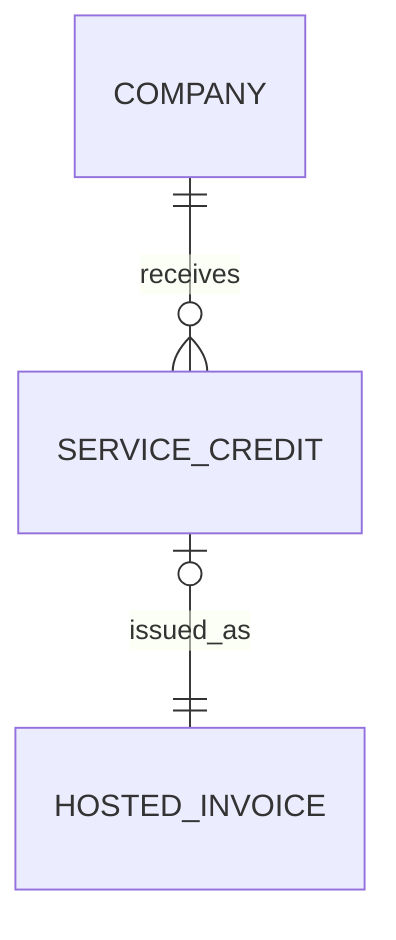
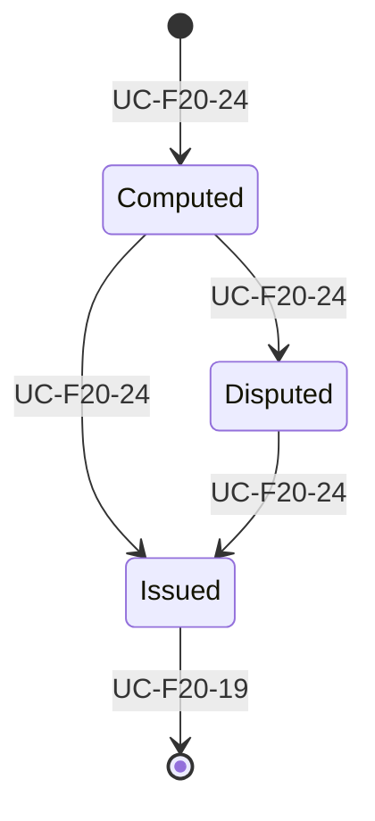

🏠 [Specs](../../../README.md) › 🧩 [Functional capabilities](../../README.md) ›
🛟 [F20 Hosted support assistant (hosted edition)](../README.md) › 🗃️ [Data](README.md) › 🗃️ E-F20-16 Service credit

# 🗃️ E-F20-16 Service credit

**Status:** ✅ specified

## Purpose

A credit for a month whose targets were missed.

## Fields

| Name | Type | Required | Validation | Default | Example | Personal data | Custom fields |
|---|---|---|---|---|---|---|---|
| company | link | yes | - | - | the retail example company | no | no |
| month | month | yes | - | - | 2026-11 | no | no |
| targets missed | list | yes | - | - | availability 99.4 % | no | no |
| percent, amount | number, amount | yes | capped at 50 % | computed | 10 %, 42.00 EUR | no | no |
| credit note | link | when issued | - | - | AV-2026-0101 | no | no |

## Relations

## Lifecycle

## Indexes and search

By company and month.

## Retention

As accounting records: CR-FR-002.

## Audit

Every creation and change, with who, when, the old and the new value.

## Import and export

CSV and JSON export through the API (T5); no bulk import.

## Used by

- [UC-F20-24 Credit missed service-level targets](../use-cases/06-after-an-incident/uc-f20-24-credit-missed-service-level-targets.md)
- [UC-F20-19 Choose a support plan and see its times](../use-cases/04-govern-the-assistant/uc-f20-19-choose-a-support-plan-and-see-its-times.md)

## Open questions

None.

---

⬅️ [E-F20-15 Incident report](e-f20-15-incident-report.md) · ⬆️ [Up](README.md) ·
➡️ [E-F20-17 NIS2 fact sheet](e-f20-17-nis2-fact-sheet.md)
