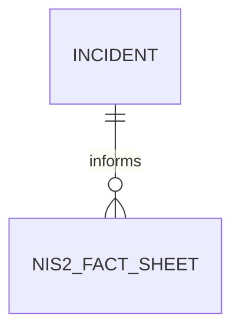
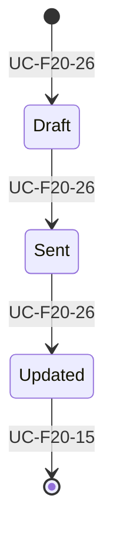

🏠 [Specs](../../../README.md) › 🧩 [Functional capabilities](../../README.md) ›
🛟 [F20 Hosted support assistant (hosted edition)](../README.md) › 🗃️ [Data](README.md) › 🗃️ E-F20-17 NIS2 fact sheet

# 🗃️ E-F20-17 NIS2 fact sheet

**Status:** 🔄 waiting for the owner

## Purpose

The facts a customer under NIS2 needs for its own notification.

## Fields

| Name | Type | Required | Validation | Default | Example | Personal data | Custom fields |
|---|---|---|---|---|---|---|---|
| company | link | yes | declared subject | - | the transport example company | no | no |
| incident | link | yes | - | - | INC-12 | no | no |
| facts | text | yes | start, nature, services, data, measures | - | 09:00, outage, invoicing, none, restored | no | no |
| sent | date and time | yes | within the delay | - | 2026-11-20 16:00 | no | no |
| updates | list | no | - | - | final on 2026-11-25 | no | no |

## Relations

## Lifecycle

## Indexes and search

By incident and company.

## Retention

(Proposed) 5 years.

## Audit

Every creation and change, with who, when, the old and the new value.

## Import and export

CSV and JSON export through the API (T5); no bulk import.

## Used by

- [UC-F20-26 Give the facts for a NIS2 notification](../use-cases/06-after-an-incident/uc-f20-26-give-the-facts-for-a-nis2-notification.md)
- [UC-F20-15 Handle a security incident or breach](../use-cases/03-incidents/uc-f20-15-handle-a-security-incident-or-breach.md)

## Open questions

None.

---

⬅️ [E-F20-16 Service credit](e-f20-16-service-credit.md) · ⬆️ [Up](README.md) ·
➡️ [E-F20-18 Support conversation export](e-f20-18-support-conversation-export.md)
