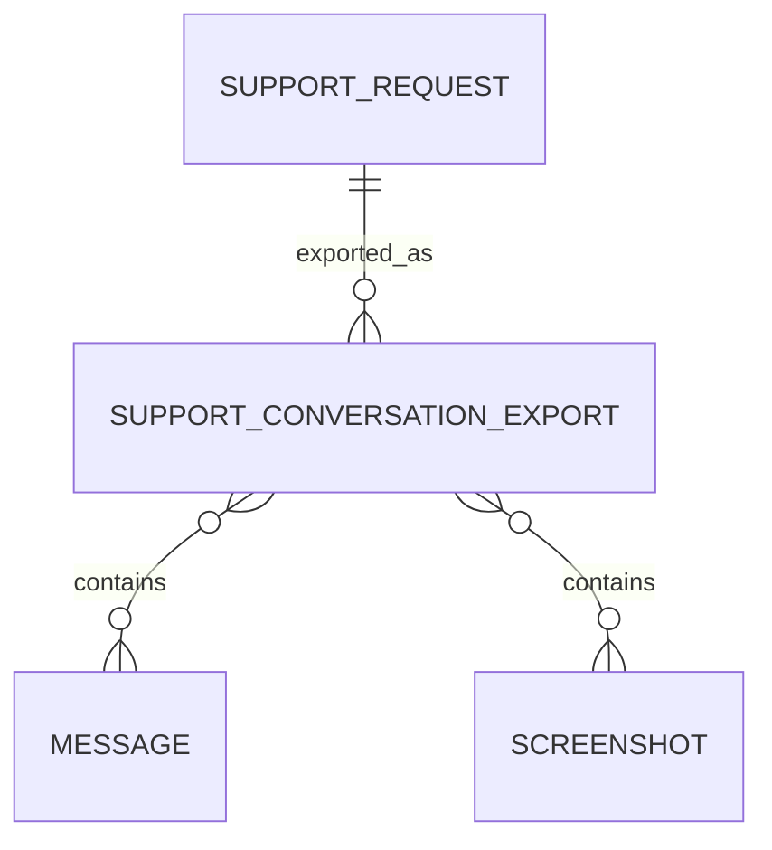
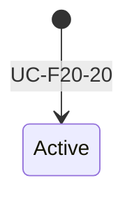

🏠 [Specs](../../../README.md) › 🧩 [Functional capabilities](../../README.md) ›
🛟 [F20 Hosted support assistant (hosted edition)](../README.md) › 🗃️ [Data](README.md) ›
🗃️ E-F20-18 Support conversation export

# 🗃️ E-F20-18 Support conversation export

**Status:** ✅ specified

## Purpose

The support conversation export the flow charts name with the words "exports"
([FL-F20-04](../flows/fl-f20-04-govern-the-assistant.md)). An export is one support conversation, with its actions and
masked screenshots, downloaded by the administrator to keep records (BR-F20-12). The owner decided to create it
([D516](../../../06-decisions/foundations/d516-naming-rules-and-the-seven-classes-of-names.md)); its fields are derived
from the specifications and confirmed by the owner (D572).

## Fields

| Name | Type | Required | Validation | Default | Example | Personal data | Custom fields |
|---|---|---|---|---|---|---|---|
| title | text | yes | not empty | the request and the date | Export R-41, Nov 2026 | no | no |
| support request | link | yes | a support request (E-F20-01) of the company | - | R-41 | no | no |
| content | conversation, actions, screenshots | yes | the whole conversation, screenshots masked (BR-F20-06) | all three | conversation, actions and masked screenshots | yes | no |
| format | choice | yes | PDF and JSON, PDF | PDF and JSON | PDF and JSON | no | no |
| zipped | yes or no | yes | yes when the export is too large | no | yes | no | no |
| file | file | yes | the generated download | - | r-41-export.zip | yes | no |
| exported by | user | yes | an administrator of the company | the creator | Claire P. | yes | no |
| exported on | date and time | yes | set at the export | now | 2026-11-20 10:42 | no | no |
| state | choice | yes | Active | Active | Active | no | no |

Derived from [UC-F20-20](../use-cases/04-govern-the-assistant/uc-f20-20-export-a-support-conversation.md) (the
conversation chosen, the PDF alternative, the zip when too large, the masked screenshots),
[BR-F20-12](../business-rules/br-f20-12-conversations-kept-and-exportable.md) (PDF and JSON), the list view
[S-F20-L18](../screens/00-lists/s-f20-l18-support-conversation-exports.md) (title and state) and the screen
[S-F20-20 Export](../screens/04-govern-the-assistant/s-f20-20-export.md) (exports are read-only).

## Relations

- [E-F20-01 Support request](e-f20-01-support-request.md): the conversation exported.
- [E-F20-02 Message](e-f20-02-message.md): the messages and actions of the conversation.
- [E-F20-03 Screenshot](e-f20-03-screenshot.md): the screenshots, masked in the export.

## Lifecycle

## Indexes and search

By support request, exported by and exported on; searched on the title. The list view sorts on the title and the state
and filters on the state ([S-F20-L18](../screens/00-lists/s-f20-l18-support-conversation-exports.md)).

## Retention

As the other records of its capability.

## Audit

Every change, as the other records of its capability.

## Import and export

The export itself is downloaded as PDF and JSON, or PDF alone, zipped when too large (BR-F20-12). The list of exports
is exported as a CSV of the fields the user may see; no import.

## Used by

- [UC-F20-20 Export a support conversation](../use-cases/04-govern-the-assistant/uc-f20-20-export-a-support-conversation.md)

## Open questions

None.

---

⬅️ [E-F20-17 NIS2 fact sheet](e-f20-17-nis2-fact-sheet.md) · ⬆️ [Up](README.md) ·
➡️ [E-F20-19 Engineer call](e-f20-19-engineer-call.md)
