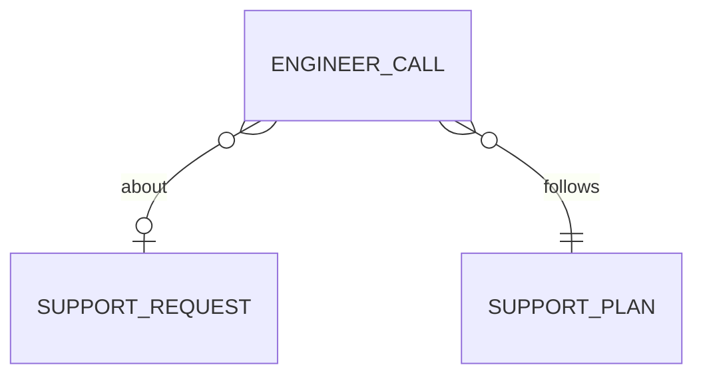
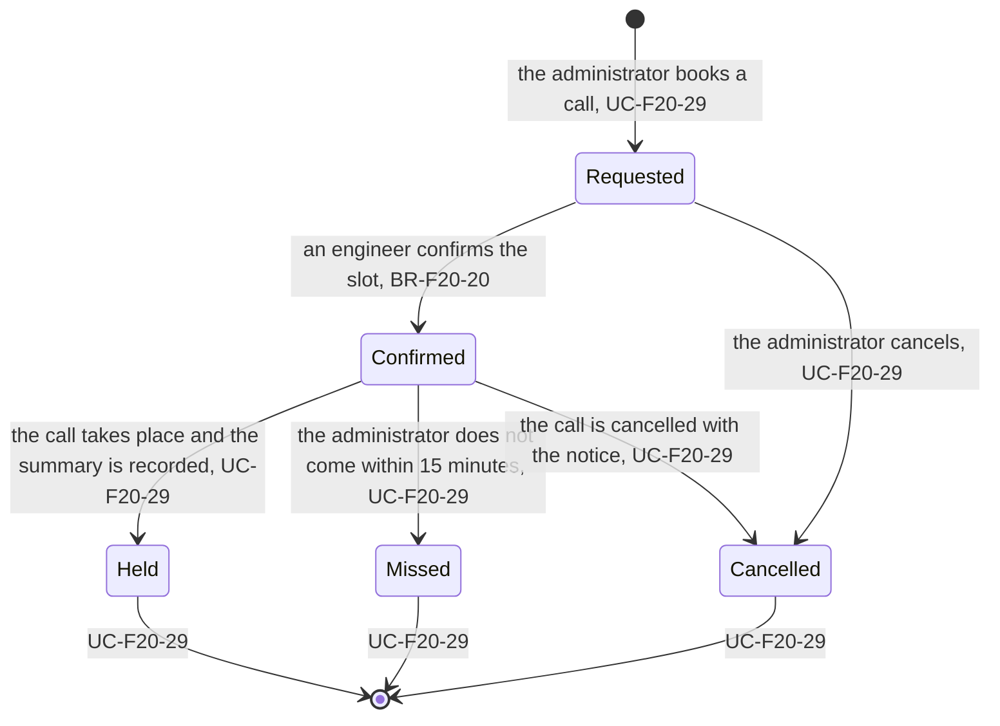

🏠 [Specs](../../../README.md) › 🧩 [Functional capabilities](../../README.md) ›
🛟 [F20 Hosted support assistant (hosted edition)](../README.md) › 🗃️ [Data](README.md) › 🗃️ E-F20-19 Engineer call

# 🗃️ E-F20-19 Engineer call

**Status:** ✅ specified

## Purpose

One call between a company's administrator and a hosting engineer, with its slot, its language and its summary
([D539](../../../06-decisions/f20-hosted-support-assistant/d539-benchmark-gaps-f20-hosted-support-assistant.md)). It
differs from the support request ([E-F20-01 Support request](e-f20-01-support-request.md)): the request is the problem,
the call is one way of treating it.

## Fields

| Name | Type | Required | Validation | Default | Example | Personal data | Custom fields |
|---|---|---|---|---|---|---|---|
| request | support request (E-F20-01) | no | a request of the company | - | 4127 | no | no |
| topic | text | yes | at most 200 characters | - | Invoices do not post | no | no |
| urgency | urgent, normal | yes | one of the two | normal | urgent | no | no |
| language | language | yes | a supported language | - | French | no | no |
| slot | date, time and length | yes | inside the plan's hours | - | 2026-11-14 14:30, 30 min | no | no |
| way | video, phone | yes | one of the two | video | video | no | no |
| requested by | user | yes | an administrator of the company | - | Claire P. | yes | no |
| engineer | hosting engineer | no | set at the confirmation | - | Mehdi K. | yes | no |
| summary | text | no | required to become Held | - | Posting rule fixed, to verify | no | no |
| state | Requested, Confirmed, Cancelled, Held, Missed | yes | the lifecycle below | Requested | Confirmed | no | no |
| owner | user | yes | a user of the company | the creator | Claire P. | yes | no |

## Relations

- [E-F20-01 Support request](e-f20-01-support-request.md)
- [E-F20-12 Support plan](e-f20-12-support-plan.md)
- [E-F20-04 Diagnosis](e-f20-04-diagnosis.md)

## Lifecycle

## Indexes and search

By company, request, state, slot, engineer and language.

## Retention

Kept with the support conversations
([BR-F20-12](../business-rules/br-f20-12-conversations-kept-and-exportable.md)).

## Audit

Every booking, move, confirmation, cancellation, call held or missed, and summary.

## Import and export

No import. The calls of a year are part of the support conversation export
([UC-F20-20](../use-cases/04-govern-the-assistant/uc-f20-20-export-a-support-conversation.md)).

## Used by

- [UC-F20-29](../use-cases/08-engineers-sharing-and-reports/uc-f20-29-book-a-call-with-an-engineer.md)

## Open questions

None.

---

⬅️ [E-F20-18 Support conversation export](e-f20-18-support-conversation-export.md) · ⬆️ [Up](README.md) ·
➡️ [E-F20-20 Access grant](e-f20-20-access-grant.md)
