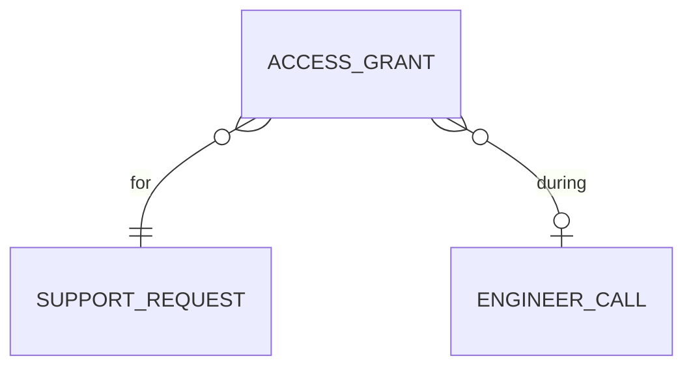
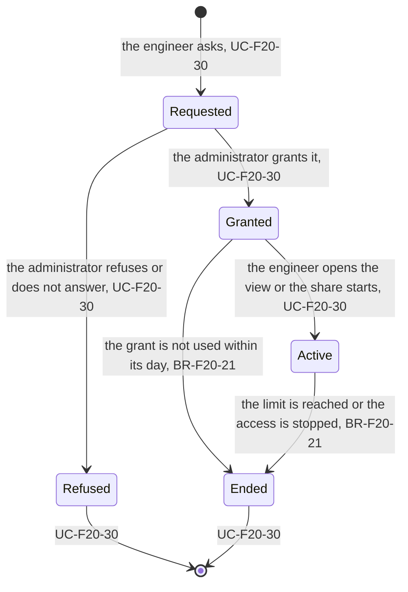

🏠 [Specs](../../../README.md) › 🧩 [Functional capabilities](../../README.md) ›
🛟 [F20 Hosted support assistant (hosted edition)](../README.md) › 🗃️ [Data](README.md) › 🗃️ E-F20-20 Access grant

# 🗃️ E-F20-20 Access grant

**Status:** ✅ specified

## Purpose

One access an engineer is allowed to a customer's screen or app, with its scope, its limit and its record
([D539](../../../06-decisions/f20-hosted-support-assistant/d539-benchmark-gaps-f20-hosted-support-assistant.md)). It
differs from the rights record ([E-F20-11 Assistant policy](e-f20-11-assistant-policy.md)), which sets the standing
rights of the AI assistant, and from the act-as session of F1
([E-F1-26 Act-as session](../../f01-administration/data/e-f01-26-act-as-session.md)), which lets an IT provider's user
act inside a client company: an access grant is looked at, never acted in.

## Fields

| Name | Type | Required | Validation | Default | Example | Personal data | Custom fields |
|---|---|---|---|---|---|---|---|
| request | support request (E-F20-01) | yes | a request of the company | - | 4127 | no | no |
| engineer | hosting engineer | yes | an engineer of the support team | - | Mehdi K. | yes | no |
| kind | screen share, read-only view | yes | one of the two | - | read-only view | no | no |
| role seen | role (E-F1-06) | no | required for a read-only view | - | Accounting | no | no |
| reason | text | yes | at most 300 characters | - | see the posting screen error | no | no |
| limit | minutes | yes | 5 to 240 | 30 | 30 | no | no |
| granted by | user | no | an administrator of the company | - | Claire P. | yes | no |
| started at | date and time | no | set at the start | - | 2026-11-14 14:00 | no | no |
| ended at | date and time | no | start plus at most the limit | - | 2026-11-14 14:30 | no | no |
| end reason | limit reached, revoked, never used | no | set at the end | - | limit reached | no | no |
| pages seen | list of pages | no | kept for a view | - | posting screen | no | no |
| state | Requested, Granted, Refused, Active, Ended | yes | the lifecycle below | Requested | Granted | no | no |
| owner | user | yes | a user of the company | the creator | Claire P. | yes | no |

## Relations

- [E-F20-01 Support request](e-f20-01-support-request.md)
- [E-F20-19 Engineer call](e-f20-19-engineer-call.md)
- [E-F20-11 Assistant policy](e-f20-11-assistant-policy.md)
- [E-F1-26 Act-as session](../../f01-administration/data/e-f01-26-act-as-session.md)

## Lifecycle

## Indexes and search

By company, engineer, request, state, kind and start.

## Retention

The record is kept for 3 years, as long as the support conversations and the rights record
([BR-F20-12](../business-rules/br-f20-12-conversations-kept-and-exportable.md)).

## Audit

Every request, decision, start, stop, expiry and page seen, with who and when.

## Import and export

No import. The records of a period are exported as a CSV for the customer's own audit.

## Used by

- [UC-F20-30](../use-cases/08-engineers-sharing-and-reports/uc-f20-30-share-the-screen-or-a-time-limited-view.md)

## Open questions

None.

---

⬅️ [E-F20-19 Engineer call](e-f20-19-engineer-call.md) · ⬆️ [Up](README.md) ·
➡️ [E-F20-21 Health report](e-f20-21-health-report.md)
