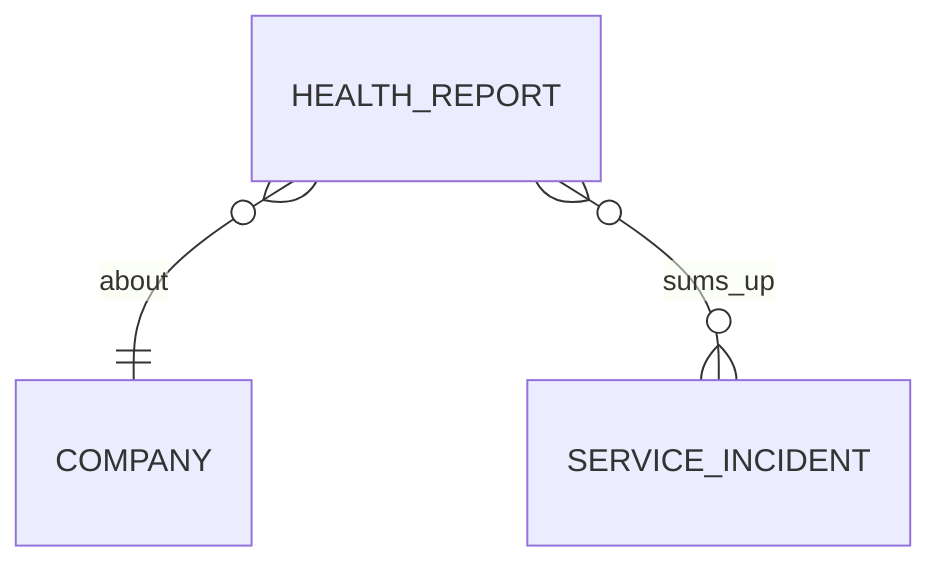
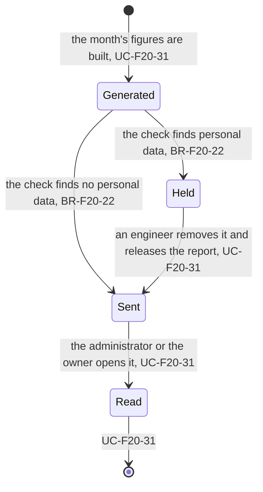

🏠 [Specs](../../../README.md) › 🧩 [Functional capabilities](../../README.md) ›
🛟 [F20 Hosted support assistant (hosted edition)](../README.md) › 🗃️ [Data](README.md) › 🗃️ E-F20-21 Health report

# 🗃️ E-F20-21 Health report

**Status:** ✅ specified

## Purpose

The monthly health report of one company's hosted environment, with its figures, its advice and its sending
([D539](../../../06-decisions/f20-hosted-support-assistant/d539-benchmark-gaps-f20-hosted-support-assistant.md)). It
differs from the incident report ([E-F20-15 Incident report](e-f20-15-incident-report.md)), which tells one incident;
the health report sums up a month.

## Fields

| Name | Type | Required | Validation | Default | Example | Personal data | Custom fields |
|---|---|---|---|---|---|---|---|
| month | month | yes | a past month | - | 2026-10 | no | no |
| availability | percent | yes | 0 to 100 | - | 99.92 | no | no |
| incidents | number and minutes | yes | 0 or more | 0 | 1 and 42 | no | no |
| slowest report | seconds | no | 0 or more | - | 3.1 | no | no |
| last restore test | date | no | not in the future | - | 2026-10-20 | no | no |
| storage used | percent | yes | 0 to 100 | - | 71 | no | no |
| requests | number and number within target | yes | 0 or more | 0 | 6 and 6 | no | no |
| credits due | amount | yes | 0 or more | 0 | 0 EUR | no | no |
| advice | up to five lines | no | no personal data | - | Storage full in 5 months | no | no |
| sent to | list of administrators and owner | no | set at the sending | - | Claire P., owner | yes | no |
| state | Generated, Sent, Held, Read | yes | the lifecycle below | Generated | Sent | no | no |
| owner | user | yes | a user of the company | the creator | Claire P. | yes | no |

## Relations

- [E-F20-05 Cluster reading](e-f20-05-cluster-reading.md)
- [E-F20-07 Service incident](e-f20-07-service-incident.md)
- [E-F20-15 Incident report](e-f20-15-incident-report.md)
- [E-F20-16 Service credit](e-f20-16-service-credit.md)

## Lifecycle

## Indexes and search

By company, month, state, availability and credits due.

## Retention

Kept for 3 years with the support records
([BR-F20-12](../business-rules/br-f20-12-conversations-kept-and-exportable.md)).

## Audit

Every report built, checked, held, released, sent and opened.

## Import and export

No import. Export as a PDF per month and as a CSV of the figures.

## Used by

- [UC-F20-31](../use-cases/08-engineers-sharing-and-reports/uc-f20-31-read-the-monthly-health-report.md)

## Open questions

None.

---

⬅️ [E-F20-20 Access grant](e-f20-20-access-grant.md) · ⬆️ [Up](README.md)
