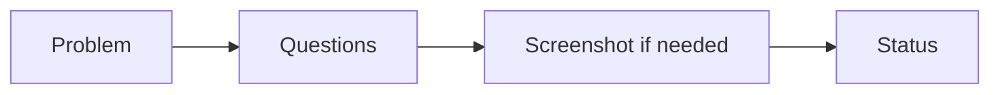

🏠 [Specs](../../../README.md) › 🧩 [Functional capabilities](../../README.md) ›
🛟 [F20 Hosted support assistant (hosted edition)](../README.md) › 🔀 [Flows](README.md) › 🔀 FL-F20-01 Talk it through

# 🔀 FL-F20-01 Talk it through

**Status:** ✅ specified

## Summary

Covers UC-F20-01, UC-F20-02, UC-F20-03, UC-F20-09, UC-F20-12.

## Personas

- [U01 Employee](../../../01-users/personas/u01-employee.md)
- [U07 Administrator](../../../01-users/personas/u07-administrator.md)
- [U13 Owner](../../../01-users/personas/u13-owner.md)

## Flowchart

## Sequence diagram

See each use case.

## Steps

| Step | Persona | Screen | Use case | What happens |
|---|---|---|---|---|
| 1 | U07, U01 | [S-F20-01](../screens/01-talk-it-through/s-f20-01-support-chat.md) | [UC-F20-01](../use-cases/01-talk-it-through/uc-f20-01-report-a-problem-in-plain-words.md) | Report a problem in plain words |
| 2 | U07 | [S-F20-02](../screens/01-talk-it-through/s-f20-02-clarify.md) | [UC-F20-02](../use-cases/01-talk-it-through/uc-f20-02-answer-clarifying-questions.md) | Answer clarifying questions |
| 3 | U07 | [S-F20-03](../screens/01-talk-it-through/s-f20-03-screenshots.md) | [UC-F20-03](../use-cases/01-talk-it-through/uc-f20-03-share-screenshots-when-needed.md) | Share screenshots when needed |
| 4 | U07, U13 | [S-F20-09](../screens/01-talk-it-through/s-f20-09-my-requests.md) | [UC-F20-09](../use-cases/01-talk-it-through/uc-f20-09-follow-the-request.md) | Follow the request |
| 5 | U01, U07 | [S-F20-12](../screens/01-talk-it-through/s-f20-12-how-to.md) | [UC-F20-12](../use-cases/01-talk-it-through/uc-f20-12-answer-how-to-questions-from-the-documentation.md) | Answer how-to questions from the documentation |

### Entities and screens

| Entity | States in this flow | Shown at step and screen | Aggregated view |
|---|---|---|---|
| [E-F20-01 Support request](../data/e-f20-01-support-request.md) | Active | 1 [S-F20-01](../screens/01-talk-it-through/s-f20-01-support-chat.md); 2 [S-F20-02](../screens/01-talk-it-through/s-f20-02-clarify.md); 4 [S-F20-09](../screens/01-talk-it-through/s-f20-09-my-requests.md) | Support requests |
| [E-F20-02 Message](../data/e-f20-02-message.md) | Recorded | 1 [S-F20-01](../screens/01-talk-it-through/s-f20-01-support-chat.md); 2 [S-F20-02](../screens/01-talk-it-through/s-f20-02-clarify.md); 4 [S-F20-09](../screens/01-talk-it-through/s-f20-09-my-requests.md); 5 [S-F20-12](../screens/01-talk-it-through/s-f20-12-how-to.md) | Messages |
| [E-F20-03 Screenshot](../data/e-f20-03-screenshot.md) | Active | 3 [S-F20-03](../screens/01-talk-it-through/s-f20-03-screenshots.md) | Screenshots |

## Errors

As each use case.

## Images

Every step and error, for each persona taking part, in light and dark mode (D120). Steps are numbered as in the Steps
table; E rows are the error cases.

| Step | Persona | Device | Light | Dark |
|---|---|---|---|---|
| 1 | U07 | desktop | [light](../images/01-talk-it-through/u07-administrator/1-report-desktop-light.png) | [dark](../images/01-talk-it-through/u07-administrator/1-report-desktop-dark.png) |
| 1 | U01 | desktop | [light](../images/01-talk-it-through/u01-employee/1-report-desktop-light.png) | [dark](../images/01-talk-it-through/u01-employee/1-report-desktop-dark.png) |
| 1 | U01 | phone | [light](../images/01-talk-it-through/u01-employee/1-report-phone-light.png) | [dark](../images/01-talk-it-through/u01-employee/1-report-phone-dark.png) |
| 2 | U07 | desktop | [light](../images/01-talk-it-through/u07-administrator/2-clarify-desktop-light.png) | [dark](../images/01-talk-it-through/u07-administrator/2-clarify-desktop-dark.png) |
| 3 | U07 | desktop | [light](../images/01-talk-it-through/u07-administrator/3-screenshot-desktop-light.png) | [dark](../images/01-talk-it-through/u07-administrator/3-screenshot-desktop-dark.png) |
| 4 | U13 | desktop | [light](../images/01-talk-it-through/u13-owner/4-follow-desktop-light.png) | [dark](../images/01-talk-it-through/u13-owner/4-follow-desktop-dark.png) |
| 4 | U13 | phone | [light](../images/01-talk-it-through/u13-owner/4-follow-phone-light.png) | [dark](../images/01-talk-it-through/u13-owner/4-follow-phone-dark.png) |
| 4 | U07 | desktop | [light](../images/01-talk-it-through/u07-administrator/4-follow-desktop-light.png) | [dark](../images/01-talk-it-through/u07-administrator/4-follow-desktop-dark.png) |
| 5 | U01 | desktop | [light](../images/01-talk-it-through/u01-employee/5-how-to-desktop-light.png) | [dark](../images/01-talk-it-through/u01-employee/5-how-to-desktop-dark.png) |
| 5 | U01 | phone | [light](../images/01-talk-it-through/u01-employee/5-how-to-phone-light.png) | [dark](../images/01-talk-it-through/u01-employee/5-how-to-phone-dark.png) |
| 5 | U07 | desktop | [light](../images/01-talk-it-through/u07-administrator/5-how-to-desktop-light.png) | [dark](../images/01-talk-it-through/u07-administrator/5-how-to-desktop-dark.png) |
| E1 | U07 | desktop | [light](../images/01-talk-it-through/u07-administrator/e1-known-incident-desktop-light.png) | [dark](../images/01-talk-it-through/u07-administrator/e1-known-incident-desktop-dark.png) |

## Open questions

None.

---

⬆️ [Up](README.md) · ➡️ [FL-F20-02 Diagnose and fix](fl-f20-02-diagnose-and-fix.md)
