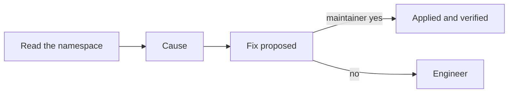

🏠 [Specs](../../../README.md) › 🧩 [Functional capabilities](../../README.md) ›
🛟 [F20 Hosted support assistant (hosted edition)](../README.md) › 🔀 [Flows](README.md) › 🔀 FL-F20-02 Diagnose and fix

# 🔀 FL-F20-02 Diagnose and fix

**Status:** ✅ specified

## Summary

Covers UC-F20-04, UC-F20-05, UC-F20-06, UC-F20-07, UC-F20-13, UC-F20-14.

## Personas

- [U07 Administrator](../../../01-users/personas/u07-administrator.md)
- [U48 Hosting engineer](../../../01-users/personas/u48-hosting-engineer.md)

## Flowchart

## Sequence diagram

See each use case.

## Steps

| Step | Persona | Screen | Use case | What happens |
|---|---|---|---|---|
| 1 | U48 | [S-F20-04](../screens/02-diagnose-and-fix/s-f20-04-diagnosis.md) | [UC-F20-04](../use-cases/02-diagnose-and-fix/uc-f20-04-diagnose-on-the-cluster.md) | Diagnose on the cluster |
| 2 | U07 | [S-F20-05](../screens/02-diagnose-and-fix/s-f20-05-explanation.md) | [UC-F20-05](../use-cases/02-diagnose-and-fix/uc-f20-05-explain-the-cause-simply.md) | Explain the cause simply |
| 3 | U48 | [S-F20-06](../screens/02-diagnose-and-fix/s-f20-06-fix-approval.md) | [UC-F20-06](../use-cases/02-diagnose-and-fix/uc-f20-06-propose-a-fix-for-a-maintainer-s-yes.md) | Propose a fix for a maintainer's yes |
| 4 | U48 | [S-F20-07](../screens/02-diagnose-and-fix/s-f20-07-fix-result.md) | [UC-F20-07](../use-cases/02-diagnose-and-fix/uc-f20-07-apply-and-verify-the-fix.md) | Apply and verify the fix |
| 5 | U07, U48 | [S-F20-13](../screens/02-diagnose-and-fix/s-f20-13-restore.md) | [UC-F20-13](../use-cases/02-diagnose-and-fix/uc-f20-13-restore-data-from-a-backup.md) | Restore data from a backup |
| 6 | U07 | [S-F20-14](../screens/02-diagnose-and-fix/s-f20-14-slowness.md) | [UC-F20-14](../use-cases/02-diagnose-and-fix/uc-f20-14-investigate-slowness.md) | Investigate slowness |

### Entities and screens

| Entity | States in this flow | Shown at step and screen | Aggregated view |
|---|---|---|---|
| [E-F20-05 Cluster reading](../data/e-f20-05-cluster-reading.md) | Recorded | 1 [S-F20-04](../screens/02-diagnose-and-fix/s-f20-04-diagnosis.md); 6 [S-F20-14](../screens/02-diagnose-and-fix/s-f20-14-slowness.md) | Cluster readings |
| [E-F20-04 Diagnosis](../data/e-f20-04-diagnosis.md) | Active | 1 [S-F20-04](../screens/02-diagnose-and-fix/s-f20-04-diagnosis.md); 2 [S-F20-05](../screens/02-diagnose-and-fix/s-f20-05-explanation.md); 4 [S-F20-07](../screens/02-diagnose-and-fix/s-f20-07-fix-result.md); 6 [S-F20-14](../screens/02-diagnose-and-fix/s-f20-14-slowness.md) | Diagnosis |
| [E-F20-06 Fix proposal](../data/e-f20-06-fix-proposal.md) | Active | 3 [S-F20-06](../screens/02-diagnose-and-fix/s-f20-06-fix-approval.md); 4 [S-F20-07](../screens/02-diagnose-and-fix/s-f20-07-fix-result.md); 5 [S-F20-13](../screens/02-diagnose-and-fix/s-f20-13-restore.md) | Fix proposals |

## Errors

As each use case.

## Images

Every step and error, for each persona taking part, in light and dark mode (D120). Steps are numbered as in the Steps
table; E rows are the error cases.

| Step | Persona | Device | Light | Dark |
|---|---|---|---|---|
| 1 | U48 | desktop | [light](../images/02-diagnose-and-fix/u48-hosting-engineer/1-diagnose-desktop-light.png) | [dark](../images/02-diagnose-and-fix/u48-hosting-engineer/1-diagnose-desktop-dark.png) |
| 1 | U48 | phone | [light](../images/02-diagnose-and-fix/u48-hosting-engineer/1-diagnose-phone-light.png) | [dark](../images/02-diagnose-and-fix/u48-hosting-engineer/1-diagnose-phone-dark.png) |
| 2 | U07 | desktop | [light](../images/02-diagnose-and-fix/u07-administrator/2-explain-desktop-light.png) | [dark](../images/02-diagnose-and-fix/u07-administrator/2-explain-desktop-dark.png) |
| 3 | U48 | desktop | [light](../images/02-diagnose-and-fix/u48-hosting-engineer/3-propose-desktop-light.png) | [dark](../images/02-diagnose-and-fix/u48-hosting-engineer/3-propose-desktop-dark.png) |
| 3 | U48 | phone | [light](../images/02-diagnose-and-fix/u48-hosting-engineer/3-propose-phone-light.png) | [dark](../images/02-diagnose-and-fix/u48-hosting-engineer/3-propose-phone-dark.png) |
| 4 | U48 | desktop | [light](../images/02-diagnose-and-fix/u48-hosting-engineer/4-apply-desktop-light.png) | [dark](../images/02-diagnose-and-fix/u48-hosting-engineer/4-apply-desktop-dark.png) |
| 4 | U48 | phone | [light](../images/02-diagnose-and-fix/u48-hosting-engineer/4-apply-phone-light.png) | [dark](../images/02-diagnose-and-fix/u48-hosting-engineer/4-apply-phone-dark.png) |
| 5 | U48 | desktop | [light](../images/02-diagnose-and-fix/u48-hosting-engineer/5-restore-desktop-light.png) | [dark](../images/02-diagnose-and-fix/u48-hosting-engineer/5-restore-desktop-dark.png) |
| 5 | U48 | phone | [light](../images/02-diagnose-and-fix/u48-hosting-engineer/5-restore-phone-light.png) | [dark](../images/02-diagnose-and-fix/u48-hosting-engineer/5-restore-phone-dark.png) |
| 5 | U07 | desktop | [light](../images/02-diagnose-and-fix/u07-administrator/5-restore-desktop-light.png) | [dark](../images/02-diagnose-and-fix/u07-administrator/5-restore-desktop-dark.png) |
| 6 | U07 | desktop | [light](../images/02-diagnose-and-fix/u07-administrator/6-slowness-desktop-light.png) | [dark](../images/02-diagnose-and-fix/u07-administrator/6-slowness-desktop-dark.png) |
| E1 | U48 | desktop | [light](../images/02-diagnose-and-fix/u48-hosting-engineer/e1-refused-desktop-light.png) | [dark](../images/02-diagnose-and-fix/u48-hosting-engineer/e1-refused-desktop-dark.png) |
| E1 | U48 | phone | [light](../images/02-diagnose-and-fix/u48-hosting-engineer/e1-refused-phone-light.png) | [dark](../images/02-diagnose-and-fix/u48-hosting-engineer/e1-refused-phone-dark.png) |

## Open questions

None.

---

⬅️ [FL-F20-01 Talk it through](fl-f20-01-talk-it-through.md) · ⬆️ [Up](README.md) ·
➡️ [FL-F20-03 Incidents](fl-f20-03-incidents.md)
