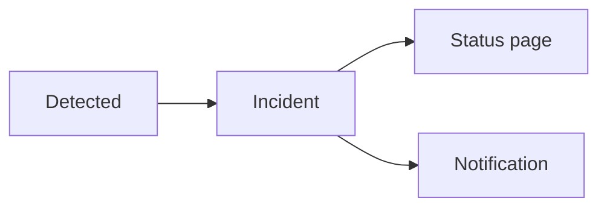

🏠 [Specs](../../../README.md) › 🧩 [Functional capabilities](../../README.md) ›
🛟 [F20 Hosted support assistant (hosted edition)](../README.md) › 🔀 [Flows](README.md) › 🔀 FL-F20-03 Incidents

# 🔀 FL-F20-03 Incidents

**Status:** ✅ specified

## Summary

Covers UC-F20-08, UC-F20-10, UC-F20-11, UC-F20-15.

## Personas

- [U13 Owner](../../../01-users/personas/u13-owner.md)
- [U48 Hosting engineer](../../../01-users/personas/u48-hosting-engineer.md)

## Flowchart

## Sequence diagram

See each use case.

## Steps

| Step | Persona | Screen | Use case | What happens |
|---|---|---|---|---|
| 1 | U48 | [S-F20-08](../screens/03-incidents/s-f20-08-escalation.md) | [UC-F20-08](../use-cases/03-incidents/uc-f20-08-escalate-to-an-engineer.md) | Escalate to an engineer |
| 2 | U48 | [S-F20-28](../screens/03-incidents/s-f20-28-incident-handling.md) | [UC-F20-10](../use-cases/03-incidents/uc-f20-10-handle-a-wide-incident-with-a-status-page.md) | Handle a wide incident with a status page |
| 3 | U48 | [S-F20-11](../screens/03-incidents/s-f20-11-proactive-alerts.md) | [UC-F20-11](../use-cases/03-incidents/uc-f20-11-warn-before-customers-notice.md) | Warn before customers notice |
| 4 | U48, U13 | [S-F20-15](../screens/03-incidents/s-f20-15-security-incident.md) | [UC-F20-15](../use-cases/03-incidents/uc-f20-15-handle-a-security-incident-or-breach.md) | Handle a security incident or breach |
| 5 | U48 | [S-F20-10](../screens/03-incidents/s-f20-10-status-page.md) | [UC-F20-10](../use-cases/03-incidents/uc-f20-10-handle-a-wide-incident-with-a-status-page.md) | Publish the status page customers read |

### Entities and screens

| Entity | States in this flow | Shown at step and screen | Aggregated view |
|---|---|---|---|
| [E-F20-07 Service incident](../data/e-f20-07-service-incident.md) | Active | 1 [S-F20-08](../screens/03-incidents/s-f20-08-escalation.md); 2 [S-F20-28](../screens/03-incidents/s-f20-28-incident-handling.md); 3 [S-F20-11](../screens/03-incidents/s-f20-11-proactive-alerts.md); 4 [S-F20-15](../screens/03-incidents/s-f20-15-security-incident.md); 5 [S-F20-10](../screens/03-incidents/s-f20-10-status-page.md) | Service incidents |
| [E-T10-02 Notification](../../../03-technical/t10-translations-and-notifications/data/e-t10-02-notification.md) | Active | Shown elsewhere: [S-T10-02 Notification](../../../03-technical/t10-translations-and-notifications/screens/s-t10-02-notification.md), from the admin list [S-T10-L02](../../../03-technical/t10-translations-and-notifications/screens/00-lists/s-t10-l02-notifications.md) | Notifications |

## Errors

As each use case.

## Images

Every step and error, for each persona taking part, in light and dark mode (D120). Steps are numbered as in the Steps
table; E rows are the error cases.

| Step | Persona | Device | Light | Dark |
|---|---|---|---|---|
| 1 | U48 | desktop | [light](../images/03-incidents/u48-hosting-engineer/1-escalate-desktop-light.png) | [dark](../images/03-incidents/u48-hosting-engineer/1-escalate-desktop-dark.png) |
| 1 | U48 | phone | [light](../images/03-incidents/u48-hosting-engineer/1-escalate-phone-light.png) | [dark](../images/03-incidents/u48-hosting-engineer/1-escalate-phone-dark.png) |
| 2 | U48 | desktop | [light](../images/03-incidents/u48-hosting-engineer/2-status-page-desktop-light.png) | [dark](../images/03-incidents/u48-hosting-engineer/2-status-page-desktop-dark.png) |
| 2 | U48 | phone | [light](../images/03-incidents/u48-hosting-engineer/2-status-page-phone-light.png) | [dark](../images/03-incidents/u48-hosting-engineer/2-status-page-phone-dark.png) |
| 3 | U48 | desktop | [light](../images/03-incidents/u48-hosting-engineer/3-proactive-desktop-light.png) | [dark](../images/03-incidents/u48-hosting-engineer/3-proactive-desktop-dark.png) |
| 3 | U48 | phone | [light](../images/03-incidents/u48-hosting-engineer/3-proactive-phone-light.png) | [dark](../images/03-incidents/u48-hosting-engineer/3-proactive-phone-dark.png) |
| 4 | U48 | desktop | [light](../images/03-incidents/u48-hosting-engineer/4-breach-desktop-light.png) | [dark](../images/03-incidents/u48-hosting-engineer/4-breach-desktop-dark.png) |
| 4 | U48 | phone | [light](../images/03-incidents/u48-hosting-engineer/4-breach-phone-light.png) | [dark](../images/03-incidents/u48-hosting-engineer/4-breach-phone-dark.png) |
| 4 | U13 | desktop | [light](../images/03-incidents/u13-owner/4-breach-desktop-light.png) | [dark](../images/03-incidents/u13-owner/4-breach-desktop-dark.png) |
| 4 | U13 | phone | [light](../images/03-incidents/u13-owner/4-breach-phone-light.png) | [dark](../images/03-incidents/u13-owner/4-breach-phone-dark.png) |
| 5 | U48 | desktop | [light](../images/03-incidents/u48-hosting-engineer/5-status-page-desktop-light.png) | [dark](../images/03-incidents/u48-hosting-engineer/5-status-page-desktop-dark.png) |
| 5 | U48 | phone | [light](../images/03-incidents/u48-hosting-engineer/5-status-page-phone-light.png) | [dark](../images/03-incidents/u48-hosting-engineer/5-status-page-phone-dark.png) |
| E1 | U48 | desktop | [light](../images/03-incidents/u48-hosting-engineer/e1-unsure-desktop-light.png) | [dark](../images/03-incidents/u48-hosting-engineer/e1-unsure-desktop-dark.png) |
| E1 | U48 | phone | [light](../images/03-incidents/u48-hosting-engineer/e1-unsure-phone-light.png) | [dark](../images/03-incidents/u48-hosting-engineer/e1-unsure-phone-dark.png) |

## Open questions

None.

---

⬅️ [FL-F20-02 Diagnose and fix](fl-f20-02-diagnose-and-fix.md) · ⬆️ [Up](README.md) ·
➡️ [FL-F20-04 Govern the AI assistant](fl-f20-04-govern-the-assistant.md)
