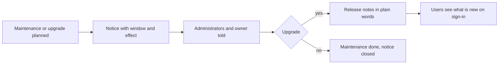
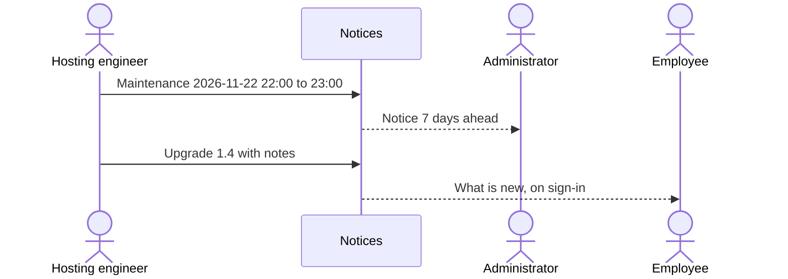

🏠 [Specs](../../../README.md) › 🧩 [Functional capabilities](../../README.md) ›
🛟 [F20 Hosted support assistant (hosted edition)](../README.md) › 🔀 [Flows](README.md) ›
🔀 FL-F20-05 Maintenance and releases

# 🔀 FL-F20-05 Maintenance and releases

**Status:** ✅ specified

## Summary

Customers know ahead what changes on their hosted simple-ERP: planned maintenance is announced with its window, and each
upgrade comes with release notes in plain words (D477).

## Personas

- [U48 Hosting engineer](../../../01-users/personas/u48-hosting-engineer.md)
- [U07 Administrator](../../../01-users/personas/u07-administrator.md)
- [U13 Owner](../../../01-users/personas/u13-owner.md)
- [U01 Employee](../../../01-users/personas/u01-employee.md)

## Flowchart

## Sequence diagram

## Steps

| Step | Persona | Screen | Use case | What happens |
|---|---|---|---|---|
| 1 | U48, U07, U13 | [S-F20-21](../screens/05-maintenance-and-releases/s-f20-21-maintenance-notices.md) | [UC-F20-21](../use-cases/05-maintenance-and-releases/uc-f20-21-announce-planned-maintenance.md) | Announce planned maintenance |
| 2 | U07, U01 | [S-F20-22](../screens/05-maintenance-and-releases/s-f20-22-release-notes.md) | [UC-F20-22](../use-cases/05-maintenance-and-releases/uc-f20-22-read-the-release-notes-of-an-upgrade.md) | Read the release notes of an upgrade |

### Entities and screens

| Entity | States in this flow | Shown at step and screen | Aggregated view |
|---|---|---|---|
| [E-T09-03 Upgrade run](../../../03-technical/t09-install-backups-and-updates/data/e-t09-03-upgrade-run.md) | Recorded | Shown elsewhere: [S-T09-03 Upgrade run](../../../03-technical/t09-install-backups-and-updates/screens/s-t09-03-upgrade-run.md), from the admin list [S-T09-L03](../../../03-technical/t09-install-backups-and-updates/screens/00-lists/s-t09-l03-upgrade-runs.md) | Upgrade runs |
| [E-F20-13 Maintenance notice](../data/e-f20-13-maintenance-notice.md) | Planned, Running, Done, Overrun | 1 [S-F20-21](../screens/05-maintenance-and-releases/s-f20-21-maintenance-notices.md) | Maintenance notices |
| [E-F20-14 Upgrade release note](../data/e-f20-14-upgrade-release-note.md) | Draft, Published, Withdrawn | 2 [S-F20-22](../screens/05-maintenance-and-releases/s-f20-22-release-notes.md) | Upgrade release notes |

## Errors

E1: maintenance runs past its window: the notice is updated and the status page opened (UC-F20-10). E2: an upgrade is
rolled back: its release notes are withdrawn and a notice says so.

## Images

Every step and error, for each persona taking part, in light and dark mode (D120). Steps are numbered as in the Steps
table; E rows are the error cases.

| Step | Persona | Device | Light | Dark |
|---|---|---|---|---|
| 1 | U48 | desktop | [light](../images/05-maintenance-and-releases/u48-hosting-engineer/1-maintenance-notices-desktop-light.png) | [dark](../images/05-maintenance-and-releases/u48-hosting-engineer/1-maintenance-notices-desktop-dark.png) |
| 1 | U48 | phone | [light](../images/05-maintenance-and-releases/u48-hosting-engineer/1-maintenance-notices-phone-light.png) | [dark](../images/05-maintenance-and-releases/u48-hosting-engineer/1-maintenance-notices-phone-dark.png) |
| 1 | U07 | desktop | [light](../images/05-maintenance-and-releases/u07-administrator/1-maintenance-notices-desktop-light.png) | [dark](../images/05-maintenance-and-releases/u07-administrator/1-maintenance-notices-desktop-dark.png) |
| 1 | U13 | desktop | [light](../images/05-maintenance-and-releases/u13-owner/1-maintenance-notices-desktop-light.png) | [dark](../images/05-maintenance-and-releases/u13-owner/1-maintenance-notices-desktop-dark.png) |
| 1 | U13 | phone | [light](../images/05-maintenance-and-releases/u13-owner/1-maintenance-notices-phone-light.png) | [dark](../images/05-maintenance-and-releases/u13-owner/1-maintenance-notices-phone-dark.png) |
| 2 | U07 | desktop | [light](../images/05-maintenance-and-releases/u07-administrator/2-release-notes-desktop-light.png) | [dark](../images/05-maintenance-and-releases/u07-administrator/2-release-notes-desktop-dark.png) |
| 2 | U01 | desktop | [light](../images/05-maintenance-and-releases/u01-employee/2-release-notes-desktop-light.png) | [dark](../images/05-maintenance-and-releases/u01-employee/2-release-notes-desktop-dark.png) |
| 2 | U01 | phone | [light](../images/05-maintenance-and-releases/u01-employee/2-release-notes-phone-light.png) | [dark](../images/05-maintenance-and-releases/u01-employee/2-release-notes-phone-dark.png) |
| E1 | U48 | desktop | [light](../images/05-maintenance-and-releases/u48-hosting-engineer/e1-maintenance-notices-refused-desktop-light.png) | [dark](../images/05-maintenance-and-releases/u48-hosting-engineer/e1-maintenance-notices-refused-desktop-dark.png) |
| E1 | U48 | phone | [light](../images/05-maintenance-and-releases/u48-hosting-engineer/e1-maintenance-notices-refused-phone-light.png) | [dark](../images/05-maintenance-and-releases/u48-hosting-engineer/e1-maintenance-notices-refused-phone-dark.png) |

## Open questions

None.

---

⬅️ [FL-F20-04 Govern the AI assistant](fl-f20-04-govern-the-assistant.md) · ⬆️ [Up](README.md) ·
➡️ [FL-F20-06 After an incident](fl-f20-06-after-an-incident.md)
