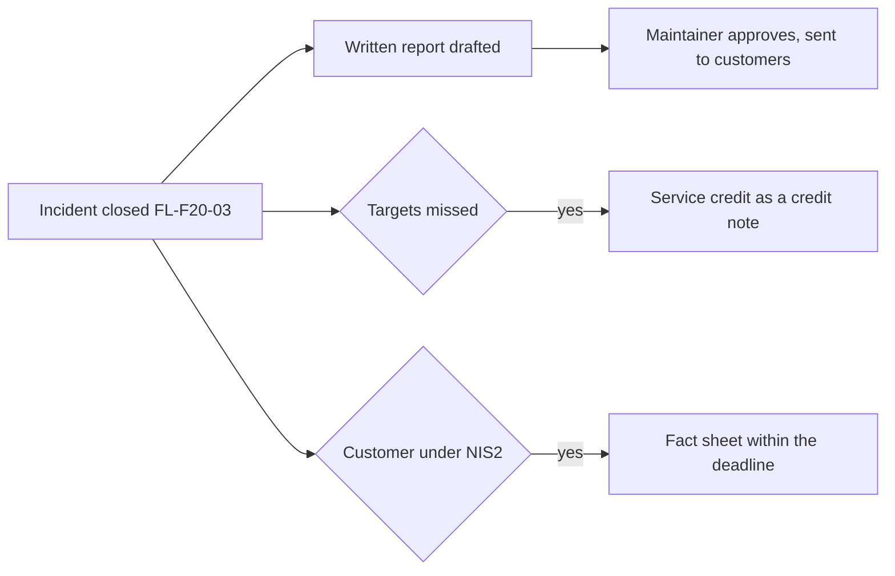
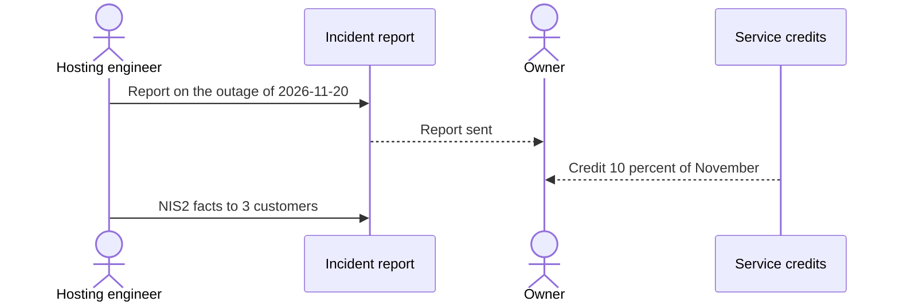

🏠 [Specs](../../../README.md) › 🧩 [Functional capabilities](../../README.md) ›
🛟 [F20 Hosted support assistant (hosted edition)](../README.md) › 🔀 [Flows](README.md) › 🔀 FL-F20-06 After an incident

# 🔀 FL-F20-06 After an incident

**Status:** ✅ specified

## Summary

Once an outage is over, each customer receives a written incident report, missed service-level targets are credited, and
customers subject to NIS2 receive the facts they need for their own notification (D477).

## Personas

- [U48 Hosting engineer](../../../01-users/personas/u48-hosting-engineer.md)
- [U13 Owner](../../../01-users/personas/u13-owner.md)
- [U05 Accounting](../../../01-users/personas/u05-accounting.md)

## Flowchart

## Sequence diagram

## Steps

| Step | Persona | Screen | Use case | What happens |
|---|---|---|---|---|
| 1 | U48, U13 | [S-F20-23](../screens/06-after-an-incident/s-f20-23-incident-report.md) | [UC-F20-23](../use-cases/06-after-an-incident/uc-f20-23-send-the-written-incident-report.md) | Send the written incident report |
| 2 | U13, U05 | [S-F20-24](../screens/06-after-an-incident/s-f20-24-service-credits.md) | [UC-F20-24](../use-cases/06-after-an-incident/uc-f20-24-credit-missed-service-level-targets.md) | Credit missed service-level targets |
| 3 | U13, U48 | [S-F20-25](../screens/06-after-an-incident/s-f20-25-nis2-facts.md) | [UC-F20-26](../use-cases/06-after-an-incident/uc-f20-26-give-the-facts-for-a-nis2-notification.md) | Give the facts for a NIS2 notification |

### Entities and screens

| Entity | States in this flow | Shown at step and screen | Aggregated view |
|---|---|---|---|
| [E-F20-07 Service incident](../data/e-f20-07-service-incident.md) | Active | 1 [S-F20-23](../screens/06-after-an-incident/s-f20-23-incident-report.md) | Service incidents |
| [E-F20-15 Incident report](../data/e-f20-15-incident-report.md) | Draft, Approved, Sent | 1 [S-F20-23](../screens/06-after-an-incident/s-f20-23-incident-report.md) | Incident reports |
| [E-F20-12 Support plan](../data/e-f20-12-support-plan.md) | Active | 2 [S-F20-24](../screens/06-after-an-incident/s-f20-24-service-credits.md) | Support plans |
| [E-F20-16 Service credit](../data/e-f20-16-service-credit.md) | Computed, Disputed | 2 [S-F20-24](../screens/06-after-an-incident/s-f20-24-service-credits.md) | Service credits |
| [E-F19-09 Hosted invoice](../../f19-feature-factory/data/e-f19-09-hosted-invoice.md) | Active | Shown elsewhere: [S-F19-16 Invoices](../../f19-feature-factory/screens/05-bill-and-credit/s-f19-16-invoices.md) | Hosted invoices |
| [E-F20-17 NIS2 fact sheet](../data/e-f20-17-nis2-fact-sheet.md) | Draft, Sent | 3 [S-F20-25](../screens/06-after-an-incident/s-f20-25-nis2-facts.md) | NIS2 fact sheets |

## Errors

E1: the report is not approved within its delay: the owner is told it is late (step 1). E2: a credit is disputed: the
hosting engineer checks the measured times and decides (step 2).

## Images

Every step and error, for each persona taking part, in light and dark mode (D120). Steps are numbered as in the Steps
table; E rows are the error cases.

| Step | Persona | Device | Light | Dark |
|---|---|---|---|---|
| 1 | U48 | desktop | [light](../images/06-after-an-incident/u48-hosting-engineer/1-incident-report-desktop-light.png) | [dark](../images/06-after-an-incident/u48-hosting-engineer/1-incident-report-desktop-dark.png) |
| 1 | U48 | phone | [light](../images/06-after-an-incident/u48-hosting-engineer/1-incident-report-phone-light.png) | [dark](../images/06-after-an-incident/u48-hosting-engineer/1-incident-report-phone-dark.png) |
| 1 | U13 | desktop | [light](../images/06-after-an-incident/u13-owner/1-incident-report-desktop-light.png) | [dark](../images/06-after-an-incident/u13-owner/1-incident-report-desktop-dark.png) |
| 1 | U13 | phone | [light](../images/06-after-an-incident/u13-owner/1-incident-report-phone-light.png) | [dark](../images/06-after-an-incident/u13-owner/1-incident-report-phone-dark.png) |
| 2 | U13 | desktop | [light](../images/06-after-an-incident/u13-owner/2-service-credits-desktop-light.png) | [dark](../images/06-after-an-incident/u13-owner/2-service-credits-desktop-dark.png) |
| 2 | U13 | phone | [light](../images/06-after-an-incident/u13-owner/2-service-credits-phone-light.png) | [dark](../images/06-after-an-incident/u13-owner/2-service-credits-phone-dark.png) |
| 2 | U05 | desktop | [light](../images/06-after-an-incident/u05-accounting/2-service-credits-desktop-light.png) | [dark](../images/06-after-an-incident/u05-accounting/2-service-credits-desktop-dark.png) |
| 3 | U13 | desktop | [light](../images/06-after-an-incident/u13-owner/3-nis2-facts-desktop-light.png) | [dark](../images/06-after-an-incident/u13-owner/3-nis2-facts-desktop-dark.png) |
| 3 | U13 | phone | [light](../images/06-after-an-incident/u13-owner/3-nis2-facts-phone-light.png) | [dark](../images/06-after-an-incident/u13-owner/3-nis2-facts-phone-dark.png) |
| 3 | U48 | desktop | [light](../images/06-after-an-incident/u48-hosting-engineer/3-nis2-facts-desktop-light.png) | [dark](../images/06-after-an-incident/u48-hosting-engineer/3-nis2-facts-desktop-dark.png) |
| 3 | U48 | phone | [light](../images/06-after-an-incident/u48-hosting-engineer/3-nis2-facts-phone-light.png) | [dark](../images/06-after-an-incident/u48-hosting-engineer/3-nis2-facts-phone-dark.png) |
| E1 | U48 | desktop | [light](../images/06-after-an-incident/u48-hosting-engineer/e1-incident-report-refused-desktop-light.png) | [dark](../images/06-after-an-incident/u48-hosting-engineer/e1-incident-report-refused-desktop-dark.png) |
| E1 | U48 | phone | [light](../images/06-after-an-incident/u48-hosting-engineer/e1-incident-report-refused-phone-light.png) | [dark](../images/06-after-an-incident/u48-hosting-engineer/e1-incident-report-refused-phone-dark.png) |

## Open questions

None.

---

⬅️ [FL-F20-05 Maintenance and releases](fl-f20-05-maintenance-and-releases.md) · ⬆️ [Up](README.md) ·
➡️ [FL-F20-07 Employees' help](fl-f20-07-employees-help.md)
