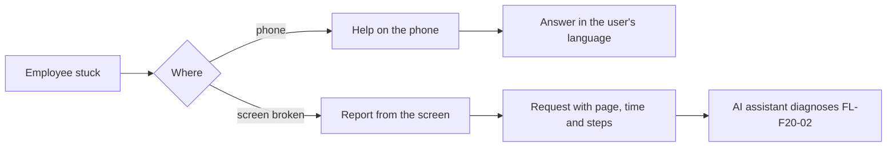
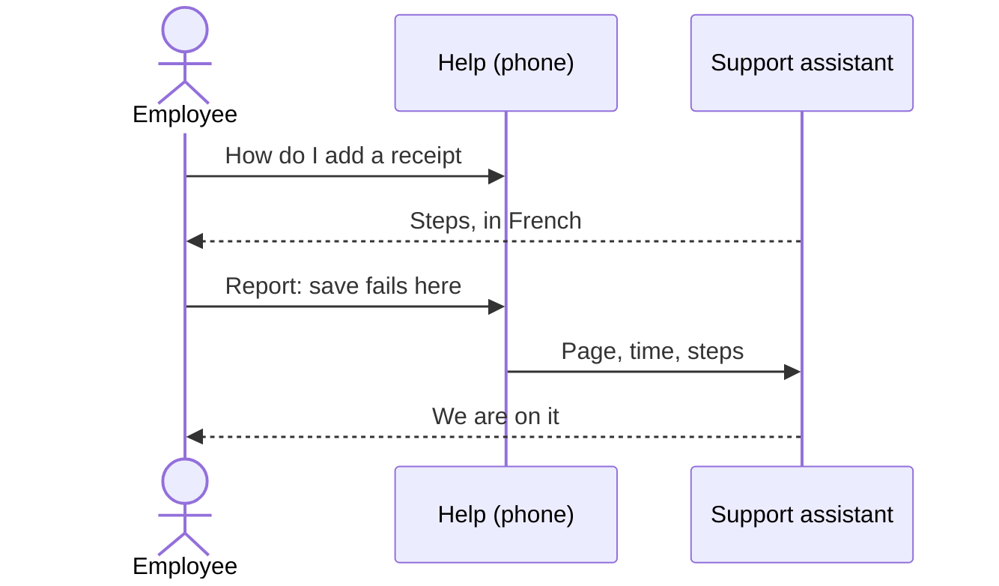

🏠 [Specs](../../../README.md) › 🧩 [Functional capabilities](../../README.md) ›
🛟 [F20 Hosted support assistant (hosted edition)](../README.md) › 🔀 [Flows](README.md) › 🔀 FL-F20-07 Employees' help

# 🔀 FL-F20-07 Employees' help

**Status:** ✅ specified

## Summary

Employees get help where they work: from their phone, in French or English, and by reporting a problem from the very
screen where it happened (D477).

## Personas

- [U01 Employee](../../../01-users/personas/u01-employee.md)
- [U07 Administrator](../../../01-users/personas/u07-administrator.md)

## Flowchart

## Sequence diagram

## Steps

| Step | Persona | Screen | Use case | What happens |
|---|---|---|---|---|
| 1 | U01, U07 | [S-F20-01](../screens/01-talk-it-through/s-f20-01-support-chat.md) | [UC-F20-25](../use-cases/07-employees-help/uc-f20-25-get-support-in-french-or-english.md) | Get support in French or English |
| 2 | U01 | [S-F20-26](../screens/07-employees-help/s-f20-26-help-on-the-phone.md) | [UC-F20-27](../use-cases/07-employees-help/uc-f20-27-get-help-on-a-task-from-the-phone.md) | Get help on a task from the phone |
| 3 | U01 | [S-F20-27](../screens/07-employees-help/s-f20-27-report-a-problem.md) | [UC-F20-28](../use-cases/07-employees-help/uc-f20-28-report-something-broken-from-the-screen.md) | Report something broken from the screen |

### Entities and screens

| Entity | States in this flow | Shown at step and screen | Aggregated view |
|---|---|---|---|
| [E-F20-01 Support request](../data/e-f20-01-support-request.md) | Active | 1 [S-F20-01](../screens/01-talk-it-through/s-f20-01-support-chat.md); 3 [S-F20-27](../screens/07-employees-help/s-f20-27-report-a-problem.md) | Support requests |
| [E-F20-02 Message](../data/e-f20-02-message.md) | Recorded | 1 [S-F20-01](../screens/01-talk-it-through/s-f20-01-support-chat.md); 2 [S-F20-26](../screens/07-employees-help/s-f20-26-help-on-the-phone.md) | Messages |
| [E-F21-16 Language setting](../../f21-onboarding-and-modules/data/e-f21-16-language-setting.md) | Set, Changed | Shown elsewhere: [S-F21-24 Languages](../../f21-onboarding-and-modules/screens/01-first-run/s-f21-24-languages.md) | Language settings |

## Errors

E1: the user's language is neither French nor English: English is used and said (step 1). E2: offline: the question
waits until the network is back (D182) (step 2).

## Images

Every step and error, for each persona taking part, in light and dark mode (D120). Steps are numbered as in the Steps
table; E rows are the error cases.

| Step | Persona | Device | Light | Dark |
|---|---|---|---|---|
| 1 | U01 | desktop | [light](../images/07-employees-help/u01-employee/1-support-chat-desktop-light.png) | [dark](../images/07-employees-help/u01-employee/1-support-chat-desktop-dark.png) |
| 1 | U01 | phone | [light](../images/07-employees-help/u01-employee/1-support-chat-phone-light.png) | [dark](../images/07-employees-help/u01-employee/1-support-chat-phone-dark.png) |
| 1 | U07 | desktop | [light](../images/07-employees-help/u07-administrator/1-support-chat-desktop-light.png) | [dark](../images/07-employees-help/u07-administrator/1-support-chat-desktop-dark.png) |
| 2 | U01 | desktop | [light](../images/07-employees-help/u01-employee/2-help-on-the-phone-desktop-light.png) | [dark](../images/07-employees-help/u01-employee/2-help-on-the-phone-desktop-dark.png) |
| 2 | U01 | phone | [light](../images/07-employees-help/u01-employee/2-help-on-the-phone-phone-light.png) | [dark](../images/07-employees-help/u01-employee/2-help-on-the-phone-phone-dark.png) |
| 3 | U01 | desktop | [light](../images/07-employees-help/u01-employee/3-report-a-problem-desktop-light.png) | [dark](../images/07-employees-help/u01-employee/3-report-a-problem-desktop-dark.png) |
| 3 | U01 | phone | [light](../images/07-employees-help/u01-employee/3-report-a-problem-phone-light.png) | [dark](../images/07-employees-help/u01-employee/3-report-a-problem-phone-dark.png) |
| E1 | U01 | desktop | [light](../images/07-employees-help/u01-employee/e1-support-chat-refused-desktop-light.png) | [dark](../images/07-employees-help/u01-employee/e1-support-chat-refused-desktop-dark.png) |
| E1 | U01 | phone | [light](../images/07-employees-help/u01-employee/e1-support-chat-refused-phone-light.png) | [dark](../images/07-employees-help/u01-employee/e1-support-chat-refused-phone-dark.png) |

## Open questions

None.

---

⬅️ [FL-F20-06 After an incident](fl-f20-06-after-an-incident.md) · ⬆️ [Up](README.md) ·
➡️ [FL-F20-08 Engineers, screen sharing, reports and languages](fl-f20-08-engineers-sharing-and-reports.md)
