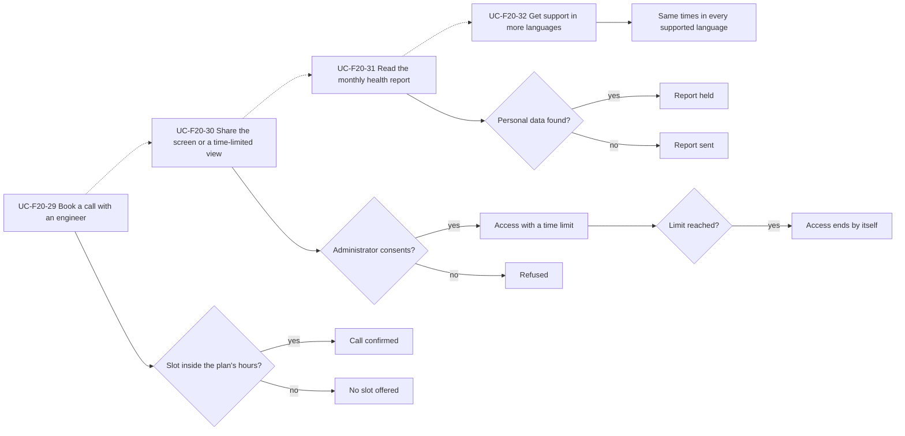
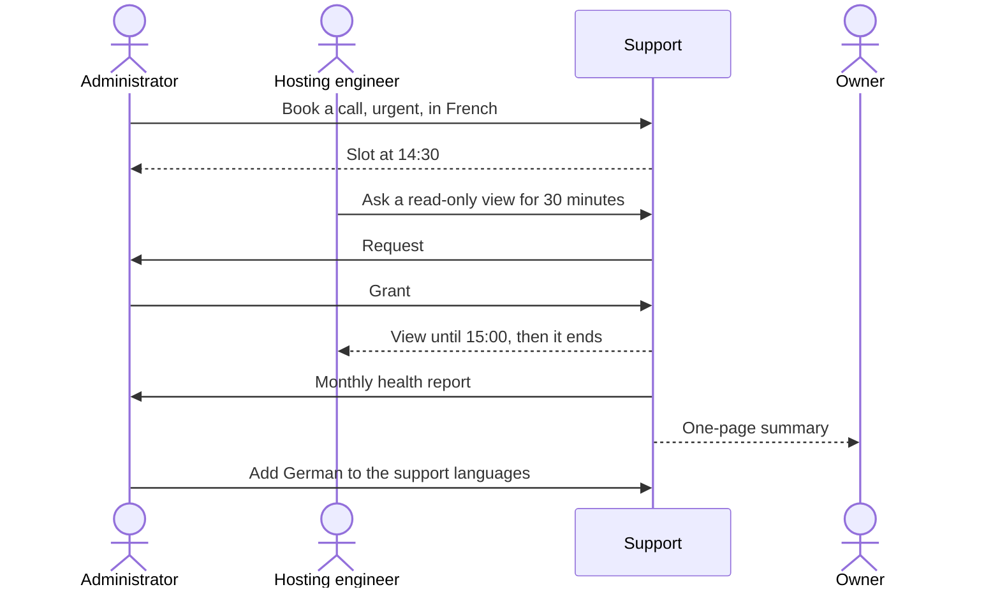

🏠 [Specs](../../../README.md) › 🧩 [Functional capabilities](../../README.md) ›
🛟 [F20 Hosted support assistant (hosted edition)](../README.md) › 🔀 [Flows](README.md) ›
🔀 FL-F20-08 Engineers, screen sharing, reports and languages

# 🔀 FL-F20-08 Engineers, screen sharing, reports and languages

**Status:** 🔄 waiting for the owner

## Summary

An administrator books a call with a hosting engineer inside the plan's hours, lets the engineer see the problem for a
limited time with the customer's consent, reads a monthly health report that holds no personal data, and chooses support
languages that all keep the plan's times
([D539](../../../06-decisions/f20-hosted-support-assistant/d539-benchmark-gaps-f20-hosted-support-assistant.md)).

## Personas

- [U07 Administrator](../../../01-users/personas/u07-administrator.md), who books calls, grants access, reads the report
  and chooses languages
- [U48 Hosting engineer](../../../01-users/personas/u48-hosting-engineer.md), who holds the calls and asks for access
- [U13 Owner](../../../01-users/personas/u13-owner.md), who reads the report's summary on a phone

## Flowchart

## Sequence diagram

## Steps

| Step | Persona | Screen | Use case | What happens |
|---|---|---|---|---|
| 1 | [U07](../../../01-users/personas/u07-administrator.md) | [S-F20-29](../screens/08-engineers-sharing-and-reports/s-f20-29-engineer-booking.md) | [UC-F20-29](../use-cases/08-engineers-sharing-and-reports/uc-f20-29-book-a-call-with-an-engineer.md) | The administrator books a call inside the plan's hours with the history attached |
| 2 | [U07](../../../01-users/personas/u07-administrator.md) | [S-F20-30](../screens/08-engineers-sharing-and-reports/s-f20-30-consented-access.md) | [UC-F20-30](../use-cases/08-engineers-sharing-and-reports/uc-f20-30-share-the-screen-or-a-time-limited-view.md) | The engineer asks to see the problem and the administrator grants a limited access |
| 3 | [U07](../../../01-users/personas/u07-administrator.md) | [S-F20-31](../screens/08-engineers-sharing-and-reports/s-f20-31-health-report.md) | [UC-F20-31](../use-cases/08-engineers-sharing-and-reports/uc-f20-31-read-the-monthly-health-report.md) | The administrator and the owner read the monthly health report, which holds no personal data |
| 4 | [U07](../../../01-users/personas/u07-administrator.md) | [S-F20-32](../screens/08-engineers-sharing-and-reports/s-f20-32-support-languages.md) | [UC-F20-32](../use-cases/08-engineers-sharing-and-reports/uc-f20-32-get-support-in-more-languages.md) | The administrator chooses the support languages and sees the same times for each |

### Entities and screens

| Entity | States in this flow | Shown at step and screen | Aggregated view |
|---|---|---|---|
| [E-F20-19 Engineer call](../data/e-f20-19-engineer-call.md) | Requested, Confirmed, Cancelled, Held, Missed | 1 [S-F20-29](../screens/08-engineers-sharing-and-reports/s-f20-29-engineer-booking.md) | Engineer calls |
| [E-F20-20 Access grant](../data/e-f20-20-access-grant.md) | Requested, Granted, Refused, Active, Ended | 2 [S-F20-30](../screens/08-engineers-sharing-and-reports/s-f20-30-consented-access.md) | Access grants |
| [E-F20-21 Health report](../data/e-f20-21-health-report.md) | Generated, Sent, Held, Read | 3 [S-F20-31](../screens/08-engineers-sharing-and-reports/s-f20-31-health-report.md) | Health reports |

## Errors

- **E1 The access has expired.** The engineer tries to continue after the limit: the view shows that the access ended
  and shows nothing more ([BR-F20-21](../business-rules/br-f20-21-access-ends-at-its-time-limit-and-is-audited.md), step
  2).

## Images

Every step and error, for each persona taking part, in light and dark mode (D120). Steps are numbered as in the Steps
table; E rows are the error cases.

| Step | Persona | Device | Light | Dark |
|---|---|---|---|---|
| 1 | U07 | desktop | [light](../images/08-engineers-sharing-and-reports/u07-administrator/1-engineer-booking-desktop-light.png) | [dark](../images/08-engineers-sharing-and-reports/u07-administrator/1-engineer-booking-desktop-dark.png) |
| 1 | U48 | desktop | [light](../images/08-engineers-sharing-and-reports/u48-hosting-engineer/1-engineer-booking-desktop-light.png) | [dark](../images/08-engineers-sharing-and-reports/u48-hosting-engineer/1-engineer-booking-desktop-dark.png) |
| 2 | U07 | desktop | [light](../images/08-engineers-sharing-and-reports/u07-administrator/2-consented-access-desktop-light.png) | [dark](../images/08-engineers-sharing-and-reports/u07-administrator/2-consented-access-desktop-dark.png) |
| 2 | U48 | desktop | [light](../images/08-engineers-sharing-and-reports/u48-hosting-engineer/2-consented-access-desktop-light.png) | [dark](../images/08-engineers-sharing-and-reports/u48-hosting-engineer/2-consented-access-desktop-dark.png) |
| 3 | U07 | desktop | [light](../images/08-engineers-sharing-and-reports/u07-administrator/3-health-report-desktop-light.png) | [dark](../images/08-engineers-sharing-and-reports/u07-administrator/3-health-report-desktop-dark.png) |
| 3 | U13 | phone | [light](../images/08-engineers-sharing-and-reports/u13-owner/3-health-report-phone-light.png) | [dark](../images/08-engineers-sharing-and-reports/u13-owner/3-health-report-phone-dark.png) |
| 4 | U07 | desktop | [light](../images/08-engineers-sharing-and-reports/u07-administrator/4-support-languages-desktop-light.png) | [dark](../images/08-engineers-sharing-and-reports/u07-administrator/4-support-languages-desktop-dark.png) |
| E1 | U07 | desktop | [light](../images/08-engineers-sharing-and-reports/u07-administrator/e1-the-access-has-expired-desktop-light.png) | [dark](../images/08-engineers-sharing-and-reports/u07-administrator/e1-the-access-has-expired-desktop-dark.png) |

## Open questions

None.

---

⬅️ [FL-F20-07 Employees' help](fl-f20-07-employees-help.md) · ⬆️ [Up](README.md)
