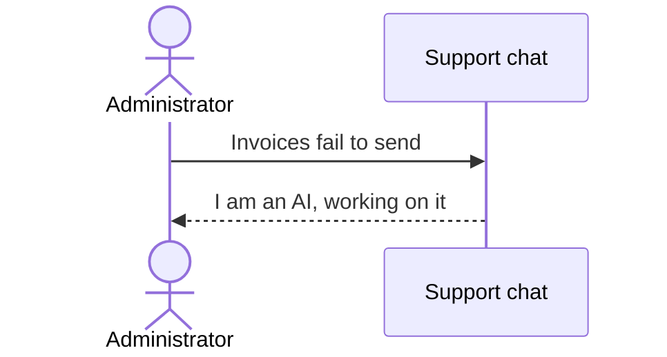

🏠 [Specs](../../../../README.md) › 🧩 [Functional capabilities](../../../README.md) ›
🛟 [F20 Hosted support assistant (hosted edition)](../../README.md) › 📝 [Use cases](../README.md) ›
📝 [Use cases: FL-F20-01 Talk it through](README.md) › 📝 UC-F20-01 Report a problem in plain words

# 📝 UC-F20-01 Report a problem in plain words

**Status:** ✅ specified

## Summary

The administrator or an employee describes a problem in plain words; the AI assistant acknowledges, says it is an AI,
and shows a simple status.

## Personas

- [U07 Administrator](../../../../01-users/personas/u07-administrator.md)
- [U01 Employee](../../../../01-users/personas/u01-employee.md)

## Goal

The problem taken in hand at once.

## Trigger

Something wrong in simple-ERP.

## Frequency

A few a month per company.

## Preconditions

- Signed in.

## Postconditions

- Success: a request with a status.
- Failure: none.

## Main flow

1. The administrator opens the Support chat (S-F20-01) and describes the problem.
2. The AI assistant acknowledges, says it is an AI and offers a human (BR-F20-09).
3. A request is created with the status "working on it".
4. The AI assistant asks what it needs (UC-F20-02) or starts the diagnosis (UC-F20-04).

## Alternative flows

- 1a. From the screen where it happened (UC-F20-28).

## Error flows

- 3e. An open incident covers it: linked to the status page.
- Any step: a service does not answer; the call is retried first (BR-F3-32), then the message follows the error pattern
  (D122) and what was typed stays on the screen.

## Business rules

- [BR-F20-02 Plain words first](../../business-rules/br-f20-02-plain-words-first.md)
- [BR-F20-09 The customer knows it is an AI](../../business-rules/br-f20-09-ai-disclosed.md)
- [BR-F20-18 Support in French or English](../../business-rules/br-f20-18-support-in-french-or-english.md)

## Entities

- [E-F20-01 Support request](../../data/e-f20-01-support-request.md)

## Permissions

Administrators; employees their own.

## Notifications

- The requester on status changes.

## Audit events

Requests.

## AI involvement

Disclosed AI.

## API, MCP and A2A exposure

Through T5 and T6 with the caller's rights (BR-F3-34).

## Screens

- [S-F20-01 Support chat](../../screens/01-talk-it-through/s-f20-01-support-chat.md)

## Flowchart

See [FL-F20-01 Talk it through](../../flows/fl-f20-01-talk-it-through.md#flowchart).

## Sequence diagram

## Acceptance criteria

1. **Given** "invoices fail to send" **when** sent **then** a request "working on it" is created.
2. **Given** an open incident **when** matched **then** linked.
3. **Given** a human asked **when** asked **then** escalated.

## Non-functional notes

D408's targets ([Performance](../../../../05-non-functional/performance.md)): 95 % of screens within 1 second; lists
paged on the server, the first page within 1 second; reports within 5 seconds or in the background.

## Regulatory references

Support rules of the France country pack:
[CR-FR-199 Notifying a personal data breach](../../../../10-country-packs/france/data-protection/cr-fr-199-personal-data-breach-notification.md),
[CR-FR-169 NIS2 incident notification](../../../../10-country-packs/france/digital/cr-fr-169-nis2-incident-notification.md),
[CR-FR-049 Processors and transfers outside the EU](../../../../10-country-packs/france/data-protection/cr-fr-049-processors-and-transfers.md),
[CR-FR-056 People know they deal with an AI](../../../../10-country-packs/france/ai-and-recording/cr-fr-056-people-know-they-deal-with-an-ai.md),
[CR-FR-057 A person confirms what the AI does](../../../../10-country-packs/france/ai-and-recording/cr-fr-057-human-oversight.md),
[CR-FR-052 Personal data kept no longer than needed](../../../../10-country-packs/france/data-protection/cr-fr-052-storage-limitation.md),
[CR-FR-168 Cyber Resilience Act reporting](../../../../10-country-packs/france/digital/cr-fr-168-cyber-resilience-reporting.md).

## Related use cases

- [UC-F20-02 Answer clarifying questions](uc-f20-02-answer-clarifying-questions.md)
- [UC-F20-28 Report something broken from the screen](../07-employees-help/uc-f20-28-report-something-broken-from-the-screen.md)

## Open questions

None.

---

⬆️ [Up](README.md) · ➡️ [UC-F20-02 Answer clarifying questions](uc-f20-02-answer-clarifying-questions.md)
