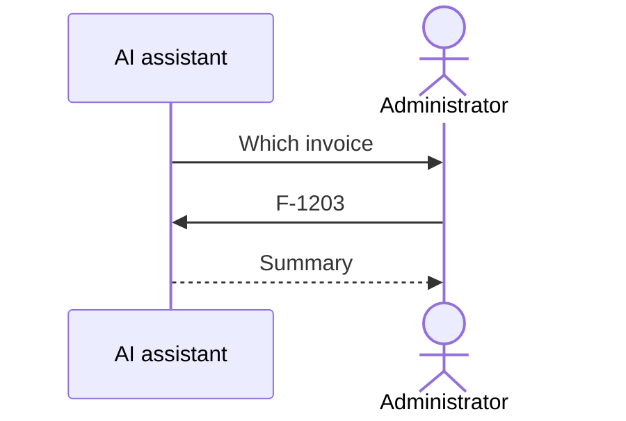

🏠 [Specs](../../../../README.md) › 🧩 [Functional capabilities](../../../README.md) ›
🛟 [F20 Hosted support assistant (hosted edition)](../../README.md) › 📝 [Use cases](../README.md) ›
📝 [Use cases: FL-F20-01 Talk it through](README.md) › 📝 UC-F20-02 Answer clarifying questions

# 📝 UC-F20-02 Answer clarifying questions

**Status:** 🔄 waiting for the owner

## Summary

The AI assistant asks one clarifying question at a time and summarises what it understood.

## Personas

- [U07 Administrator](../../../../01-users/personas/u07-administrator.md)

## Goal

Enough facts to diagnose.

## Trigger

Unclear request.

## Frequency

Most requests.

## Preconditions

- A request.

## Postconditions

- Success: summary agreed.
- Failure: escalated.

## Main flow

1. The AI assistant asks a question (S-F20-02).
2. The administrator answers.
3. More questions, one at a time (BR-F20-02).
4. The AI assistant summarises; the administrator confirms.

## Alternative flows

- 1a. A screenshot needed (UC-F20-03).

## Error flows

- 2e. No answer for (Proposed) 3 days: request waits, reminder.
- Any step: a service does not answer; the call is retried first (BR-F3-32), then the message follows the error pattern
  (D122) and what was typed stays on the screen.

## Business rules

- [BR-F20-02 Plain words first](../../business-rules/br-f20-02-plain-words-first.md)

## Entities

- [E-F20-01 Support request](../../data/e-f20-01-support-request.md)
- [E-F20-02 Message](../../data/e-f20-02-message.md)

## Permissions

The requester.

## Notifications

- Reminders.

## Audit events

Messages.

## AI involvement

The AI assistant asks.

## API, MCP and A2A exposure

Through T5 and T6 with the caller's rights (BR-F3-34).

## Screens

- [S-F20-02 Clarify](../../screens/01-talk-it-through/s-f20-02-clarify.md)

## Flowchart

See [FL-F20-01 Talk it through](../../flows/fl-f20-01-talk-it-through.md#flowchart).

## Sequence diagram

## Acceptance criteria

1. **Given** an unclear request **when** asked **then** one question at a time.
2. **Given** answers **when** complete **then** a summary.
3. **Given** no answer for 3 days **when** passed **then** reminder.

## Non-functional notes

D408's targets ([Performance](../../../../05-non-functional/performance.md)): 95 % of screens within 1 second; lists
paged on the server, the first page within 1 second; reports within 5 seconds or in the background.

## Regulatory references

Support rules of the France country pack:
[CR-FR-199 Notifying a personal data breach](../../../../10-country-packs/france/data-protection/cr-fr-199-personal-data-breach-notification.md),
[CR-FR-169 NIS2 incident notification](../../../../10-country-packs/france/digital/cr-fr-169-nis2-incident-notification.md),
[CR-FR-049 Processors and transfers outside the EU](../../../../10-country-packs/france/data-protection/cr-fr-049-processors-and-transfers.md),
[CR-FR-056 People know they deal with an AI](../../../../10-country-packs/france/ai-and-recording/cr-fr-056-people-know-they-deal-with-an-ai.md),
[CR-FR-057 A person confirms what the AI does](../../../../10-country-packs/france/ai-and-recording/cr-fr-057-human-oversight.md),
[CR-FR-052 Personal data kept no longer than needed](../../../../10-country-packs/france/data-protection/cr-fr-052-storage-limitation.md),
[CR-FR-168 Cyber Resilience Act reporting](../../../../10-country-packs/france/digital/cr-fr-168-cyber-resilience-reporting.md).

## Related use cases

- [UC-F20-03 Share screenshots when needed](uc-f20-03-share-screenshots-when-needed.md)

## Open questions

None.

---

⬅️ [UC-F20-01 Report a problem in plain words](uc-f20-01-report-a-problem-in-plain-words.md) · ⬆️ [Up](README.md) ·
➡️ [UC-F20-03 Share screenshots when needed](uc-f20-03-share-screenshots-when-needed.md)
